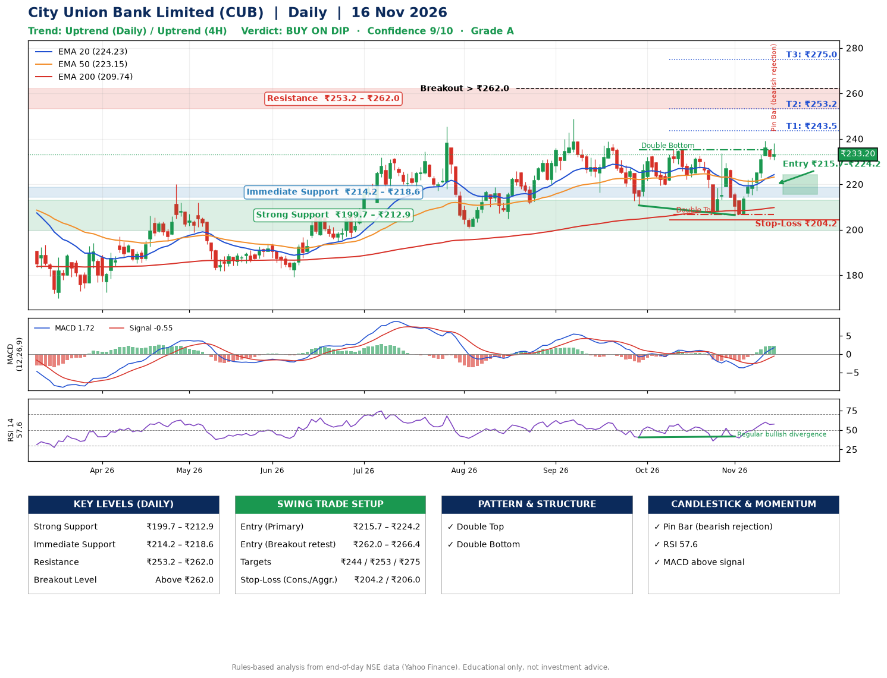

📌 **City Union Bank Limited (CUB) – Multi-Timeframe Technical Analysis (Daily + 4H Combined)**
_Data up to 16 Nov 2026 · Close ₹233.20_

**📍 Daily Timeframe Trend**
- Trend: **Uptrend** (price above rising EMAs)
- Recent swing highs: ₹238.9, ₹235.2, ₹233.7 · swing lows: ₹216.4, ₹210.7, ₹206.4
- EMAs: EMA20 ₹224.2, EMA50 ₹223.2, EMA200 ₹209.7; bullish stack (EMA20 > EMA50 > EMA200); price above EMA20, EMA50, EMA200
- MACD 1.72 above signal -0.55 (above zero), fresh bullish crossover; histogram rising
- RSI(14) 57.6; Regular bullish divergence

**📍 4-Hour Timeframe Trend**
- Structure: **Uptrend** (price above rising EMAs)
- Pullback/support area: recent 4H swing lows ₹206.8, ₹206.5; EMA20 ₹227.6
- EMA20/50: bullish stack (EMA20 > EMA50); price above EMA20, EMA50
- MACD 3.93 above signal 3.06 (above zero); histogram falling
- RSI(14) 60.2; Regular bullish divergence

**📍 Pattern Detection (Both Timeframes)**
- Daily: **Double Top** – tops near ₹235.2/₹233.7, neckline ₹206.8, forming
- Daily: **Double Bottom** – bottoms near ₹210.7/₹206.4, neckline ₹235.2, forming
- 4H: **Double Top** – tops near ₹232.5/₹239.0, neckline ₹206.5, forming

**📍 Candlestick Patterns (last 3 daily candles)**
- **Pin Bar (bearish rejection)** – 16 Nov: long upper wick shows selling near ₹237.9

**📍 Price Action Key Levels (Daily Structure)**

| Zone | Price Level (₹) | Context |
|------|-----------------|---------|
| Strong Support | ₹199.7 – ₹212.9 | Cluster of earlier swing lows (demand) |
| Immediate Support | ₹214.2 – ₹218.6 | Nearest swing-low / wick area |
| Resistance | ₹253.2 – ₹262.0 | Nearest swing-high supply |
| Breakout Level | Above ₹262.0 | Swing continuation trigger (52-week high ₹248.9) |

**📍 Swing Trade Setup**

🟢 **Entry Zone**
- Primary: ₹215.7 – ₹224.2 (daily support / EMA20 area; enter on a bullish 4H candle)
- Alternate: ₹262.0 – ₹266.4 (breakout retest)

🎯 **Profit Targets**
- T1: ₹243.5
- T2: ₹253.2
- T3: ₹275.0

🛑 **Stop-Loss**
- Conservative: below daily swing low (₹204.2)
- Aggressive: below 4H structure (₹206.0)
- Risk per share ≈ ₹15.7; reward:risk to T1 ≈ 1.5
- Time to T1: about 18 trading days (it rose this much within 60 trading days 75% of the time in the last 2 years)
- Time to T2: about 26 trading days (it rose this much within 60 trading days 64% of the time in the last 2 years)

**📌 Strategy Notes**
- Higher timeframe: daily trend is uptrend; only take longs while price holds above ₹199.7.
- Entry timing: wait for a bullish 4H candle (engulfing/hammer) inside ₹215.7 – ₹224.2 rather than buying mid-range.
- EMA stacking: bullish stack (EMA20 > EMA50 > EMA200); price above EMA20, EMA50, EMA200.
- Breakout rule: a daily close above ₹262.0 with volume above its 20-day average (≈3,518,015) opens T2/T3.
- Momentum: RSI 58 – room to run; Regular bullish divergence.
- Exit discipline: move the stop to entry once T1 is hit; book partial profits at each target.

**STEP 2 — Marked Up Chart**

**✅ Trade Validation Checklist**
- Trend + momentum aligned: Yes · Price at entry zone: No
- Stop defined (₹204.2) · Reward:risk ≥ 1.5 to T1: No

## 📌 Final Verdict

Recommendation: **🟡 BUY ON DIP**

Confidence: **9/10**

Trade Quality: **A**

Reason:
• Daily uptrend (price above rising EMAs)
• EMAs stacked bullishly

Next Action:
• Wait for a pullback to ₹215.7–₹224.2

_Rules-based analysis from end-of-day data. Educational only, not investment advice. Never place orders without your own confirmation._