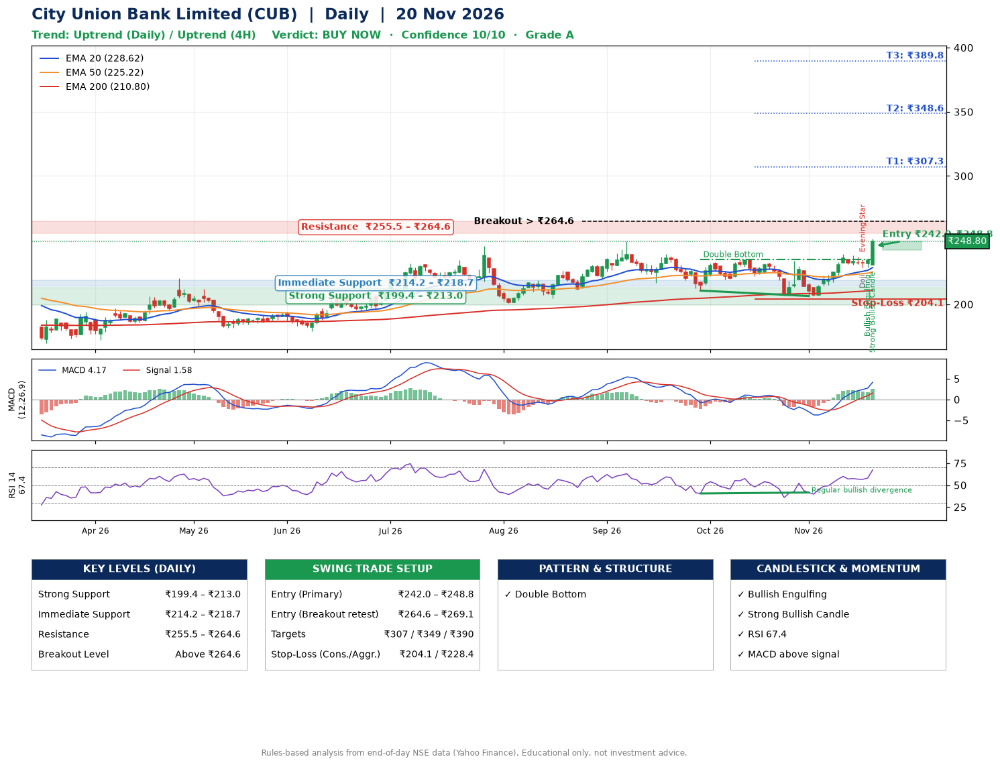

📌 **City Union Bank Limited (CUB) – Multi-Timeframe Technical Analysis (Daily + 4H Combined)**
_Data up to 20 Nov 2026 · Close ₹248.80_

**📍 Daily Timeframe Trend**
- Trend: **Uptrend** (price above rising EMAs)
- Recent swing highs: ₹235.2, ₹233.7, ₹239.0 · swing lows: ₹216.4, ₹210.7, ₹206.4
- EMAs: EMA20 ₹228.6, EMA50 ₹225.2, EMA200 ₹210.8; bullish stack (EMA20 > EMA50 > EMA200); price above EMA20, EMA50, EMA200
- MACD 4.17 above signal 1.58 (above zero); histogram rising
- RSI(14) 67.4; Regular bullish divergence

**📍 4-Hour Timeframe Trend**
- Structure: **Uptrend** (higher highs and higher lows)
- Pullback/support area: recent 4H swing lows ₹206.5, ₹229.0; EMA20 ₹232.7
- EMA20/50: bullish stack (EMA20 > EMA50); price above EMA20, EMA50
- MACD 5.32 above signal 3.91 (above zero); histogram rising
- RSI(14) 76.1; no divergence

**📍 Pattern Detection (Both Timeframes)**
- Daily: **Double Bottom** – bottoms near ₹210.7/₹206.4, neckline ₹235.2, confirmed (closed above neckline)

**📍 Candlestick Patterns (last 3 daily candles)**
- **Doji** – 18 Nov: indecision; wait for the next candle to confirm direction
- **Evening Star** – 18 Nov: three-candle bearish reversal
- **Bullish Engulfing** – 19 Nov: buyers fully reversed the prior red candle
- **Strong Bullish Candle** – 20 Nov: wide-range green candle, buyers in control

**📍 Price Action Key Levels (Daily Structure)**

| Zone | Price Level (₹) | Context |
|------|-----------------|---------|
| Strong Support | ₹199.4 – ₹213.0 | Cluster of earlier swing lows (demand) |
| Immediate Support | ₹214.2 – ₹218.7 | Nearest swing-low / wick area |
| Resistance | ₹255.5 – ₹264.6 | Nearest swing-high supply |
| Breakout Level | Above ₹264.6 | Swing continuation trigger (52-week high ₹251.0) |

**📍 Swing Trade Setup**

🟢 **Entry Zone**
- Primary: ₹242.0 – ₹248.8 (daily support / EMA20 area; enter on a bullish 4H candle)
- Alternate: ₹264.6 – ₹269.1 (breakout retest)

🎯 **Profit Targets**
- T1: ₹307.3
- T2: ₹348.6
- T3: ₹389.8

🛑 **Stop-Loss**
- Conservative: below daily swing low (₹204.1)
- Aggressive: below 4H structure (₹228.4)
- Risk per share ≈ ₹41.3; reward:risk to T1 ≈ 1.5
- Time to T1: about 40 trading days (it rose this much within 60 trading days 33% of the time in the last 2 years)
- Time to T2: about 55 trading days (it rose this much within 60 trading days 3% of the time in the last 2 years)

**📌 Strategy Notes**
- Higher timeframe: daily trend is uptrend; only take longs while price holds above ₹199.4.
- Entry timing: wait for a bullish 4H candle (engulfing/hammer) inside ₹242.0 – ₹248.8 rather than buying mid-range.
- EMA stacking: bullish stack (EMA20 > EMA50 > EMA200); price above EMA20, EMA50, EMA200.
- Breakout rule: a daily close above ₹264.6 with volume above its 20-day average (≈4,658,363) opens T2/T3.
- Momentum: RSI 67 – elevated, prefer dips; Regular bullish divergence.
- Exit discipline: move the stop to entry once T1 is hit; book partial profits at each target.

**STEP 2 — Marked Up Chart**

**✅ Trade Validation Checklist**
- Trend + momentum aligned: Yes · Price at entry zone: Yes
- Stop defined (₹204.1) · Reward:risk ≥ 1.5 to T1: Yes

## 📌 Final Verdict

Recommendation: **🟢 BUY NOW**

Confidence: **10/10**

Trade Quality: **A**

Reason:
• Daily uptrend (price above rising EMAs)
• EMAs stacked bullishly

Next Action:
• Buy now within the entry zone, with the stop-loss in place

_Rules-based analysis from end-of-day data. Educational only, not investment advice. Never place orders without your own confirmation._