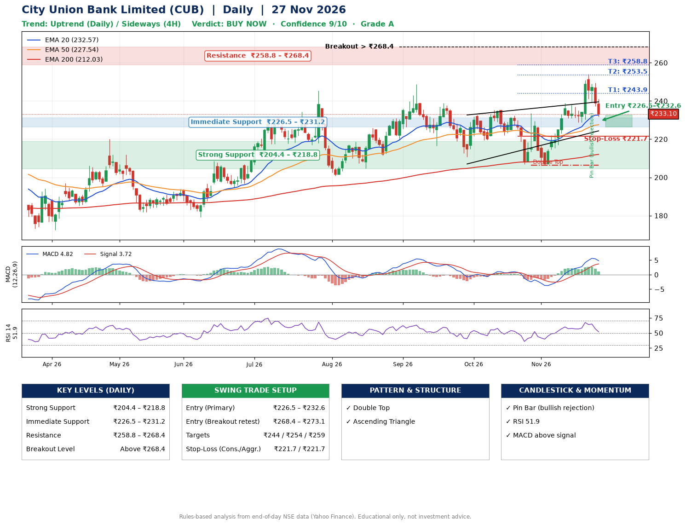

📌 **City Union Bank Limited (CUB) – Multi-Timeframe Technical Analysis (Daily + 4H Combined)**
_Data up to 27 Nov 2026 · Close ₹233.10_

**📍 Daily Timeframe Trend**
- Trend: **Uptrend** (higher highs and higher lows)
- Recent swing highs: ₹235.2, ₹233.7, ₹239.0 · swing lows: ₹210.7, ₹206.4, ₹228.9
- EMAs: EMA20 ₹232.6, EMA50 ₹227.5, EMA200 ₹212.0; bullish stack (EMA20 > EMA50 > EMA200); price above EMA20, EMA50, EMA200
- MACD 4.82 above signal 3.72 (above zero); histogram falling
- RSI(14) 51.9; no divergence on the last two swings

**📍 4-Hour Timeframe Trend**
- Structure: **Sideways** (mixed swing structure)
- Pullback/support area: recent 4H swing lows ₹206.5, ₹229.0; EMA20 ₹236.9
- EMA20/50: bullish stack (EMA20 > EMA50); price above EMA50
- MACD 3.31 below signal 4.67 (above zero), fresh bearish crossover; histogram falling
- RSI(14) 47.2; no divergence

**📍 Pattern Detection (Both Timeframes)**
- Daily: **Double Top** – tops near ₹233.7/₹239.0, neckline ₹206.4, forming
- Daily: **Ascending Triangle** – converging swing highs and lows over the last ~60 sessions

**📍 Candlestick Patterns (last 3 daily candles)**
- **Pin Bar (bullish rejection)** – 25 Nov: long lower wick shows dip-buying near ₹239.4

**📍 Price Action Key Levels (Daily Structure)**

| Zone | Price Level (₹) | Context |
|------|-----------------|---------|
| Strong Support | ₹204.4 – ₹218.8 | Cluster of earlier swing lows (demand) |
| Immediate Support | ₹226.5 – ₹231.2 | Nearest swing-low / wick area |
| Resistance | ₹258.8 – ₹268.4 | Nearest swing-high supply |
| Breakout Level | Above ₹268.4 | Swing continuation trigger (52-week high ₹254.0) |

**📍 Swing Trade Setup**

🟢 **Entry Zone**
- Primary: ₹226.5 – ₹232.6 (daily support / EMA20 area; enter on a bullish 4H candle)
- Alternate: ₹268.4 – ₹273.1 (breakout retest)

🎯 **Profit Targets**
- T1: ₹243.9
- T2: ₹253.5
- T3: ₹258.8

🛑 **Stop-Loss**
- Conservative: below daily swing low (₹221.7)
- Aggressive: below 4H structure (₹221.7)
- Risk per share ≈ ₹9.6; reward:risk to T1 ≈ 1.5
- Time to T1: about 10 trading days (it rose this much within 60 trading days 85% of the time in the last 2 years)
- Time to T2: about 17 trading days (it rose this much within 60 trading days 77% of the time in the last 2 years)

**📌 Strategy Notes**
- Higher timeframe: daily trend is uptrend; only take longs while price holds above ₹204.4.
- Entry timing: wait for a bullish 4H candle (engulfing/hammer) inside ₹226.5 – ₹232.6 rather than buying mid-range.
- EMA stacking: bullish stack (EMA20 > EMA50 > EMA200); price above EMA20, EMA50, EMA200.
- Breakout rule: a daily close above ₹268.4 with volume above its 20-day average (≈4,664,251) opens T2/T3.
- Momentum: RSI 52 – room to run; no divergence on the last two swings.
- Exit discipline: move the stop to entry once T1 is hit; book partial profits at each target.

**STEP 2 — Marked Up Chart**

**✅ Trade Validation Checklist**
- Trend + momentum aligned: Yes · Price at entry zone: No
- Stop defined (₹221.7) · Reward:risk ≥ 1.5 to T1: Yes

## 📌 Final Verdict

Recommendation: **🟢 BUY NOW**

Confidence: **9/10**

Trade Quality: **A**

Reason:
• Daily uptrend (higher highs and higher lows)
• EMAs stacked bullishly

Next Action:
• Buy now within the entry zone, with the stop-loss in place

_Rules-based analysis from end-of-day data. Educational only, not investment advice. Never place orders without your own confirmation._