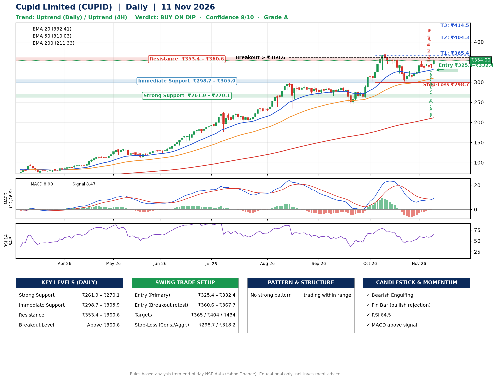

📌 **Cupid Limited (CUPID) – Multi-Timeframe Technical Analysis (Daily + 4H Combined)**
_Data up to 11 Nov 2026 · Close ₹354.00_

**📍 Daily Timeframe Trend**
- Trend: **Uptrend** (higher highs and higher lows)
- Recent swing highs: ₹299.0, ₹287.0, ₹369.0 · swing lows: ₹265.5, ₹246.0, ₹302.3
- EMAs: EMA20 ₹332.4, EMA50 ₹310.0, EMA200 ₹211.3; bullish stack (EMA20 > EMA50 > EMA200); price above EMA20, EMA50, EMA200
- MACD 8.90 above signal 8.47 (above zero), fresh bullish crossover; histogram rising
- RSI(14) 64.5; no divergence on the last two swings

**📍 4-Hour Timeframe Trend**
- Structure: **Uptrend** (price above rising EMAs)
- Pullback/support area: recent 4H swing lows ₹302.5, ₹330.3; EMA20 ₹346.7
- EMA20/50: bullish stack (EMA20 > EMA50); price above EMA20, EMA50
- MACD 10.78 above signal 5.90 (above zero); histogram rising
- RSI(14) 80.0; no divergence

**📍 Pattern Detection (Both Timeframes)**
- 4H: **Inverse Head & Shoulders** – head ₹302.5, neckline ₹364.0

**📍 Candlestick Patterns (last 3 daily candles)**
- **Bearish Engulfing** – 06 Nov: sellers fully reversed the prior green candle
- **Pin Bar (bullish rejection)** – 09 Nov: long lower wick shows dip-buying near ₹335.6

**📍 Price Action Key Levels (Daily Structure)**

| Zone | Price Level (₹) | Context |
|------|-----------------|---------|
| Strong Support | ₹261.9 – ₹270.1 | Cluster of earlier swing lows (demand) |
| Immediate Support | ₹298.7 – ₹305.9 | Nearest swing-low / wick area |
| Resistance | ₹353.4 – ₹360.6 | Nearest swing-high supply |
| Breakout Level | Above ₹360.6 | Swing continuation trigger (52-week high ₹369.0) |

**📍 Swing Trade Setup**

🟢 **Entry Zone**
- Primary: ₹325.4 – ₹332.4 (daily support / EMA20 area; enter on a bullish 4H candle)
- Alternate: ₹360.6 – ₹367.7 (breakout retest)

🎯 **Profit Targets**
- T1: ₹365.4
- T2: ₹404.3
- T3: ₹434.5

🛑 **Stop-Loss**
- Conservative: below daily swing low (₹298.7)
- Aggressive: below 4H structure (₹318.2)
- Risk per share ≈ ₹30.2; reward:risk to T1 ≈ 1.2
- Time to T1: about 8 trading days (it rose this much within 60 trading days 91% of the time in the last 2 years)
- Time to T2: about 18 trading days (it rose this much within 60 trading days 81% of the time in the last 2 years)

**📌 Strategy Notes**
- Higher timeframe: daily trend is uptrend; only take longs while price holds above ₹261.9.
- Entry timing: wait for a bullish 4H candle (engulfing/hammer) inside ₹325.4 – ₹332.4 rather than buying mid-range.
- EMA stacking: bullish stack (EMA20 > EMA50 > EMA200); price above EMA20, EMA50, EMA200.
- Breakout rule: a daily close above ₹360.6 with volume above its 20-day average (≈12,809,467) opens T2/T3.
- Momentum: RSI 64 – room to run; no divergence on the last two swings.
- Exit discipline: move the stop to entry once T1 is hit; book partial profits at each target.

**STEP 2 — Marked Up Chart**

**✅ Trade Validation Checklist**
- Trend + momentum aligned: Yes · Price at entry zone: No
- Stop defined (₹298.7) · Reward:risk ≥ 1.5 to T1: No

## 📌 Final Verdict

Recommendation: **🟡 BUY ON DIP**

Confidence: **9/10**

Trade Quality: **A**

Reason:
• Daily uptrend (higher highs and higher lows)
• EMAs stacked bullishly

Next Action:
• Wait for a pullback to ₹325.4–₹332.4

_Rules-based analysis from end-of-day data. Educational only, not investment advice. Never place orders without your own confirmation._