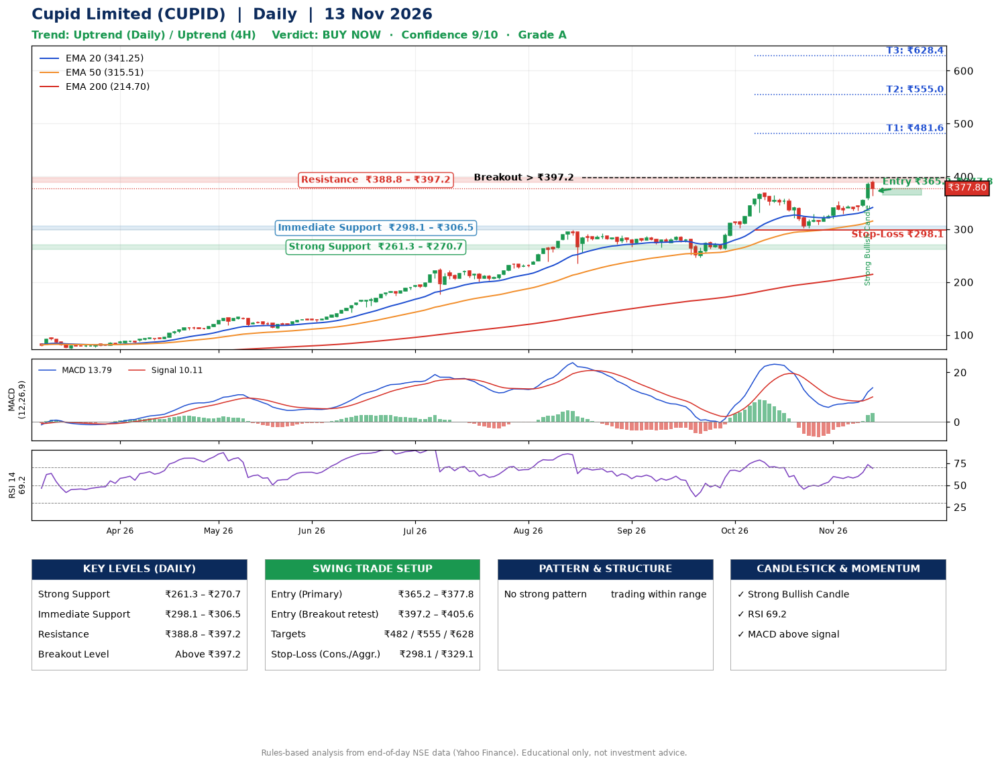

📌 **Cupid Limited (CUPID) – Multi-Timeframe Technical Analysis (Daily + 4H Combined)**
_Data up to 13 Nov 2026 · Close ₹377.80_

**📍 Daily Timeframe Trend**
- Trend: **Uptrend** (higher highs and higher lows)
- Recent swing highs: ₹299.0, ₹287.0, ₹369.0 · swing lows: ₹265.5, ₹246.0, ₹302.3
- EMAs: EMA20 ₹341.2, EMA50 ₹315.5, EMA200 ₹214.7; bullish stack (EMA20 > EMA50 > EMA200); price above EMA20, EMA50, EMA200
- MACD 13.79 above signal 10.11 (above zero), fresh bullish crossover; histogram rising
- RSI(14) 69.2; no divergence on the last two swings

**📍 4-Hour Timeframe Trend**
- Structure: **Uptrend** (higher highs and higher lows)
- Pullback/support area: recent 4H swing lows ₹302.5, ₹330.3; EMA20 ₹353.0
- EMA20/50: bullish stack (EMA20 > EMA50); price above EMA20, EMA50
- MACD 10.43 above signal 8.91 (above zero); histogram falling
- RSI(14) 57.2; no divergence

**📍 Pattern Detection (Both Timeframes)**
- 4H: **Inverse Head & Shoulders** – head ₹302.5, neckline ₹364.0

**📍 Candlestick Patterns (last 3 daily candles)**
- **Strong Bullish Candle** – 12 Nov: wide-range green candle, buyers in control

**📍 Price Action Key Levels (Daily Structure)**

| Zone | Price Level (₹) | Context |
|------|-----------------|---------|
| Strong Support | ₹261.3 – ₹270.7 | Cluster of earlier swing lows (demand) |
| Immediate Support | ₹298.1 – ₹306.5 | Nearest swing-low / wick area |
| Resistance | ₹388.8 – ₹397.2 | Nearest swing-high supply |
| Breakout Level | Above ₹397.2 | Swing continuation trigger (52-week high ₹393.0) |

**📍 Swing Trade Setup**

🟢 **Entry Zone**
- Primary: ₹365.2 – ₹377.8 (daily support / EMA20 area; enter on a bullish 4H candle)
- Alternate: ₹397.2 – ₹405.6 (breakout retest)

🎯 **Profit Targets**
- T1: ₹481.6
- T2: ₹555.0
- T3: ₹628.4

🛑 **Stop-Loss**
- Conservative: below daily swing low (₹298.1)
- Aggressive: below 4H structure (₹329.1)
- Risk per share ≈ ₹73.4; reward:risk to T1 ≈ 1.5
- Time to T1: about 23 trading days (it rose this much within 60 trading days 80% of the time in the last 2 years)
- Time to T2: about 36 trading days (it rose this much within 60 trading days 73% of the time in the last 2 years)

**📌 Strategy Notes**
- Higher timeframe: daily trend is uptrend; only take longs while price holds above ₹261.3.
- Entry timing: wait for a bullish 4H candle (engulfing/hammer) inside ₹365.2 – ₹377.8 rather than buying mid-range.
- EMA stacking: bullish stack (EMA20 > EMA50 > EMA200); price above EMA20, EMA50, EMA200.
- Breakout rule: a daily close above ₹397.2 with volume above its 20-day average (≈15,298,626) opens T2/T3.
- Momentum: RSI 69 – elevated, prefer dips; no divergence on the last two swings.
- Exit discipline: move the stop to entry once T1 is hit; book partial profits at each target.

**STEP 2 — Marked Up Chart**

**✅ Trade Validation Checklist**
- Trend + momentum aligned: Yes · Price at entry zone: Yes
- Stop defined (₹298.1) · Reward:risk ≥ 1.5 to T1: No

## 📌 Final Verdict

Recommendation: **🟢 BUY NOW**

Confidence: **9/10**

Trade Quality: **A**

Reason:
• Daily uptrend (higher highs and higher lows)
• EMAs stacked bullishly

Next Action:
• Buy now within the entry zone, with the stop-loss in place

_Rules-based analysis from end-of-day data. Educational only, not investment advice. Never place orders without your own confirmation._