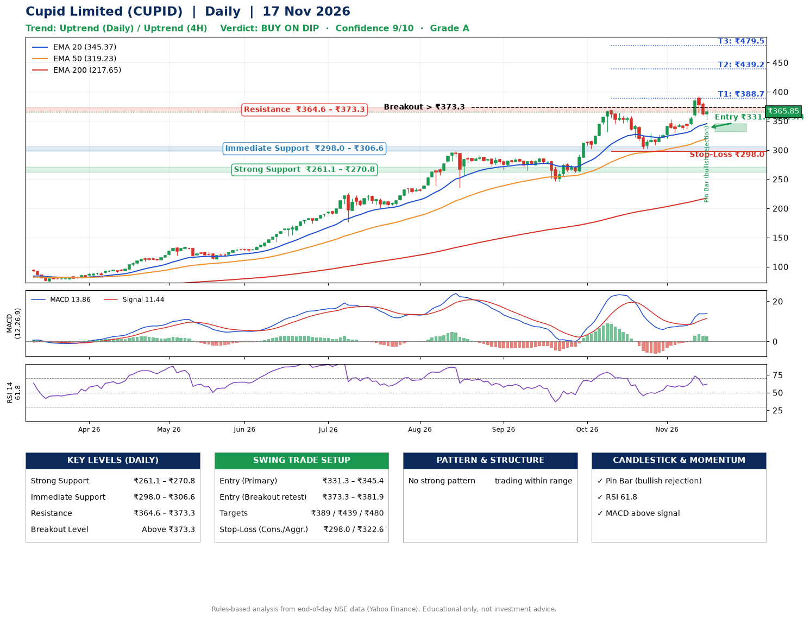

📌 **Cupid Limited (CUPID) – Multi-Timeframe Technical Analysis (Daily + 4H Combined)**
_Data up to 17 Nov 2026 · Close ₹365.85_

**📍 Daily Timeframe Trend**
- Trend: **Uptrend** (higher highs and higher lows)
- Recent swing highs: ₹299.0, ₹287.0, ₹369.0 · swing lows: ₹265.5, ₹246.0, ₹302.3
- EMAs: EMA20 ₹345.4, EMA50 ₹319.2, EMA200 ₹217.6; bullish stack (EMA20 > EMA50 > EMA200); price above EMA20, EMA50, EMA200
- MACD 13.86 above signal 11.44 (above zero), fresh bullish crossover; histogram falling
- RSI(14) 61.8; no divergence on the last two swings

**📍 4-Hour Timeframe Trend**
- Structure: **Uptrend** (higher highs and higher lows)
- Pullback/support area: recent 4H swing lows ₹330.3, ₹352.5; EMA20 ₹356.7
- EMA20/50: bullish stack (EMA20 > EMA50); price above EMA20, EMA50
- MACD 8.62 below signal 9.13 (above zero), fresh bearish crossover; histogram falling
- RSI(14) 57.4; no divergence

**📍 Pattern Detection (Both Timeframes)**
- No strong pattern detected. Trading within range.

**📍 Candlestick Patterns (last 3 daily candles)**
- **Pin Bar (bullish rejection)** – 17 Nov: long lower wick shows dip-buying near ₹351.9

**📍 Price Action Key Levels (Daily Structure)**

| Zone | Price Level (₹) | Context |
|------|-----------------|---------|
| Strong Support | ₹261.1 – ₹270.8 | Cluster of earlier swing lows (demand) |
| Immediate Support | ₹298.0 – ₹306.6 | Nearest swing-low / wick area |
| Resistance | ₹364.6 – ₹373.3 | Nearest swing-high supply |
| Breakout Level | Above ₹373.3 | Swing continuation trigger (52-week high ₹393.0) |

**📍 Swing Trade Setup**

🟢 **Entry Zone**
- Primary: ₹331.3 – ₹345.4 (daily support / EMA20 area; enter on a bullish 4H candle)
- Alternate: ₹373.3 – ₹381.9 (breakout retest)

🎯 **Profit Targets**
- T1: ₹388.7
- T2: ₹439.2
- T3: ₹479.5

🛑 **Stop-Loss**
- Conservative: below daily swing low (₹298.0)
- Aggressive: below 4H structure (₹322.6)
- Risk per share ≈ ₹40.3; reward:risk to T1 ≈ 1.2
- Time to T1: about 11 trading days (it rose this much within 60 trading days 86% of the time in the last 2 years)
- Time to T2: about 24 trading days (it rose this much within 60 trading days 80% of the time in the last 2 years)

**📌 Strategy Notes**
- Higher timeframe: daily trend is uptrend; only take longs while price holds above ₹261.1.
- Entry timing: wait for a bullish 4H candle (engulfing/hammer) inside ₹331.3 – ₹345.4 rather than buying mid-range.
- EMA stacking: bullish stack (EMA20 > EMA50 > EMA200); price above EMA20, EMA50, EMA200.
- Breakout rule: a daily close above ₹373.3 with volume above its 20-day average (≈15,240,780) opens T2/T3.
- Momentum: RSI 62 – room to run; no divergence on the last two swings.
- Exit discipline: move the stop to entry once T1 is hit; book partial profits at each target.

**STEP 2 — Marked Up Chart**

**✅ Trade Validation Checklist**
- Trend + momentum aligned: Yes · Price at entry zone: No
- Stop defined (₹298.0) · Reward:risk ≥ 1.5 to T1: No

## 📌 Final Verdict

Recommendation: **🟡 BUY ON DIP**

Confidence: **9/10**

Trade Quality: **A**

Reason:
• Daily uptrend (higher highs and higher lows)
• EMAs stacked bullishly

Next Action:
• Wait for a pullback to ₹331.3–₹345.4

_Rules-based analysis from end-of-day data. Educational only, not investment advice. Never place orders without your own confirmation._