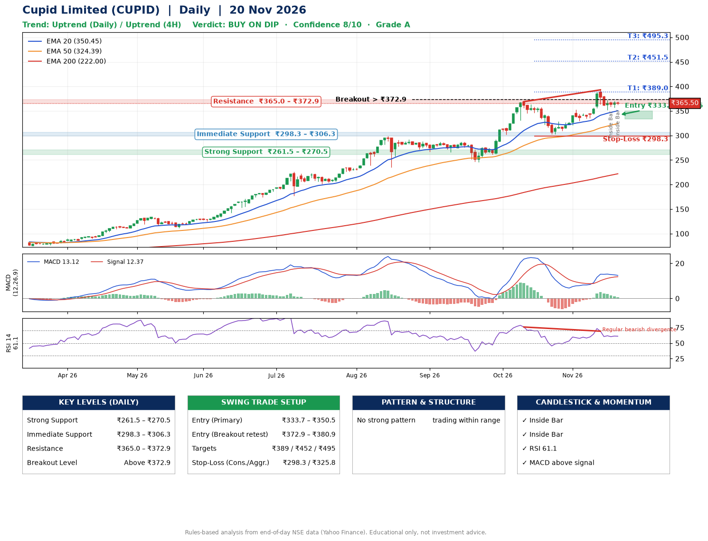

📌 **Cupid Limited (CUPID) – Multi-Timeframe Technical Analysis (Daily + 4H Combined)**
_Data up to 20 Nov 2026 · Close ₹365.50_

**📍 Daily Timeframe Trend**
- Trend: **Uptrend** (higher highs and higher lows)
- Recent swing highs: ₹287.0, ₹369.0, ₹393.0 · swing lows: ₹265.5, ₹246.0, ₹302.3
- EMAs: EMA20 ₹350.5, EMA50 ₹324.4, EMA200 ₹222.0; bullish stack (EMA20 > EMA50 > EMA200); price above EMA20, EMA50, EMA200
- MACD 13.12 above signal 12.37 (above zero); histogram falling
- RSI(14) 61.1; Regular bearish divergence

**📍 4-Hour Timeframe Trend**
- Structure: **Uptrend** (price above rising EMAs)
- Pullback/support area: recent 4H swing lows ₹352.5, ₹356.7; EMA20 ₹359.8
- EMA20/50: bullish stack (EMA20 > EMA50); price above EMA20, EMA50
- MACD 7.22 below signal 8.29 (above zero); histogram falling
- RSI(14) 57.7; Hidden bullish divergence

**📍 Pattern Detection (Both Timeframes)**
- No strong pattern detected. Trading within range.

**📍 Candlestick Patterns (last 3 daily candles)**
- **Inside Bar** – 18 Nov: compression inside the prior range ₹351.9–₹371.8
- **Inside Bar** – 20 Nov: compression inside the prior range ₹356.6–₹370.1

**📍 Price Action Key Levels (Daily Structure)**

| Zone | Price Level (₹) | Context |
|------|-----------------|---------|
| Strong Support | ₹261.5 – ₹270.5 | Cluster of earlier swing lows (demand) |
| Immediate Support | ₹298.3 – ₹306.3 | Nearest swing-low / wick area |
| Resistance | ₹365.0 – ₹372.9 | Nearest swing-high supply |
| Breakout Level | Above ₹372.9 | Swing continuation trigger (52-week high ₹393.0) |

**📍 Swing Trade Setup**

🟢 **Entry Zone**
- Primary: ₹333.7 – ₹350.5 (daily support / EMA20 area; enter on a bullish 4H candle)
- Alternate: ₹372.9 – ₹380.9 (breakout retest)

🎯 **Profit Targets**
- T1: ₹389.0
- T2: ₹451.5
- T3: ₹495.3

🛑 **Stop-Loss**
- Conservative: below daily swing low (₹298.3)
- Aggressive: below 4H structure (₹325.8)
- Risk per share ≈ ₹43.8; reward:risk to T1 ≈ 1.1
- Time to T1: about 10 trading days (it rose this much within 60 trading days 89% of the time in the last 2 years)
- Time to T2: about 26 trading days (it rose this much within 60 trading days 80% of the time in the last 2 years)

**📌 Strategy Notes**
- Higher timeframe: daily trend is uptrend; only take longs while price holds above ₹261.5.
- Entry timing: wait for a bullish 4H candle (engulfing/hammer) inside ₹333.7 – ₹350.5 rather than buying mid-range.
- EMA stacking: bullish stack (EMA20 > EMA50 > EMA200); price above EMA20, EMA50, EMA200.
- Breakout rule: a daily close above ₹372.9 with volume above its 20-day average (≈12,863,192) opens T2/T3.
- Momentum: RSI 61 – room to run; Regular bearish divergence.
- Exit discipline: move the stop to entry once T1 is hit; book partial profits at each target.

**STEP 2 — Marked Up Chart**

**✅ Trade Validation Checklist**
- Trend + momentum aligned: Yes · Price at entry zone: No
- Stop defined (₹298.3) · Reward:risk ≥ 1.5 to T1: No

## 📌 Final Verdict

Recommendation: **🟡 BUY ON DIP**

Confidence: **8/10**

Trade Quality: **A**

Reason:
• Daily uptrend (higher highs and higher lows)
• EMAs stacked bullishly

Next Action:
• Wait for a pullback to ₹333.7–₹350.5

_Rules-based analysis from end-of-day data. Educational only, not investment advice. Never place orders without your own confirmation._