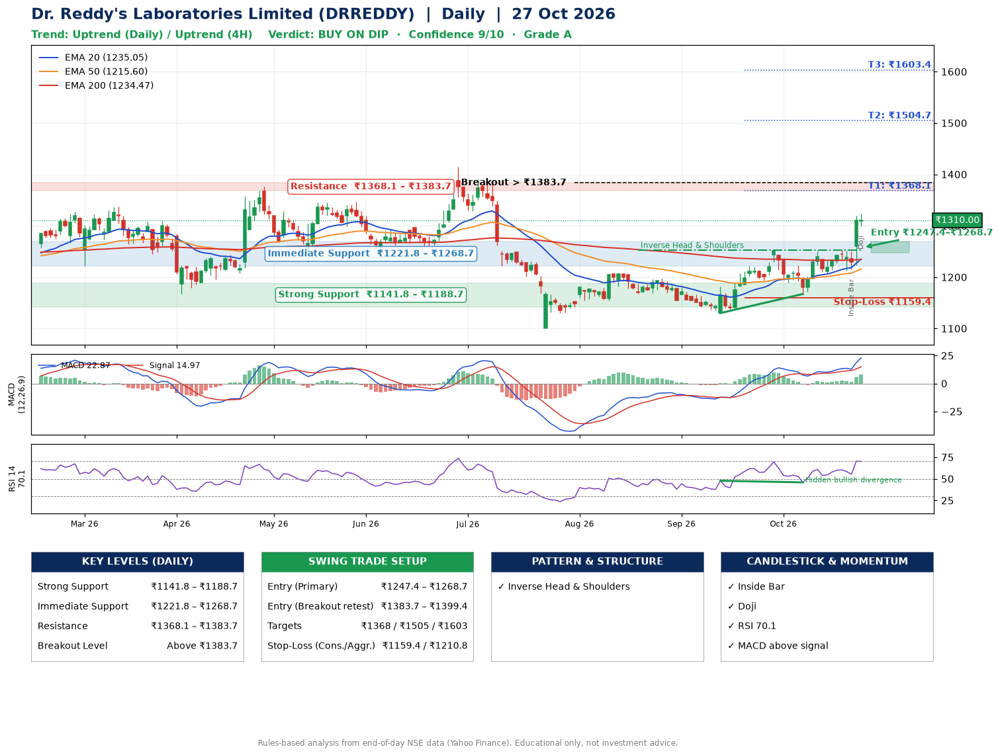

📌 **Dr. Reddy's Laboratories Limited (DRREDDY) – Multi-Timeframe Technical Analysis (Daily + 4H Combined)**
_Data up to 27 Oct 2026 · Close ₹1310.00_

**📍 Daily Timeframe Trend**
- Trend: **Uptrend** (higher highs and higher lows)
- Recent swing highs: ₹1208.1, ₹1197.2, ₹1252.8 · swing lows: ₹1168.0, ₹1130.0, ₹1167.2
- EMAs: EMA20 ₹1235.1, EMA50 ₹1215.6, EMA200 ₹1234.5; mixed / crossing; price above EMA20, EMA50, EMA200
- MACD 22.87 above signal 14.97 (above zero); histogram rising
- RSI(14) 70.1; Hidden bullish divergence

**📍 4-Hour Timeframe Trend**
- Structure: **Uptrend** (price above rising EMAs)
- Pullback/support area: recent 4H swing lows ₹1207.1, ₹1213.0; EMA20 ₹1254.8
- EMA20/50: bullish stack (EMA20 > EMA50); price above EMA20, EMA50
- MACD 23.47 above signal 14.75 (above zero), fresh bullish crossover; histogram falling
- RSI(14) 68.7; Hidden bullish divergence

**📍 Pattern Detection (Both Timeframes)**
- Daily: **Inverse Head & Shoulders** – head ₹1130.0, neckline ₹1252.8

**📍 Candlestick Patterns (last 3 daily candles)**
- **Inside Bar** – 23 Oct: compression inside the prior range ₹1212.7–₹1250.7
- **Doji** – 27 Oct: indecision; wait for the next candle to confirm direction

**📍 Price Action Key Levels (Daily Structure)**

| Zone | Price Level (₹) | Context |
|------|-----------------|---------|
| Strong Support | ₹1141.8 – ₹1188.7 | Cluster of earlier swing lows (demand) |
| Immediate Support | ₹1221.8 – ₹1268.7 | Nearest swing-low / wick area |
| Resistance | ₹1368.1 – ₹1383.7 | Nearest swing-high supply |
| Breakout Level | Above ₹1383.7 | Swing continuation trigger (52-week high ₹1414.9) |

**📍 Swing Trade Setup**

🟢 **Entry Zone**
- Primary: ₹1247.4 – ₹1268.7 (daily support / EMA20 area; enter on a bullish 4H candle)
- Alternate: ₹1383.7 – ₹1399.4 (breakout retest)

🎯 **Profit Targets**
- T1: ₹1368.1
- T2: ₹1504.7
- T3: ₹1603.4

🛑 **Stop-Loss**
- Conservative: below daily swing low (₹1159.4)
- Aggressive: below 4H structure (₹1210.8)
- Risk per share ≈ ₹98.7; reward:risk to T1 ≈ 1.1

**📌 Strategy Notes**
- Higher timeframe: daily trend is uptrend; only take longs while price holds above ₹1141.8.
- Entry timing: wait for a bullish 4H candle (engulfing/hammer) inside ₹1247.4 – ₹1268.7 rather than buying mid-range.
- EMA stacking: mixed / crossing; price above EMA20, EMA50, EMA200.
- Breakout rule: a daily close above ₹1383.7 with volume above its 20-day average (≈2,644,532) opens T2/T3.
- Momentum: RSI 70 – elevated, prefer dips; Hidden bullish divergence.
- Exit discipline: move the stop to entry once T1 is hit; book partial profits at each target.

**STEP 2 — Marked Up Chart**

**✅ Trade Validation Checklist**
- Trend + momentum aligned: Yes · Price at entry zone: No
- Stop defined (₹1159.4) · Reward:risk ≥ 1.5 to T1: No

## 📌 Final Verdict

Recommendation: **🟡 BUY ON DIP**

Confidence: **9/10**

Trade Quality: **A**

Reason:
• Daily uptrend (higher highs and higher lows)
• Inverse Head & Shoulders: head ₹1130.0, neckline ₹1252.8

Next Action:
• Wait for a pullback to ₹1247.4–₹1268.7

_Rules-based analysis from end-of-day data. Educational only, not investment advice. Never place orders without your own confirmation._