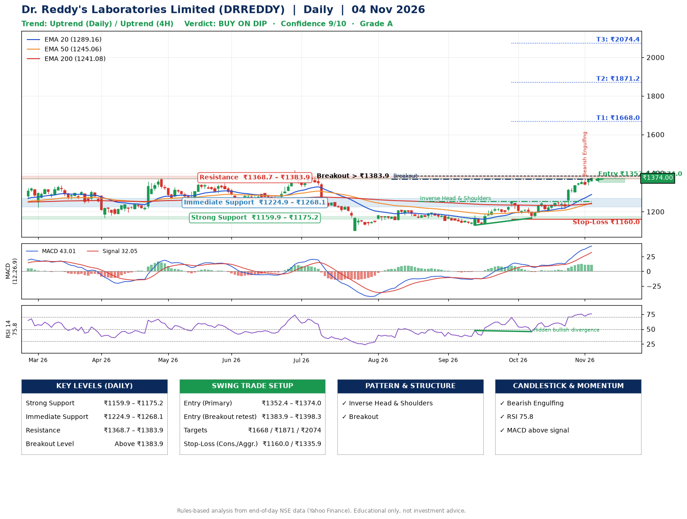

📌 **Dr. Reddy's Laboratories Limited (DRREDDY) – Multi-Timeframe Technical Analysis (Daily + 4H Combined)**
_Data up to 04 Nov 2026 · Close ₹1374.00_

**📍 Daily Timeframe Trend**
- Trend: **Uptrend** (higher highs and higher lows)
- Recent swing highs: ₹1208.1, ₹1197.2, ₹1252.8 · swing lows: ₹1168.0, ₹1130.0, ₹1167.2
- EMAs: EMA20 ₹1289.2, EMA50 ₹1245.1, EMA200 ₹1241.1; bullish stack (EMA20 > EMA50 > EMA200); price above EMA20, EMA50, EMA200
- MACD 43.01 above signal 32.05 (above zero); histogram falling
- RSI(14) 75.8; Hidden bullish divergence

**📍 4-Hour Timeframe Trend**
- Structure: **Uptrend** (price above rising EMAs)
- Pullback/support area: recent 4H swing lows ₹1213.0, ₹1337.7; EMA20 ₹1325.1
- EMA20/50: bullish stack (EMA20 > EMA50); price above EMA20, EMA50
- MACD 34.40 above signal 32.50 (above zero); histogram falling
- RSI(14) 74.5; no divergence

**📍 Pattern Detection (Both Timeframes)**
- Daily: **Inverse Head & Shoulders** – head ₹1130.0, neckline ₹1252.8
- Daily: **Breakout** – closed above the 60-session high ₹1368.3 (volume not confirming yet)

**📍 Candlestick Patterns (last 3 daily candles)**
- **Bearish Engulfing** – 02 Nov: sellers fully reversed the prior green candle

**📍 Price Action Key Levels (Daily Structure)**

| Zone | Price Level (₹) | Context |
|------|-----------------|---------|
| Strong Support | ₹1159.9 – ₹1175.2 | Cluster of earlier swing lows (demand) |
| Immediate Support | ₹1224.9 – ₹1268.1 | Nearest swing-low / wick area |
| Resistance | ₹1368.7 – ₹1383.9 | Nearest swing-high supply |
| Breakout Level | Above ₹1383.9 | Swing continuation trigger (52-week high ₹1414.9) |

**📍 Swing Trade Setup**

🟢 **Entry Zone**
- Primary: ₹1352.4 – ₹1374.0 (daily support / EMA20 area; enter on a bullish 4H candle)
- Alternate: ₹1383.9 – ₹1398.3 (breakout retest)

🎯 **Profit Targets**
- T1: ₹1668.0
- T2: ₹1871.2
- T3: ₹2074.4

🛑 **Stop-Loss**
- Conservative: below daily swing low (₹1160.0)
- Aggressive: below 4H structure (₹1335.9)
- Risk per share ≈ ₹203.2; reward:risk to T1 ≈ 1.5

**📌 Strategy Notes**
- Higher timeframe: daily trend is uptrend; only take longs while price holds above ₹1159.9.
- Entry timing: wait for a bullish 4H candle (engulfing/hammer) inside ₹1352.4 – ₹1374.0 rather than buying mid-range.
- EMA stacking: bullish stack (EMA20 > EMA50 > EMA200); price above EMA20, EMA50, EMA200.
- Breakout rule: a daily close above ₹1383.9 with volume above its 20-day average (≈2,260,361) opens T2/T3.
- Momentum: RSI 76 – elevated, prefer dips; Hidden bullish divergence.
- Exit discipline: move the stop to entry once T1 is hit; book partial profits at each target.

**STEP 2 — Marked Up Chart**

**✅ Trade Validation Checklist**
- Trend + momentum aligned: Yes · Price at entry zone: Yes
- Stop defined (₹1160.0) · Reward:risk ≥ 1.5 to T1: Yes

## 📌 Final Verdict

Recommendation: **🟡 BUY ON DIP**

Confidence: **9/10**

Trade Quality: **A**

Reason:
• Daily uptrend (higher highs and higher lows)
• EMAs stacked bullishly

Next Action:
• Wait for a pullback to ₹1352.4–₹1374.0, or a breakout above ₹1383.9

_Rules-based analysis from end-of-day data. Educational only, not investment advice. Never place orders without your own confirmation._