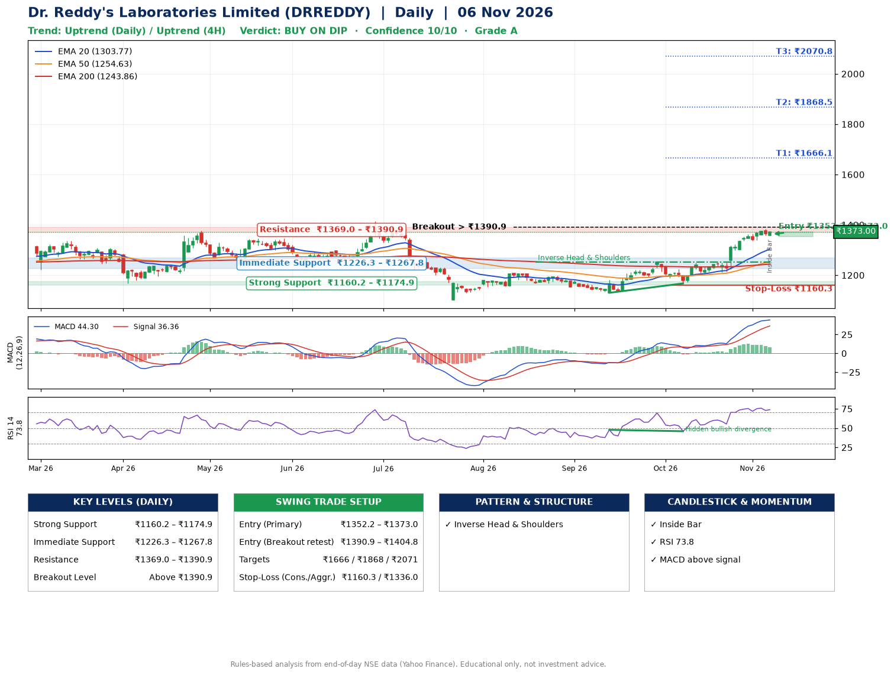

📌 **Dr. Reddy's Laboratories Limited (DRREDDY) – Multi-Timeframe Technical Analysis (Daily + 4H Combined)**
_Data up to 06 Nov 2026 · Close ₹1373.00_

**📍 Daily Timeframe Trend**
- Trend: **Uptrend** (higher highs and higher lows)
- Recent swing highs: ₹1208.1, ₹1197.2, ₹1252.8 · swing lows: ₹1168.0, ₹1130.0, ₹1167.2
- EMAs: EMA20 ₹1303.8, EMA50 ₹1254.6, EMA200 ₹1243.9; bullish stack (EMA20 > EMA50 > EMA200); price above EMA20, EMA50, EMA200
- MACD 44.30 above signal 36.36 (above zero); histogram falling
- RSI(14) 73.8; Hidden bullish divergence

**📍 4-Hour Timeframe Trend**
- Structure: **Uptrend** (higher highs and higher lows)
- Pullback/support area: recent 4H swing lows ₹1213.0, ₹1337.7; EMA20 ₹1339.4
- EMA20/50: bullish stack (EMA20 > EMA50); price above EMA20, EMA50
- MACD 30.42 below signal 31.93 (above zero), fresh bearish crossover; histogram falling
- RSI(14) 71.6; no divergence

**📍 Pattern Detection (Both Timeframes)**
- Daily: **Inverse Head & Shoulders** – head ₹1130.0, neckline ₹1252.8

**📍 Candlestick Patterns (last 3 daily candles)**
- **Inside Bar** – 06 Nov: compression inside the prior range ₹1357.0–₹1384.0

**📍 Price Action Key Levels (Daily Structure)**

| Zone | Price Level (₹) | Context |
|------|-----------------|---------|
| Strong Support | ₹1160.2 – ₹1174.9 | Cluster of earlier swing lows (demand) |
| Immediate Support | ₹1226.3 – ₹1267.8 | Nearest swing-low / wick area |
| Resistance | ₹1369.0 – ₹1390.9 | Nearest swing-high supply |
| Breakout Level | Above ₹1390.9 | Swing continuation trigger (52-week high ₹1414.9) |

**📍 Swing Trade Setup**

🟢 **Entry Zone**
- Primary: ₹1352.2 – ₹1373.0 (daily support / EMA20 area; enter on a bullish 4H candle)
- Alternate: ₹1390.9 – ₹1404.8 (breakout retest)

🎯 **Profit Targets**
- T1: ₹1666.1
- T2: ₹1868.5
- T3: ₹2070.8

🛑 **Stop-Loss**
- Conservative: below daily swing low (₹1160.3)
- Aggressive: below 4H structure (₹1336.0)
- Risk per share ≈ ₹202.3; reward:risk to T1 ≈ 1.5

**📌 Strategy Notes**
- Higher timeframe: daily trend is uptrend; only take longs while price holds above ₹1160.2.
- Entry timing: wait for a bullish 4H candle (engulfing/hammer) inside ₹1352.2 – ₹1373.0 rather than buying mid-range.
- EMA stacking: bullish stack (EMA20 > EMA50 > EMA200); price above EMA20, EMA50, EMA200.
- Breakout rule: a daily close above ₹1390.9 with volume above its 20-day average (≈2,217,981) opens T2/T3.
- Momentum: RSI 74 – elevated, prefer dips; Hidden bullish divergence.
- Exit discipline: move the stop to entry once T1 is hit; book partial profits at each target.

**STEP 2 — Marked Up Chart**

**✅ Trade Validation Checklist**
- Trend + momentum aligned: Yes · Price at entry zone: Yes
- Stop defined (₹1160.3) · Reward:risk ≥ 1.5 to T1: No

## 📌 Final Verdict

Recommendation: **🟡 BUY ON DIP**

Confidence: **10/10**

Trade Quality: **A**

Reason:
• Daily uptrend (higher highs and higher lows)
• EMAs stacked bullishly

Next Action:
• Wait for a pullback to ₹1352.2–₹1373.0, or a breakout above ₹1390.9

_Rules-based analysis from end-of-day data. Educational only, not investment advice. Never place orders without your own confirmation._