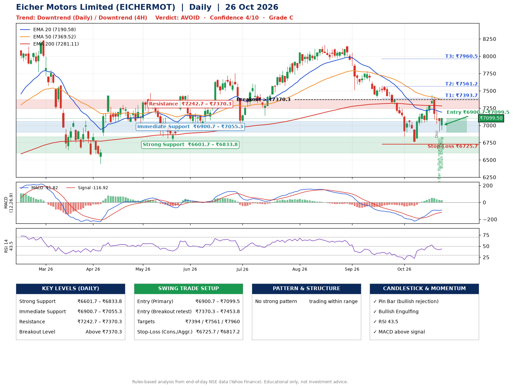

📌 **Eicher Motors Limited (EICHERMOT) – Multi-Timeframe Technical Analysis (Daily + 4H Combined)**
_Data up to 26 Oct 2026 · Close ₹7099.50_

**📍 Daily Timeframe Trend**
- Trend: **Downtrend** (lower highs and lower lows)
- Recent swing highs: ₹7603.0, ₹8165.0, ₹8140.0 · swing lows: ₹7507.5, ₹7406.0, ₹6767.5
- EMAs: EMA20 ₹7190.6, EMA50 ₹7369.5, EMA200 ₹7281.1; mixed / crossing; price below all EMAs
- MACD -91.82 above signal -116.92 (below zero); histogram falling
- RSI(14) 43.5; no divergence on the last two swings

**📍 4-Hour Timeframe Trend**
- Structure: **Downtrend** (price below falling EMAs)
- Pullback/support area: recent 4H swing lows ₹6767.5, ₹6918.0; EMA20 ₹7122.7
- EMA20/50: bearish stack (EMA20 < EMA50); price below all EMAs
- MACD -27.45 below signal -17.78 (below zero), fresh bearish crossover; histogram rising
- RSI(14) 47.9; no divergence

**📍 Pattern Detection (Both Timeframes)**
- 4H: **Double Bottom** – bottoms near ₹6767.5/₹6918.0, neckline ₹7435.5, forming
- 4H: **Symmetrical Triangle** – converging swing highs and lows over the last ~60 sessions

**📍 Candlestick Patterns (last 3 daily candles)**
- **Doji** – 22 Oct: indecision; wait for the next candle to confirm direction
- **Pin Bar (bullish rejection)** – 23 Oct: long lower wick shows dip-buying near ₹6911.0
- **Bullish Engulfing** – 26 Oct: buyers fully reversed the prior red candle

**📍 Price Action Key Levels (Daily Structure)**

| Zone | Price Level (₹) | Context |
|------|-----------------|---------|
| Strong Support | ₹6601.7 – ₹6833.8 | Cluster of earlier swing lows (demand) |
| Immediate Support | ₹6900.7 – ₹7055.3 | Nearest swing-low / wick area |
| Resistance | ₹7242.7 – ₹7370.3 | Nearest swing-high supply |
| Breakout Level | Above ₹7370.3 | Swing continuation trigger (52-week high ₹8230.0) |

**📍 Swing Trade Setup**

🟢 **Entry Zone**
- Primary: ₹6900.7 – ₹7099.5 (daily support / EMA20 area; enter on a bullish 4H candle)
- Alternate: ₹7370.3 – ₹7453.8 (breakout retest)

🎯 **Profit Targets**
- T1: ₹7393.7
- T2: ₹7561.2
- T3: ₹7960.5

🛑 **Stop-Loss**
- Conservative: below daily swing low (₹6725.7)
- Aggressive: below 4H structure (₹6817.2)
- Risk per share ≈ ₹274.4; reward:risk to T1 ≈ 1.4

**📌 Strategy Notes**
- Higher timeframe: daily trend is downtrend; only take longs while price holds above ₹6601.7.
- Entry timing: wait for a bullish 4H candle (engulfing/hammer) inside ₹6900.7 – ₹7099.5 rather than buying mid-range.
- EMA stacking: mixed / crossing; price below all EMAs.
- Breakout rule: a daily close above ₹7370.3 with volume above its 20-day average (≈419,844) opens T2/T3.
- Momentum: RSI 44 – room to run; no divergence on the last two swings.
- Exit discipline: move the stop to entry once T1 is hit; book partial profits at each target.

**STEP 2 — Marked Up Chart**

**✅ Trade Validation Checklist**
- Trend + momentum aligned: No · Price at entry zone: Yes
- Stop defined (₹6725.7) · Reward:risk ≥ 1.5 to T1: No

## 📌 Final Verdict

Recommendation: **🔴 AVOID**

Confidence: **4/10**

Trade Quality: **C**

Reason:
• Daily downtrend (lower highs and lower lows)

Next Action:
• Avoid until the trend changes (reclaim EMA50 and a higher low)

_Rules-based analysis from end-of-day data. Educational only, not investment advice. Never place orders without your own confirmation._