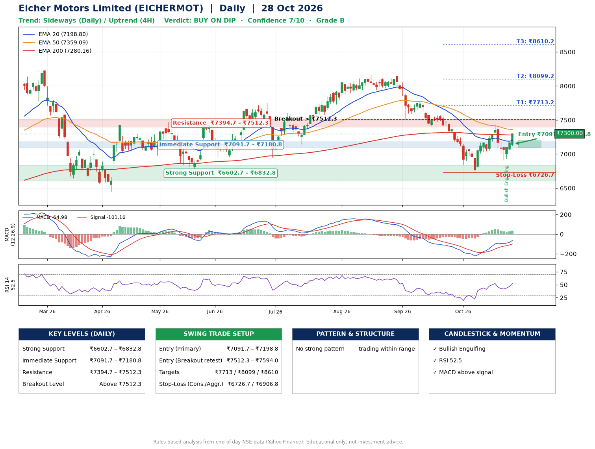

📌 **Eicher Motors Limited (EICHERMOT) – Multi-Timeframe Technical Analysis (Daily + 4H Combined)**
_Data up to 28 Oct 2026 · Close ₹7300.00_

**📍 Daily Timeframe Trend**
- Trend: **Sideways** (mixed swing structure)
- Recent swing highs: ₹8165.0, ₹8140.0, ₹7438.5 · swing lows: ₹7507.5, ₹7406.0, ₹6767.5
- EMAs: EMA20 ₹7198.8, EMA50 ₹7359.1, EMA200 ₹7280.2; mixed / crossing; price above EMA20, EMA200
- MACD -64.98 above signal -101.16 (below zero); histogram rising
- RSI(14) 52.5; no divergence on the last two swings

**📍 4-Hour Timeframe Trend**
- Structure: **Uptrend** (higher highs and higher lows)
- Pullback/support area: recent 4H swing lows ₹6767.5, ₹6918.0; EMA20 ₹7155.2
- EMA20/50: bearish stack (EMA20 < EMA50); price above EMA20, EMA50
- MACD 7.82 above signal -11.25 (above zero), fresh bullish crossover; histogram rising
- RSI(14) 58.4; no divergence

**📍 Pattern Detection (Both Timeframes)**
- 4H: **Double Bottom** – bottoms near ₹6767.5/₹6918.0, neckline ₹7435.5, forming
- 4H: **Symmetrical Triangle** – converging swing highs and lows over the last ~60 sessions

**📍 Candlestick Patterns (last 3 daily candles)**
- **Bullish Engulfing** – 26 Oct: buyers fully reversed the prior red candle

**📍 Price Action Key Levels (Daily Structure)**

| Zone | Price Level (₹) | Context |
|------|-----------------|---------|
| Strong Support | ₹6602.7 – ₹6832.8 | Cluster of earlier swing lows (demand) |
| Immediate Support | ₹7091.7 – ₹7180.8 | Nearest swing-low / wick area |
| Resistance | ₹7394.7 – ₹7512.3 | Nearest swing-high supply |
| Breakout Level | Above ₹7512.3 | Swing continuation trigger (52-week high ₹8230.0) |

**📍 Swing Trade Setup**

🟢 **Entry Zone**
- Primary: ₹7091.7 – ₹7198.8 (daily support / EMA20 area; enter on a bullish 4H candle)
- Alternate: ₹7512.3 – ₹7594.0 (breakout retest)

🎯 **Profit Targets**
- T1: ₹7713.2
- T2: ₹8099.2
- T3: ₹8610.2

🛑 **Stop-Loss**
- Conservative: below daily swing low (₹6726.7)
- Aggressive: below 4H structure (₹6906.8)
- Risk per share ≈ ₹418.6; reward:risk to T1 ≈ 1.4

**📌 Strategy Notes**
- Higher timeframe: daily trend is sideways; only take longs while price holds above ₹6602.7.
- Entry timing: wait for a bullish 4H candle (engulfing/hammer) inside ₹7091.7 – ₹7198.8 rather than buying mid-range.
- EMA stacking: mixed / crossing; price above EMA20, EMA200.
- Breakout rule: a daily close above ₹7512.3 with volume above its 20-day average (≈424,151) opens T2/T3.
- Momentum: RSI 53 – room to run; no divergence on the last two swings.
- Exit discipline: move the stop to entry once T1 is hit; book partial profits at each target.

**STEP 2 — Marked Up Chart**

**✅ Trade Validation Checklist**
- Trend + momentum aligned: No · Price at entry zone: No
- Stop defined (₹6726.7) · Reward:risk ≥ 1.5 to T1: No

## 📌 Final Verdict

Recommendation: **🟡 BUY ON DIP**

Confidence: **7/10**

Trade Quality: **B**

Reason:
• No strong edge from trend, momentum or patterns

Next Action:
• Wait for a pullback to ₹7091.7–₹7198.8, or a breakout above ₹7512.3

_Rules-based analysis from end-of-day data. Educational only, not investment advice. Never place orders without your own confirmation._