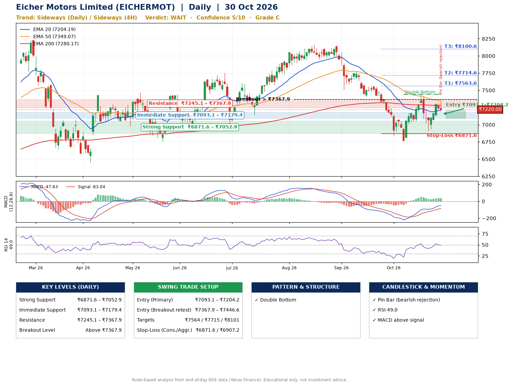

📌 **Eicher Motors Limited (EICHERMOT) – Multi-Timeframe Technical Analysis (Daily + 4H Combined)**
_Data up to 30 Oct 2026 · Close ₹7220.00_

**📍 Daily Timeframe Trend**
- Trend: **Sideways** (mixed swing structure)
- Recent swing highs: ₹8165.0, ₹8140.0, ₹7438.5 · swing lows: ₹7406.0, ₹6767.5, ₹6911.0
- EMAs: EMA20 ₹7204.2, EMA50 ₹7349.1, EMA200 ₹7280.2; mixed / crossing; price above EMA20
- MACD -47.63 above signal -83.04 (below zero); histogram falling
- RSI(14) 49.0; no divergence on the last two swings

**📍 4-Hour Timeframe Trend**
- Structure: **Sideways** (mixed swing structure)
- Pullback/support area: recent 4H swing lows ₹6767.5, ₹6918.0; EMA20 ₹7188.0
- EMA20/50: bearish stack (EMA20 < EMA50); price above EMA20
- MACD 25.56 above signal 8.25 (above zero); histogram falling
- RSI(14) 52.2; no divergence

**📍 Pattern Detection (Both Timeframes)**
- Daily: **Double Bottom** – bottoms near ₹6767.5/₹6911.0, neckline ₹7438.5, forming
- 4H: **Double Bottom** – bottoms near ₹6767.5/₹6918.0, neckline ₹7435.5, forming
- 4H: **Symmetrical Triangle** – converging swing highs and lows over the last ~60 sessions

**📍 Candlestick Patterns (last 3 daily candles)**
- **Pin Bar (bearish rejection)** – 30 Oct: long upper wick shows selling near ₹7343.0

**📍 Price Action Key Levels (Daily Structure)**

| Zone | Price Level (₹) | Context |
|------|-----------------|---------|
| Strong Support | ₹6871.6 – ₹7052.9 | Cluster of earlier swing lows (demand) |
| Immediate Support | ₹7093.1 – ₹7179.4 | Nearest swing-low / wick area |
| Resistance | ₹7245.1 – ₹7367.9 | Nearest swing-high supply |
| Breakout Level | Above ₹7367.9 | Swing continuation trigger (52-week high ₹8230.0) |

**📍 Swing Trade Setup**

🟢 **Entry Zone**
- Primary: ₹7093.1 – ₹7204.2 (daily support / EMA20 area; enter on a bullish 4H candle)
- Alternate: ₹7367.9 – ₹7446.6 (breakout retest)

🎯 **Profit Targets**
- T1: ₹7563.6
- T2: ₹7714.6
- T3: ₹8100.6

🛑 **Stop-Loss**
- Conservative: below daily swing low (₹6871.6)
- Aggressive: below 4H structure (₹6907.2)
- Risk per share ≈ ₹277.0; reward:risk to T1 ≈ 1.5

**📌 Strategy Notes**
- Higher timeframe: daily trend is sideways; only take longs while price holds above ₹6871.6.
- Entry timing: wait for a bullish 4H candle (engulfing/hammer) inside ₹7093.1 – ₹7204.2 rather than buying mid-range.
- EMA stacking: mixed / crossing; price above EMA20.
- Breakout rule: a daily close above ₹7367.9 with volume above its 20-day average (≈407,989) opens T2/T3.
- Momentum: RSI 49 – room to run; no divergence on the last two swings.
- Exit discipline: move the stop to entry once T1 is hit; book partial profits at each target.

**STEP 2 — Marked Up Chart**

**✅ Trade Validation Checklist**
- Trend + momentum aligned: No · Price at entry zone: No
- Stop defined (₹6871.6) · Reward:risk ≥ 1.5 to T1: No

## 📌 Final Verdict

Recommendation: **🟠 WAIT**

Confidence: **5/10**

Trade Quality: **C**

Reason:
• Double Bottom: bottoms near ₹6767.5/₹6911.0, neckline ₹7438.5, forming

Next Action:
• Wait for a breakout above ₹7367.9

_Rules-based analysis from end-of-day data. Educational only, not investment advice. Never place orders without your own confirmation._