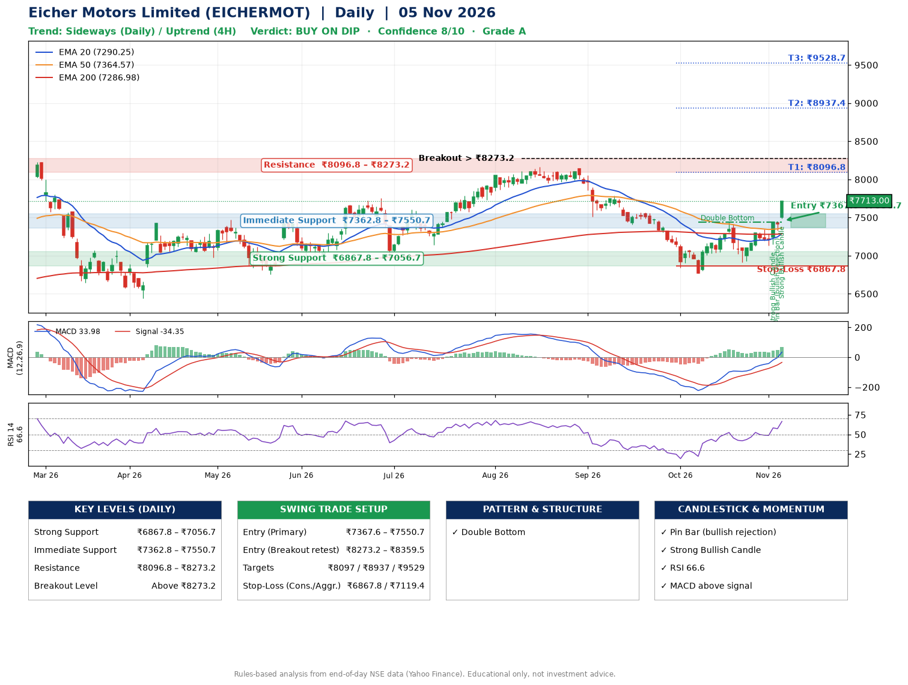

📌 **Eicher Motors Limited (EICHERMOT) – Multi-Timeframe Technical Analysis (Daily + 4H Combined)**
_Data up to 05 Nov 2026 · Close ₹7713.00_

**📍 Daily Timeframe Trend**
- Trend: **Sideways** (mixed swing structure)
- Recent swing highs: ₹8165.0, ₹8140.0, ₹7438.5 · swing lows: ₹7406.0, ₹6767.5, ₹6911.0
- EMAs: EMA20 ₹7290.3, EMA50 ₹7364.6, EMA200 ₹7287.0; mixed / crossing; price above EMA20, EMA50, EMA200
- MACD 33.98 above signal -34.35 (above zero); histogram rising
- RSI(14) 66.6; no divergence on the last two swings

**📍 4-Hour Timeframe Trend**
- Structure: **Uptrend** (price above rising EMAs)
- Pullback/support area: recent 4H swing lows ₹6918.0, ₹7131.0; EMA20 ₹7338.0
- EMA20/50: bullish stack (EMA20 > EMA50); price above EMA20, EMA50
- MACD 106.97 above signal 56.45 (above zero); histogram rising
- RSI(14) 71.9; no divergence

**📍 Pattern Detection (Both Timeframes)**
- Daily: **Double Bottom** – bottoms near ₹6767.5/₹6911.0, neckline ₹7438.5, confirmed (closed above neckline)

**📍 Candlestick Patterns (last 3 daily candles)**
- **Strong Bullish Candle** – 03 Nov: wide-range green candle, buyers in control
- **Pin Bar (bullish rejection)** – 04 Nov: long lower wick shows dip-buying near ₹7332.0
- **Strong Bullish Candle** – 05 Nov: wide-range green candle, buyers in control

**📍 Price Action Key Levels (Daily Structure)**

| Zone | Price Level (₹) | Context |
|------|-----------------|---------|
| Strong Support | ₹6867.8 – ₹7056.7 | Cluster of earlier swing lows (demand) |
| Immediate Support | ₹7362.8 – ₹7550.7 | Nearest swing-low / wick area |
| Resistance | ₹8096.8 – ₹8273.2 | Nearest swing-high supply |
| Breakout Level | Above ₹8273.2 | Swing continuation trigger (52-week high ₹8230.0) |

**📍 Swing Trade Setup**

🟢 **Entry Zone**
- Primary: ₹7367.6 – ₹7550.7 (daily support / EMA20 area; enter on a bullish 4H candle)
- Alternate: ₹8273.2 – ₹8359.5 (breakout retest)

🎯 **Profit Targets**
- T1: ₹8096.8
- T2: ₹8937.4
- T3: ₹9528.7

🛑 **Stop-Loss**
- Conservative: below daily swing low (₹6867.8)
- Aggressive: below 4H structure (₹7119.4)
- Risk per share ≈ ₹591.3; reward:risk to T1 ≈ 1.1

**📌 Strategy Notes**
- Higher timeframe: daily trend is sideways; only take longs while price holds above ₹6867.8.
- Entry timing: wait for a bullish 4H candle (engulfing/hammer) inside ₹7367.6 – ₹7550.7 rather than buying mid-range.
- EMA stacking: mixed / crossing; price above EMA20, EMA50, EMA200.
- Breakout rule: a daily close above ₹8273.2 with volume above its 20-day average (≈437,773) opens T2/T3.
- Momentum: RSI 67 – elevated, prefer dips; no divergence on the last two swings.
- Exit discipline: move the stop to entry once T1 is hit; book partial profits at each target.

**STEP 2 — Marked Up Chart**

**✅ Trade Validation Checklist**
- Trend + momentum aligned: No · Price at entry zone: No
- Stop defined (₹6867.8) · Reward:risk ≥ 1.5 to T1: No

## 📌 Final Verdict

Recommendation: **🟡 BUY ON DIP**

Confidence: **8/10**

Trade Quality: **A**

Reason:
• Double Bottom: bottoms near ₹6767.5/₹6911.0, neckline ₹7438.5, confirmed (closed above neckline)

Next Action:
• Wait for a pullback to ₹7367.6–₹7550.7, or a breakout above ₹8273.2

_Rules-based analysis from end-of-day data. Educational only, not investment advice. Never place orders without your own confirmation._