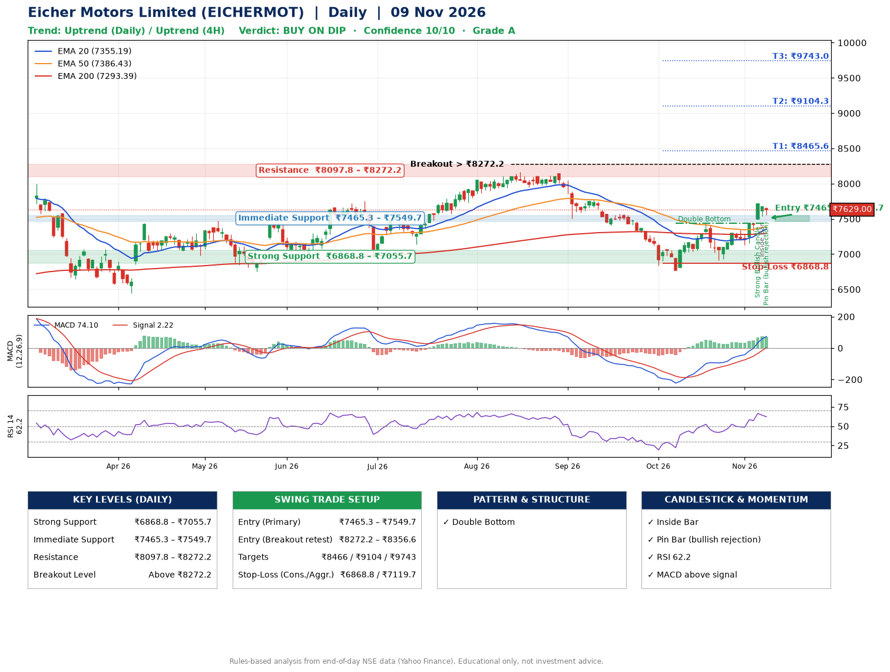

📌 **Eicher Motors Limited (EICHERMOT) – Multi-Timeframe Technical Analysis (Daily + 4H Combined)**
_Data up to 09 Nov 2026 · Close ₹7629.00_

**📍 Daily Timeframe Trend**
- Trend: **Uptrend** (price above rising EMAs)
- Recent swing highs: ₹8165.0, ₹8140.0, ₹7438.5 · swing lows: ₹7406.0, ₹6767.5, ₹6911.0
- EMAs: EMA20 ₹7355.2, EMA50 ₹7386.4, EMA200 ₹7293.4; mixed / crossing; price above EMA20, EMA50, EMA200
- MACD 74.10 above signal 2.22 (above zero); histogram falling
- RSI(14) 62.2; no divergence on the last two swings

**📍 4-Hour Timeframe Trend**
- Structure: **Uptrend** (higher highs and higher lows)
- Pullback/support area: recent 4H swing lows ₹6918.0, ₹7131.0; EMA20 ₹7431.4
- EMA20/50: bullish stack (EMA20 > EMA50); price above EMA20, EMA50
- MACD 125.07 above signal 95.10 (above zero); histogram falling
- RSI(14) 62.9; no divergence

**📍 Pattern Detection (Both Timeframes)**
- Daily: **Double Bottom** – bottoms near ₹6767.5/₹6911.0, neckline ₹7438.5, confirmed (closed above neckline)

**📍 Candlestick Patterns (last 3 daily candles)**
- **Strong Bullish Candle** – 05 Nov: wide-range green candle, buyers in control
- **Inside Bar** – 06 Nov: compression inside the prior range ₹7489.0–₹7713.0
- **Pin Bar (bullish rejection)** – 09 Nov: long lower wick shows dip-buying near ₹7554.0

**📍 Price Action Key Levels (Daily Structure)**

| Zone | Price Level (₹) | Context |
|------|-----------------|---------|
| Strong Support | ₹6868.8 – ₹7055.7 | Cluster of earlier swing lows (demand) |
| Immediate Support | ₹7465.3 – ₹7549.7 | Nearest swing-low / wick area |
| Resistance | ₹8097.8 – ₹8272.2 | Nearest swing-high supply |
| Breakout Level | Above ₹8272.2 | Swing continuation trigger (52-week high ₹8230.0) |

**📍 Swing Trade Setup**

🟢 **Entry Zone**
- Primary: ₹7465.3 – ₹7549.7 (daily support / EMA20 area; enter on a bullish 4H candle)
- Alternate: ₹8272.2 – ₹8356.6 (breakout retest)

🎯 **Profit Targets**
- T1: ₹8465.6
- T2: ₹9104.3
- T3: ₹9743.0

🛑 **Stop-Loss**
- Conservative: below daily swing low (₹6868.8)
- Aggressive: below 4H structure (₹7119.7)
- Risk per share ≈ ₹638.7; reward:risk to T1 ≈ 1.5

**📌 Strategy Notes**
- Higher timeframe: daily trend is uptrend; only take longs while price holds above ₹6868.8.
- Entry timing: wait for a bullish 4H candle (engulfing/hammer) inside ₹7465.3 – ₹7549.7 rather than buying mid-range.
- EMA stacking: mixed / crossing; price above EMA20, EMA50, EMA200.
- Breakout rule: a daily close above ₹8272.2 with volume above its 20-day average (≈430,812) opens T2/T3.
- Momentum: RSI 62 – room to run; no divergence on the last two swings.
- Exit discipline: move the stop to entry once T1 is hit; book partial profits at each target.

**STEP 2 — Marked Up Chart**

**✅ Trade Validation Checklist**
- Trend + momentum aligned: Yes · Price at entry zone: No
- Stop defined (₹6868.8) · Reward:risk ≥ 1.5 to T1: Yes

## 📌 Final Verdict

Recommendation: **🟡 BUY ON DIP**

Confidence: **10/10**

Trade Quality: **A**

Reason:
• Daily uptrend (price above rising EMAs)
• Double Bottom: bottoms near ₹6767.5/₹6911.0, neckline ₹7438.5, confirmed (closed above neckline)

Next Action:
• Wait for a pullback to ₹7465.3–₹7549.7, or a breakout above ₹8272.2

_Rules-based analysis from end-of-day data. Educational only, not investment advice. Never place orders without your own confirmation._