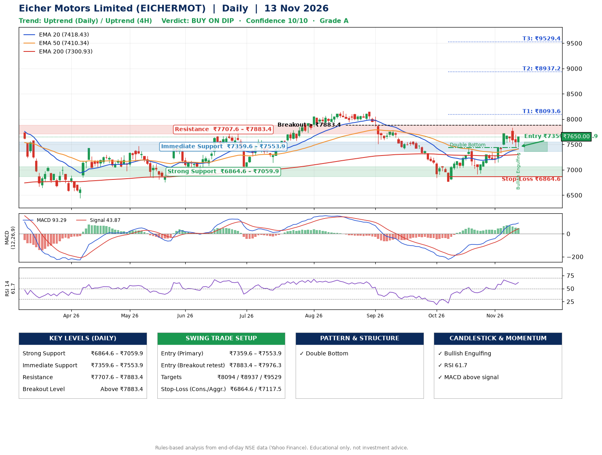

📌 **Eicher Motors Limited (EICHERMOT) – Multi-Timeframe Technical Analysis (Daily + 4H Combined)**
_Data up to 13 Nov 2026 · Close ₹7650.00_

**📍 Daily Timeframe Trend**
- Trend: **Uptrend** (price above rising EMAs)
- Recent swing highs: ₹8165.0, ₹8140.0, ₹7438.5 · swing lows: ₹7406.0, ₹6767.5, ₹6911.0
- EMAs: EMA20 ₹7418.4, EMA50 ₹7410.3, EMA200 ₹7300.9; bullish stack (EMA20 > EMA50 > EMA200); price above EMA20, EMA50, EMA200
- MACD 93.29 above signal 43.87 (above zero); histogram falling
- RSI(14) 61.7; no divergence on the last two swings

**📍 4-Hour Timeframe Trend**
- Structure: **Uptrend** (higher highs and higher lows)
- Pullback/support area: recent 4H swing lows ₹6918.0, ₹7131.0; EMA20 ₹7514.1
- EMA20/50: bullish stack (EMA20 > EMA50); price above EMA20, EMA50
- MACD 103.15 below signal 108.03 (above zero), fresh bearish crossover; histogram rising
- RSI(14) 58.3; Regular bearish divergence

**📍 Pattern Detection (Both Timeframes)**
- Daily: **Double Bottom** – bottoms near ₹6767.5/₹6911.0, neckline ₹7438.5, confirmed (closed above neckline)

**📍 Candlestick Patterns (last 3 daily candles)**
- **Bullish Engulfing** – 13 Nov: buyers fully reversed the prior red candle

**📍 Price Action Key Levels (Daily Structure)**

| Zone | Price Level (₹) | Context |
|------|-----------------|---------|
| Strong Support | ₹6864.6 – ₹7059.9 | Cluster of earlier swing lows (demand) |
| Immediate Support | ₹7359.6 – ₹7553.9 | Nearest swing-low / wick area |
| Resistance | ₹7707.6 – ₹7883.4 | Nearest swing-high supply |
| Breakout Level | Above ₹7883.4 | Swing continuation trigger (52-week high ₹8230.0) |

**📍 Swing Trade Setup**

🟢 **Entry Zone**
- Primary: ₹7359.6 – ₹7553.9 (daily support / EMA20 area; enter on a bullish 4H candle)
- Alternate: ₹7883.4 – ₹7976.3 (breakout retest)

🎯 **Profit Targets**
- T1: ₹8093.6
- T2: ₹8937.2
- T3: ₹9529.4

🛑 **Stop-Loss**
- Conservative: below daily swing low (₹6864.6)
- Aggressive: below 4H structure (₹7117.5)
- Risk per share ≈ ₹592.2; reward:risk to T1 ≈ 1.1
- Time to T1: about 22 trading days (it rose this much within 60 trading days 73% of the time in the last 2 years)
- Time to T2: about 37 trading days (it rose this much within 60 trading days 15% of the time in the last 2 years)

**📌 Strategy Notes**
- Higher timeframe: daily trend is uptrend; only take longs while price holds above ₹6864.6.
- Entry timing: wait for a bullish 4H candle (engulfing/hammer) inside ₹7359.6 – ₹7553.9 rather than buying mid-range.
- EMA stacking: bullish stack (EMA20 > EMA50 > EMA200); price above EMA20, EMA50, EMA200.
- Breakout rule: a daily close above ₹7883.4 with volume above its 20-day average (≈468,529) opens T2/T3.
- Momentum: RSI 62 – room to run; no divergence on the last two swings.
- Exit discipline: move the stop to entry once T1 is hit; book partial profits at each target.

**STEP 2 — Marked Up Chart**

**✅ Trade Validation Checklist**
- Trend + momentum aligned: Yes · Price at entry zone: No
- Stop defined (₹6864.6) · Reward:risk ≥ 1.5 to T1: No

## 📌 Final Verdict

Recommendation: **🟡 BUY ON DIP**

Confidence: **10/10**

Trade Quality: **A**

Reason:
• Daily uptrend (price above rising EMAs)
• EMAs stacked bullishly

Next Action:
• Wait for a pullback to ₹7359.6–₹7553.9, or a breakout above ₹7883.4

_Rules-based analysis from end-of-day data. Educational only, not investment advice. Never place orders without your own confirmation._