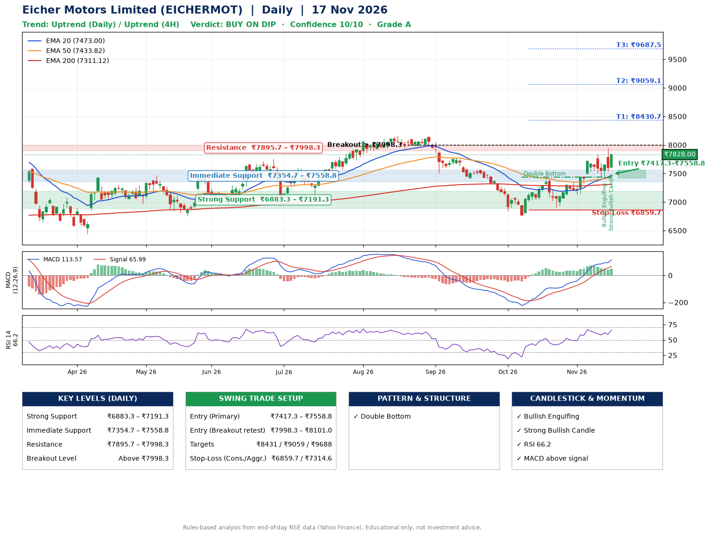

📌 **Eicher Motors Limited (EICHERMOT) – Multi-Timeframe Technical Analysis (Daily + 4H Combined)**
_Data up to 17 Nov 2026 · Close ₹7828.00_

**📍 Daily Timeframe Trend**
- Trend: **Uptrend** (price above rising EMAs)
- Recent swing highs: ₹8165.0, ₹8140.0, ₹7438.5 · swing lows: ₹7406.0, ₹6767.5, ₹6911.0
- EMAs: EMA20 ₹7473.0, EMA50 ₹7433.8, EMA200 ₹7311.1; bullish stack (EMA20 > EMA50 > EMA200); price above EMA20, EMA50, EMA200
- MACD 113.57 above signal 65.99 (above zero); histogram rising
- RSI(14) 66.2; no divergence on the last two swings

**📍 4-Hour Timeframe Trend**
- Structure: **Uptrend** (higher highs and higher lows)
- Pullback/support area: recent 4H swing lows ₹7131.0, ₹7455.5; EMA20 ₹7580.7
- EMA20/50: bullish stack (EMA20 > EMA50); price above EMA20, EMA50
- MACD 110.62 above signal 104.75 (above zero), fresh bullish crossover; histogram rising
- RSI(14) 64.1; Regular bearish divergence

**📍 Pattern Detection (Both Timeframes)**
- Daily: **Double Bottom** – bottoms near ₹6767.5/₹6911.0, neckline ₹7438.5, confirmed (closed above neckline)

**📍 Candlestick Patterns (last 3 daily candles)**
- **Bullish Engulfing** – 13 Nov: buyers fully reversed the prior red candle
- **Strong Bullish Candle** – 17 Nov: wide-range green candle, buyers in control

**📍 Price Action Key Levels (Daily Structure)**

| Zone | Price Level (₹) | Context |
|------|-----------------|---------|
| Strong Support | ₹6883.3 – ₹7191.3 | Cluster of earlier swing lows (demand) |
| Immediate Support | ₹7354.7 – ₹7558.8 | Nearest swing-low / wick area |
| Resistance | ₹7895.7 – ₹7998.3 | Nearest swing-high supply |
| Breakout Level | Above ₹7998.3 | Swing continuation trigger (52-week high ₹8230.0) |

**📍 Swing Trade Setup**

🟢 **Entry Zone**
- Primary: ₹7417.3 – ₹7558.8 (daily support / EMA20 area; enter on a bullish 4H candle)
- Alternate: ₹7998.3 – ₹8101.0 (breakout retest)

🎯 **Profit Targets**
- T1: ₹8430.7
- T2: ₹9059.1
- T3: ₹9687.5

🛑 **Stop-Loss**
- Conservative: below daily swing low (₹6859.7)
- Aggressive: below 4H structure (₹7314.6)
- Risk per share ≈ ₹628.4; reward:risk to T1 ≈ 1.5
- Time to T1: about 39 trading days (it rose this much within 60 trading days 49% of the time in the last 2 years)
- Time to T2: about 38 trading days (it rose this much within 60 trading days 13% of the time in the last 2 years)

**📌 Strategy Notes**
- Higher timeframe: daily trend is uptrend; only take longs while price holds above ₹6883.3.
- Entry timing: wait for a bullish 4H candle (engulfing/hammer) inside ₹7417.3 – ₹7558.8 rather than buying mid-range.
- EMA stacking: bullish stack (EMA20 > EMA50 > EMA200); price above EMA20, EMA50, EMA200.
- Breakout rule: a daily close above ₹7998.3 with volume above its 20-day average (≈552,283) opens T2/T3.
- Momentum: RSI 66 – elevated, prefer dips; no divergence on the last two swings.
- Exit discipline: move the stop to entry once T1 is hit; book partial profits at each target.

**STEP 2 — Marked Up Chart**

**✅ Trade Validation Checklist**
- Trend + momentum aligned: Yes · Price at entry zone: No
- Stop defined (₹6859.7) · Reward:risk ≥ 1.5 to T1: Yes

## 📌 Final Verdict

Recommendation: **🟡 BUY ON DIP**

Confidence: **10/10**

Trade Quality: **A**

Reason:
• Daily uptrend (price above rising EMAs)
• EMAs stacked bullishly

Next Action:
• Wait for a pullback to ₹7417.3–₹7558.8

_Rules-based analysis from end-of-day data. Educational only, not investment advice. Never place orders without your own confirmation._