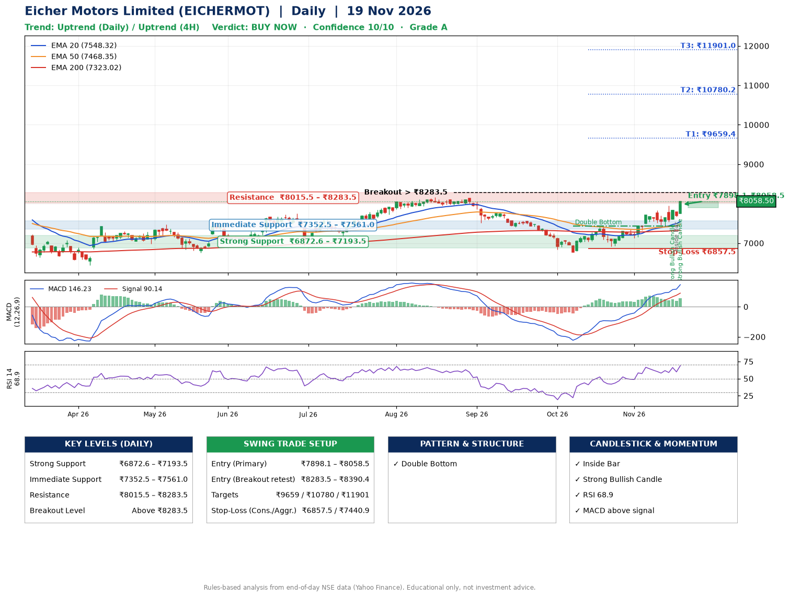

📌 **Eicher Motors Limited (EICHERMOT) – Multi-Timeframe Technical Analysis (Daily + 4H Combined)**
_Data up to 19 Nov 2026 · Close ₹8058.50_

**📍 Daily Timeframe Trend**
- Trend: **Uptrend** (price above rising EMAs)
- Recent swing highs: ₹8165.0, ₹8140.0, ₹7438.5 · swing lows: ₹7406.0, ₹6767.5, ₹6911.0
- EMAs: EMA20 ₹7548.3, EMA50 ₹7468.3, EMA200 ₹7323.0; bullish stack (EMA20 > EMA50 > EMA200); price above EMA20, EMA50, EMA200
- MACD 146.23 above signal 90.14 (above zero); histogram rising
- RSI(14) 68.9; no divergence on the last two swings

**📍 4-Hour Timeframe Trend**
- Structure: **Uptrend** (higher highs and higher lows)
- Pullback/support area: recent 4H swing lows ₹7131.0, ₹7455.5; EMA20 ₹7680.9
- EMA20/50: bullish stack (EMA20 > EMA50); price above EMA20, EMA50
- MACD 141.06 above signal 114.33 (above zero), fresh bullish crossover; histogram rising
- RSI(14) 67.7; Regular bearish divergence

**📍 Pattern Detection (Both Timeframes)**
- Daily: **Double Bottom** – bottoms near ₹6767.5/₹6911.0, neckline ₹7438.5, confirmed (closed above neckline)

**📍 Candlestick Patterns (last 3 daily candles)**
- **Strong Bullish Candle** – 17 Nov: wide-range green candle, buyers in control
- **Inside Bar** – 18 Nov: compression inside the prior range ₹7610.5–₹7848.0
- **Strong Bullish Candle** – 19 Nov: wide-range green candle, buyers in control

**📍 Price Action Key Levels (Daily Structure)**

| Zone | Price Level (₹) | Context |
|------|-----------------|---------|
| Strong Support | ₹6872.6 – ₹7193.5 | Cluster of earlier swing lows (demand) |
| Immediate Support | ₹7352.5 – ₹7561.0 | Nearest swing-low / wick area |
| Resistance | ₹8015.5 – ₹8283.5 | Nearest swing-high supply |
| Breakout Level | Above ₹8283.5 | Swing continuation trigger (52-week high ₹8230.0) |

**📍 Swing Trade Setup**

🟢 **Entry Zone**
- Primary: ₹7898.1 – ₹8058.5 (daily support / EMA20 area; enter on a bullish 4H candle)
- Alternate: ₹8283.5 – ₹8390.4 (breakout retest)

🎯 **Profit Targets**
- T1: ₹9659.4
- T2: ₹10780.2
- T3: ₹11901.0

🛑 **Stop-Loss**
- Conservative: below daily swing low (₹6857.5)
- Aggressive: below 4H structure (₹7440.9)
- Risk per share ≈ ₹1120.8; reward:risk to T1 ≈ 1.5
- Time to T1: about 38 trading days (it rose this much within 60 trading days 13% of the time in the last 2 years)
- Time to T2: it never rose this much within 60 trading days in the price history

**📌 Strategy Notes**
- Higher timeframe: daily trend is uptrend; only take longs while price holds above ₹6872.6.
- Entry timing: wait for a bullish 4H candle (engulfing/hammer) inside ₹7898.1 – ₹8058.5 rather than buying mid-range.
- EMA stacking: bullish stack (EMA20 > EMA50 > EMA200); price above EMA20, EMA50, EMA200.
- Breakout rule: a daily close above ₹8283.5 with volume above its 20-day average (≈555,503) opens T2/T3.
- Momentum: RSI 69 – elevated, prefer dips; no divergence on the last two swings.
- Exit discipline: move the stop to entry once T1 is hit; book partial profits at each target.

**STEP 2 — Marked Up Chart**

**✅ Trade Validation Checklist**
- Trend + momentum aligned: Yes · Price at entry zone: Yes
- Stop defined (₹6857.5) · Reward:risk ≥ 1.5 to T1: No

## 📌 Final Verdict

Recommendation: **🟢 BUY NOW**

Confidence: **10/10**

Trade Quality: **A**

Reason:
• Daily uptrend (price above rising EMAs)
• EMAs stacked bullishly

Next Action:
• Buy now within the entry zone, with the stop-loss in place

_Rules-based analysis from end-of-day data. Educational only, not investment advice. Never place orders without your own confirmation._