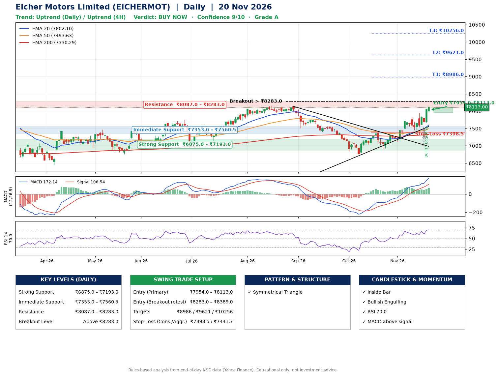

📌 **Eicher Motors Limited (EICHERMOT) – Multi-Timeframe Technical Analysis (Daily + 4H Combined)**
_Data up to 20 Nov 2026 · Close ₹8113.00_

**📍 Daily Timeframe Trend**
- Trend: **Uptrend** (price above rising EMAs)
- Recent swing highs: ₹8165.0, ₹8140.0, ₹7438.5 · swing lows: ₹6767.5, ₹6911.0, ₹7451.5
- EMAs: EMA20 ₹7602.1, EMA50 ₹7493.6, EMA200 ₹7330.3; bullish stack (EMA20 > EMA50 > EMA200); price above EMA20, EMA50, EMA200
- MACD 172.14 above signal 106.54 (above zero); histogram rising
- RSI(14) 70.0; no divergence on the last two swings

**📍 4-Hour Timeframe Trend**
- Structure: **Uptrend** (higher highs and higher lows)
- Pullback/support area: recent 4H swing lows ₹7131.0, ₹7455.5; EMA20 ₹7757.9
- EMA20/50: bullish stack (EMA20 > EMA50); price above EMA20, EMA50
- MACD 168.55 above signal 131.96 (above zero), fresh bullish crossover; histogram rising
- RSI(14) 69.1; Regular bearish divergence

**📍 Pattern Detection (Both Timeframes)**
- Daily: **Symmetrical Triangle** – converging swing highs and lows over the last ~60 sessions

**📍 Candlestick Patterns (last 3 daily candles)**
- **Inside Bar** – 18 Nov: compression inside the prior range ₹7610.5–₹7848.0
- **Bullish Engulfing** – 19 Nov: buyers fully reversed the prior red candle

**📍 Price Action Key Levels (Daily Structure)**

| Zone | Price Level (₹) | Context |
|------|-----------------|---------|
| Strong Support | ₹6875.0 – ₹7193.0 | Cluster of earlier swing lows (demand) |
| Immediate Support | ₹7353.0 – ₹7560.5 | Nearest swing-low / wick area |
| Resistance | ₹8087.0 – ₹8283.0 | Nearest swing-high supply |
| Breakout Level | Above ₹8283.0 | Swing continuation trigger (52-week high ₹8230.0) |

**📍 Swing Trade Setup**

🟢 **Entry Zone**
- Primary: ₹7954.0 – ₹8113.0 (daily support / EMA20 area; enter on a bullish 4H candle)
- Alternate: ₹8283.0 – ₹8389.0 (breakout retest)

🎯 **Profit Targets**
- T1: ₹8986.0
- T2: ₹9621.0
- T3: ₹10256.0

🛑 **Stop-Loss**
- Conservative: below daily swing low (₹7398.5)
- Aggressive: below 4H structure (₹7441.7)
- Risk per share ≈ ₹635.0; reward:risk to T1 ≈ 1.5
- Time to T1: about 34 trading days (it rose this much within 60 trading days 52% of the time in the last 2 years)
- Time to T2: about 36 trading days (it rose this much within 60 trading days 14% of the time in the last 2 years)

**📌 Strategy Notes**
- Higher timeframe: daily trend is uptrend; only take longs while price holds above ₹6875.0.
- Entry timing: wait for a bullish 4H candle (engulfing/hammer) inside ₹7954.0 – ₹8113.0 rather than buying mid-range.
- EMA stacking: bullish stack (EMA20 > EMA50 > EMA200); price above EMA20, EMA50, EMA200.
- Breakout rule: a daily close above ₹8283.0 with volume above its 20-day average (≈574,794) opens T2/T3.
- Momentum: RSI 70 – elevated, prefer dips; no divergence on the last two swings.
- Exit discipline: move the stop to entry once T1 is hit; book partial profits at each target.

**STEP 2 — Marked Up Chart**

**✅ Trade Validation Checklist**
- Trend + momentum aligned: Yes · Price at entry zone: Yes
- Stop defined (₹7398.5) · Reward:risk ≥ 1.5 to T1: Yes

## 📌 Final Verdict

Recommendation: **🟢 BUY NOW**

Confidence: **9/10**

Trade Quality: **A**

Reason:
• Daily uptrend (price above rising EMAs)
• EMAs stacked bullishly

Next Action:
• Buy now within the entry zone, with the stop-loss in place

_Rules-based analysis from end-of-day data. Educational only, not investment advice. Never place orders without your own confirmation._