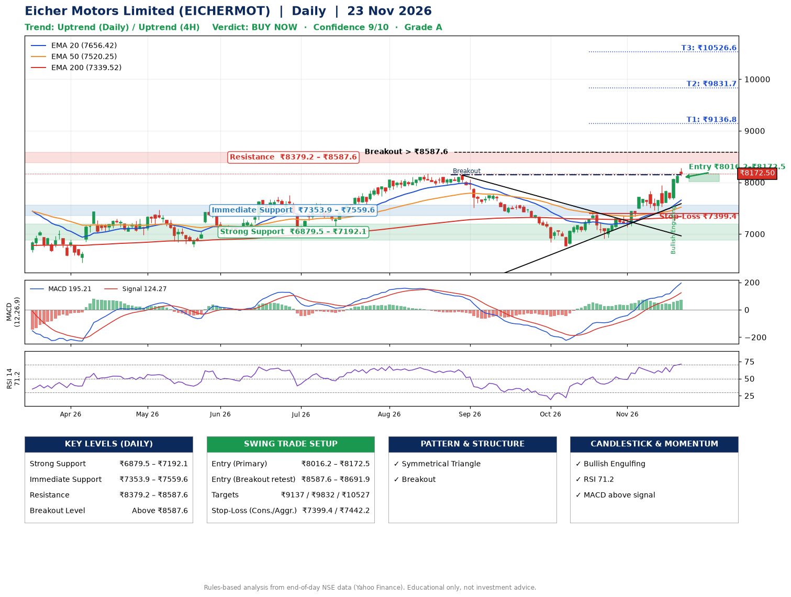

📌 **Eicher Motors Limited (EICHERMOT) – Multi-Timeframe Technical Analysis (Daily + 4H Combined)**
_Data up to 23 Nov 2026 · Close ₹8172.50_

**📍 Daily Timeframe Trend**
- Trend: **Uptrend** (price above rising EMAs)
- Recent swing highs: ₹8165.0, ₹8140.0, ₹7438.5 · swing lows: ₹6767.5, ₹6911.0, ₹7451.5
- EMAs: EMA20 ₹7656.4, EMA50 ₹7520.3, EMA200 ₹7339.5; bullish stack (EMA20 > EMA50 > EMA200); price above EMA20, EMA50, EMA200
- MACD 195.21 above signal 124.27 (above zero); histogram rising
- RSI(14) 71.2; no divergence on the last two swings

**📍 4-Hour Timeframe Trend**
- Structure: **Uptrend** (higher highs and higher lows)
- Pullback/support area: recent 4H swing lows ₹7131.0, ₹7455.5; EMA20 ₹7831.7
- EMA20/50: bullish stack (EMA20 > EMA50); price above EMA20, EMA50
- MACD 187.04 above signal 150.55 (above zero); histogram falling
- RSI(14) 70.7; Regular bearish divergence

**📍 Pattern Detection (Both Timeframes)**
- Daily: **Symmetrical Triangle** – converging swing highs and lows over the last ~60 sessions
- Daily: **Breakout** – closed above the 60-session high ₹8149.0 (volume not confirming yet)

**📍 Candlestick Patterns (last 3 daily candles)**
- **Bullish Engulfing** – 19 Nov: buyers fully reversed the prior red candle

**📍 Price Action Key Levels (Daily Structure)**

| Zone | Price Level (₹) | Context |
|------|-----------------|---------|
| Strong Support | ₹6879.5 – ₹7192.1 | Cluster of earlier swing lows (demand) |
| Immediate Support | ₹7353.9 – ₹7559.6 | Nearest swing-low / wick area |
| Resistance | ₹8379.2 – ₹8587.6 | Nearest swing-high supply |
| Breakout Level | Above ₹8587.6 | Swing continuation trigger (52-week high ₹8275.0) |

**📍 Swing Trade Setup**

🟢 **Entry Zone**
- Primary: ₹8016.2 – ₹8172.5 (daily support / EMA20 area; enter on a bullish 4H candle)
- Alternate: ₹8587.6 – ₹8691.9 (breakout retest)

🎯 **Profit Targets**
- T1: ₹9136.8
- T2: ₹9831.7
- T3: ₹10526.6

🛑 **Stop-Loss**
- Conservative: below daily swing low (₹7399.4)
- Aggressive: below 4H structure (₹7442.2)
- Risk per share ≈ ₹694.9; reward:risk to T1 ≈ 1.5
- Time to T1: about 39 trading days (it rose this much within 60 trading days 47% of the time in the last 2 years)
- Time to T2: about 38 trading days (it rose this much within 60 trading days 13% of the time in the last 2 years)

**📌 Strategy Notes**
- Higher timeframe: daily trend is uptrend; only take longs while price holds above ₹6879.5.
- Entry timing: wait for a bullish 4H candle (engulfing/hammer) inside ₹8016.2 – ₹8172.5 rather than buying mid-range.
- EMA stacking: bullish stack (EMA20 > EMA50 > EMA200); price above EMA20, EMA50, EMA200.
- Breakout rule: a daily close above ₹8587.6 with volume above its 20-day average (≈594,391) opens T2/T3.
- Momentum: RSI 71 – elevated, prefer dips; no divergence on the last two swings.
- Exit discipline: move the stop to entry once T1 is hit; book partial profits at each target.

**STEP 2 — Marked Up Chart**

**✅ Trade Validation Checklist**
- Trend + momentum aligned: Yes · Price at entry zone: Yes
- Stop defined (₹7399.4) · Reward:risk ≥ 1.5 to T1: Yes

## 📌 Final Verdict

Recommendation: **🟢 BUY NOW**

Confidence: **9/10**

Trade Quality: **A**

Reason:
• Daily uptrend (price above rising EMAs)
• EMAs stacked bullishly

Next Action:
• Buy now within the entry zone, with the stop-loss in place

_Rules-based analysis from end-of-day data. Educational only, not investment advice. Never place orders without your own confirmation._