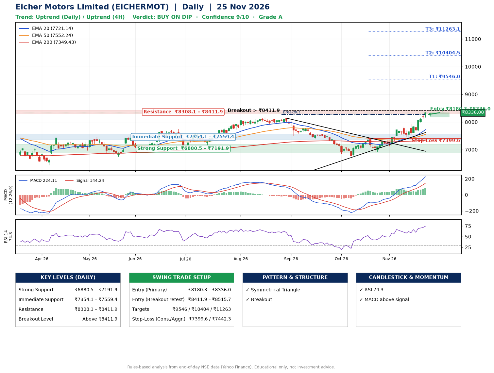

📌 **Eicher Motors Limited (EICHERMOT) – Multi-Timeframe Technical Analysis (Daily + 4H Combined)**
_Data up to 25 Nov 2026 · Close ₹8336.00_

**📍 Daily Timeframe Trend**
- Trend: **Uptrend** (price above rising EMAs)
- Recent swing highs: ₹8165.0, ₹8140.0, ₹7438.5 · swing lows: ₹6767.5, ₹6911.0, ₹7451.5
- EMAs: EMA20 ₹7721.1, EMA50 ₹7552.2, EMA200 ₹7349.4; bullish stack (EMA20 > EMA50 > EMA200); price above EMA20, EMA50, EMA200
- MACD 224.11 above signal 144.24 (above zero); histogram rising
- RSI(14) 74.3; no divergence on the last two swings

**📍 4-Hour Timeframe Trend**
- Structure: **Uptrend** (higher highs and higher lows)
- Pullback/support area: recent 4H swing lows ₹7131.0, ₹7455.5; EMA20 ₹7918.8
- EMA20/50: bullish stack (EMA20 > EMA50); price above EMA20, EMA50
- MACD 211.76 above signal 170.69 (above zero); histogram rising
- RSI(14) 74.9; Regular bearish divergence

**📍 Pattern Detection (Both Timeframes)**
- Daily: **Symmetrical Triangle** – converging swing highs and lows over the last ~60 sessions
- Daily: **Breakout** – closed above the 60-session high ₹8275.0 on strong volume

**📍 Candlestick Patterns (last 3 daily candles)**
- No notable candlestick signal in the last 3 sessions.

**📍 Price Action Key Levels (Daily Structure)**

| Zone | Price Level (₹) | Context |
|------|-----------------|---------|
| Strong Support | ₹6880.5 – ₹7191.9 | Cluster of earlier swing lows (demand) |
| Immediate Support | ₹7354.1 – ₹7559.4 | Nearest swing-low / wick area |
| Resistance | ₹8308.1 – ₹8411.9 | Nearest swing-high supply |
| Breakout Level | Above ₹8411.9 | Swing continuation trigger (52-week high ₹8360.0) |

**📍 Swing Trade Setup**

🟢 **Entry Zone**
- Primary: ₹8180.3 – ₹8336.0 (daily support / EMA20 area; enter on a bullish 4H candle)
- Alternate: ₹8411.9 – ₹8515.7 (breakout retest)

🎯 **Profit Targets**
- T1: ₹9546.0
- T2: ₹10404.5
- T3: ₹11263.1

🛑 **Stop-Loss**
- Conservative: below daily swing low (₹7399.6)
- Aggressive: below 4H structure (₹7442.3)
- Risk per share ≈ ₹858.6; reward:risk to T1 ≈ 1.5
- Time to T1: about 35 trading days (it rose this much within 60 trading days 31% of the time in the last 2 years)
- Time to T2: about 46 trading days (it rose this much within 60 trading days 6% of the time in the last 2 years)

**📌 Strategy Notes**
- Higher timeframe: daily trend is uptrend; only take longs while price holds above ₹6880.5.
- Entry timing: wait for a bullish 4H candle (engulfing/hammer) inside ₹8180.3 – ₹8336.0 rather than buying mid-range.
- EMA stacking: bullish stack (EMA20 > EMA50 > EMA200); price above EMA20, EMA50, EMA200.
- Breakout rule: a daily close above ₹8411.9 with volume above its 20-day average (≈622,508) opens T2/T3.
- Momentum: RSI 74 – elevated, prefer dips; no divergence on the last two swings.
- Exit discipline: move the stop to entry once T1 is hit; book partial profits at each target.

**STEP 2 — Marked Up Chart**

**✅ Trade Validation Checklist**
- Trend + momentum aligned: Yes · Price at entry zone: Yes
- Stop defined (₹7399.6) · Reward:risk ≥ 1.5 to T1: Yes

## 📌 Final Verdict

Recommendation: **🟡 BUY ON DIP**

Confidence: **9/10**

Trade Quality: **A**

Reason:
• Daily uptrend (price above rising EMAs)
• EMAs stacked bullishly

Next Action:
• Wait for a pullback to ₹8180.3–₹8336.0, or a breakout above ₹8411.9

_Rules-based analysis from end-of-day data. Educational only, not investment advice. Never place orders without your own confirmation._