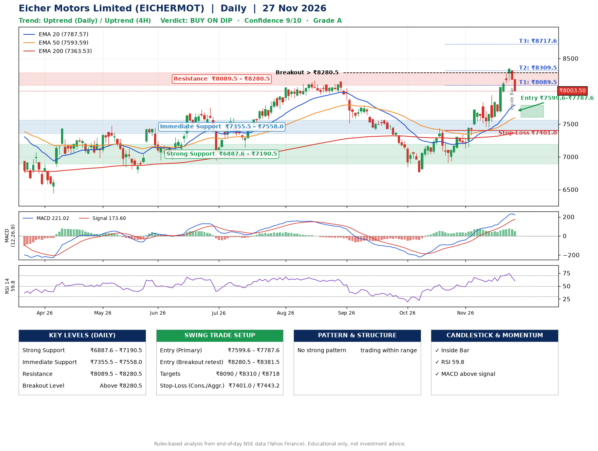

📌 **Eicher Motors Limited (EICHERMOT) – Multi-Timeframe Technical Analysis (Daily + 4H Combined)**
_Data up to 27 Nov 2026 · Close ₹8003.50_

**📍 Daily Timeframe Trend**
- Trend: **Uptrend** (price above rising EMAs)
- Recent swing highs: ₹8165.0, ₹8140.0, ₹7438.5 · swing lows: ₹6767.5, ₹6911.0, ₹7451.5
- EMAs: EMA20 ₹7787.6, EMA50 ₹7593.6, EMA200 ₹7363.5; bullish stack (EMA20 > EMA50 > EMA200); price above EMA20, EMA50, EMA200
- MACD 221.02 above signal 173.60 (above zero); histogram falling
- RSI(14) 59.8; no divergence on the last two swings

**📍 4-Hour Timeframe Trend**
- Structure: **Uptrend** (higher highs and higher lows)
- Pullback/support area: recent 4H swing lows ₹7131.0, ₹7455.5; EMA20 ₹7985.5
- EMA20/50: bullish stack (EMA20 > EMA50); price above EMA20, EMA50
- MACD 167.41 below signal 180.82 (above zero), fresh bearish crossover; histogram falling
- RSI(14) 54.8; no divergence

**📍 Pattern Detection (Both Timeframes)**
- No strong pattern detected. Trading within range.

**📍 Candlestick Patterns (last 3 daily candles)**
- **Inside Bar** – 26 Nov: compression inside the prior range ₹8163.5–₹8360.0

**📍 Price Action Key Levels (Daily Structure)**

| Zone | Price Level (₹) | Context |
|------|-----------------|---------|
| Strong Support | ₹6887.6 – ₹7190.5 | Cluster of earlier swing lows (demand) |
| Immediate Support | ₹7355.5 – ₹7558.0 | Nearest swing-low / wick area |
| Resistance | ₹8089.5 – ₹8280.5 | Nearest swing-high supply |
| Breakout Level | Above ₹8280.5 | Swing continuation trigger (52-week high ₹8360.0) |

**📍 Swing Trade Setup**

🟢 **Entry Zone**
- Primary: ₹7599.6 – ₹7787.6 (daily support / EMA20 area; enter on a bullish 4H candle)
- Alternate: ₹8280.5 – ₹8381.5 (breakout retest)

🎯 **Profit Targets**
- T1: ₹8089.5
- T2: ₹8309.5
- T3: ₹8717.6

🛑 **Stop-Loss**
- Conservative: below daily swing low (₹7401.0)
- Aggressive: below 4H structure (₹7443.2)
- Risk per share ≈ ₹292.6; reward:risk to T1 ≈ 1.4
- Time to T1: about 15 trading days (it rose this much within 60 trading days 85% of the time in the last 2 years)
- Time to T2: about 19 trading days (it rose this much within 60 trading days 73% of the time in the last 2 years)

**📌 Strategy Notes**
- Higher timeframe: daily trend is uptrend; only take longs while price holds above ₹6887.6.
- Entry timing: wait for a bullish 4H candle (engulfing/hammer) inside ₹7599.6 – ₹7787.6 rather than buying mid-range.
- EMA stacking: bullish stack (EMA20 > EMA50 > EMA200); price above EMA20, EMA50, EMA200.
- Breakout rule: a daily close above ₹8280.5 with volume above its 20-day average (≈624,158) opens T2/T3.
- Momentum: RSI 60 – room to run; no divergence on the last two swings.
- Exit discipline: move the stop to entry once T1 is hit; book partial profits at each target.

**STEP 2 — Marked Up Chart**

**✅ Trade Validation Checklist**
- Trend + momentum aligned: Yes · Price at entry zone: No
- Stop defined (₹7401.0) · Reward:risk ≥ 1.5 to T1: No

## 📌 Final Verdict

Recommendation: **🟡 BUY ON DIP**

Confidence: **9/10**

Trade Quality: **A**

Reason:
• Daily uptrend (price above rising EMAs)
• EMAs stacked bullishly

Next Action:
• Wait for a pullback to ₹7599.6–₹7787.6, or a breakout above ₹8280.5

_Rules-based analysis from end-of-day data. Educational only, not investment advice. Never place orders without your own confirmation._