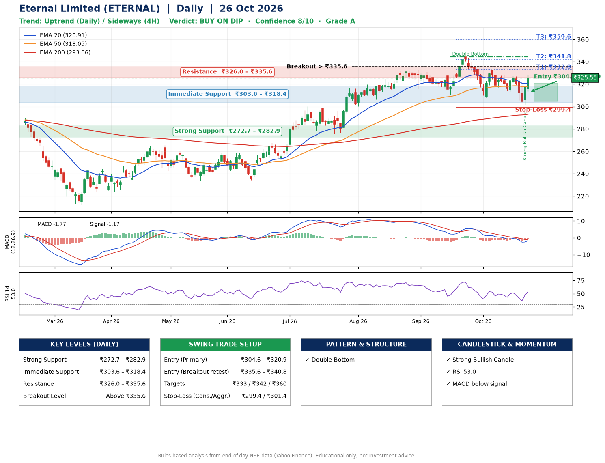

📌 **Eternal Limited (ETERNAL) – Multi-Timeframe Technical Analysis (Daily + 4H Combined)**
_Data up to 26 Oct 2026 · Close ₹325.55_

**📍 Daily Timeframe Trend**
- Trend: **Uptrend** (price above rising EMAs)
- Recent swing highs: ₹319.7, ₹333.0, ₹344.4 · swing lows: ₹315.8, ₹310.8, ₹308.1
- EMAs: EMA20 ₹320.9, EMA50 ₹318.1, EMA200 ₹293.1; bullish stack (EMA20 > EMA50 > EMA200); price above EMA20, EMA50, EMA200
- MACD -1.77 below signal -1.17 (below zero); histogram rising
- RSI(14) 53.0; no divergence on the last two swings

**📍 4-Hour Timeframe Trend**
- Structure: **Sideways** (mixed swing structure)
- Pullback/support area: recent 4H swing lows ₹313.6, ₹302.0; EMA20 ₹318.9
- EMA20/50: bearish stack (EMA20 < EMA50); price above EMA20, EMA50
- MACD -1.27 above signal -2.27 (below zero), fresh bullish crossover; histogram rising
- RSI(14) 56.1; Hidden bearish divergence

**📍 Pattern Detection (Both Timeframes)**
- Daily: **Double Bottom** – bottoms near ₹310.8/₹308.1, neckline ₹344.4, forming

**📍 Candlestick Patterns (last 3 daily candles)**
- **Strong Bullish Candle** – 23 Oct: wide-range green candle, buyers in control

**📍 Price Action Key Levels (Daily Structure)**

| Zone | Price Level (₹) | Context |
|------|-----------------|---------|
| Strong Support | ₹272.7 – ₹282.9 | Cluster of earlier swing lows (demand) |
| Immediate Support | ₹303.6 – ₹318.4 | Nearest swing-low / wick area |
| Resistance | ₹326.0 – ₹335.6 | Nearest swing-high supply |
| Breakout Level | Above ₹335.6 | Swing continuation trigger (52-week high ₹344.4) |

**📍 Swing Trade Setup**

🟢 **Entry Zone**
- Primary: ₹304.6 – ₹320.9 (daily support / EMA20 area; enter on a bullish 4H candle)
- Alternate: ₹335.6 – ₹340.8 (breakout retest)

🎯 **Profit Targets**
- T1: ₹332.8
- T2: ₹341.8
- T3: ₹359.6

🛑 **Stop-Loss**
- Conservative: below daily swing low (₹299.4)
- Aggressive: below 4H structure (₹301.4)
- Risk per share ≈ ₹13.4; reward:risk to T1 ≈ 1.5

**📌 Strategy Notes**
- Higher timeframe: daily trend is uptrend; only take longs while price holds above ₹272.7.
- Entry timing: wait for a bullish 4H candle (engulfing/hammer) inside ₹304.6 – ₹320.9 rather than buying mid-range.
- EMA stacking: bullish stack (EMA20 > EMA50 > EMA200); price above EMA20, EMA50, EMA200.
- Breakout rule: a daily close above ₹335.6 with volume above its 20-day average (≈27,710,684) opens T2/T3.
- Momentum: RSI 53 – room to run; no divergence on the last two swings.
- Exit discipline: move the stop to entry once T1 is hit; book partial profits at each target.

**STEP 2 — Marked Up Chart**

**✅ Trade Validation Checklist**
- Trend + momentum aligned: No · Price at entry zone: No
- Stop defined (₹299.4) · Reward:risk ≥ 1.5 to T1: No

## 📌 Final Verdict

Recommendation: **🟡 BUY ON DIP**

Confidence: **8/10**

Trade Quality: **A**

Reason:
• Daily uptrend (price above rising EMAs)
• EMAs stacked bullishly

Next Action:
• Wait for a pullback to ₹304.6–₹320.9, or a breakout above ₹335.6

_Rules-based analysis from end-of-day data. Educational only, not investment advice. Never place orders without your own confirmation._