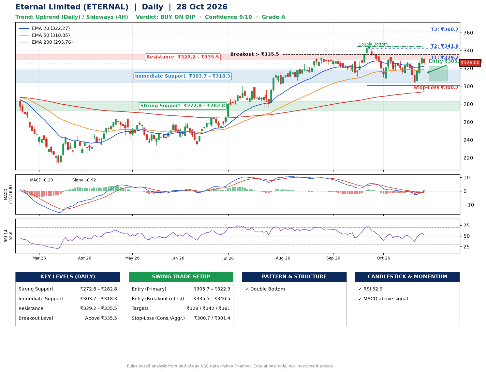

📌 **Eternal Limited (ETERNAL) – Multi-Timeframe Technical Analysis (Daily + 4H Combined)**
_Data up to 28 Oct 2026 · Close ₹326.00_

**📍 Daily Timeframe Trend**
- Trend: **Uptrend** (price above rising EMAs)
- Recent swing highs: ₹319.7, ₹333.0, ₹344.4 · swing lows: ₹315.8, ₹310.8, ₹308.1
- EMAs: EMA20 ₹322.3, EMA50 ₹318.9, EMA200 ₹293.8; bullish stack (EMA20 > EMA50 > EMA200); price above EMA20, EMA50, EMA200
- MACD -0.29 above signal -0.92 (below zero), fresh bullish crossover; histogram rising
- RSI(14) 52.6; no divergence on the last two swings

**📍 4-Hour Timeframe Trend**
- Structure: **Sideways** (mixed swing structure)
- Pullback/support area: recent 4H swing lows ₹313.6, ₹302.0; EMA20 ₹322.0
- EMA20/50: bearish stack (EMA20 < EMA50); price above EMA20, EMA50
- MACD 1.30 above signal -0.50 (above zero); histogram falling
- RSI(14) 54.5; Hidden bearish divergence

**📍 Pattern Detection (Both Timeframes)**
- Daily: **Double Bottom** – bottoms near ₹310.8/₹308.1, neckline ₹344.4, forming

**📍 Candlestick Patterns (last 3 daily candles)**
- No notable candlestick signal in the last 3 sessions.

**📍 Price Action Key Levels (Daily Structure)**

| Zone | Price Level (₹) | Context |
|------|-----------------|---------|
| Strong Support | ₹272.8 – ₹282.8 | Cluster of earlier swing lows (demand) |
| Immediate Support | ₹303.7 – ₹318.3 | Nearest swing-low / wick area |
| Resistance | ₹329.2 – ₹335.5 | Nearest swing-high supply |
| Breakout Level | Above ₹335.5 | Swing continuation trigger (52-week high ₹344.4) |

**📍 Swing Trade Setup**

🟢 **Entry Zone**
- Primary: ₹305.7 – ₹322.3 (daily support / EMA20 area; enter on a bullish 4H candle)
- Alternate: ₹335.5 – ₹340.5 (breakout retest)

🎯 **Profit Targets**
- T1: ₹329.2
- T2: ₹341.9
- T3: ₹360.7

🛑 **Stop-Loss**
- Conservative: below daily swing low (₹300.7)
- Aggressive: below 4H structure (₹301.4)
- Risk per share ≈ ₹13.3; reward:risk to T1 ≈ 1.1

**📌 Strategy Notes**
- Higher timeframe: daily trend is uptrend; only take longs while price holds above ₹272.8.
- Entry timing: wait for a bullish 4H candle (engulfing/hammer) inside ₹305.7 – ₹322.3 rather than buying mid-range.
- EMA stacking: bullish stack (EMA20 > EMA50 > EMA200); price above EMA20, EMA50, EMA200.
- Breakout rule: a daily close above ₹335.5 with volume above its 20-day average (≈28,021,254) opens T2/T3.
- Momentum: RSI 53 – room to run; no divergence on the last two swings.
- Exit discipline: move the stop to entry once T1 is hit; book partial profits at each target.

**STEP 2 — Marked Up Chart**

**✅ Trade Validation Checklist**
- Trend + momentum aligned: Yes · Price at entry zone: No
- Stop defined (₹300.7) · Reward:risk ≥ 1.5 to T1: No

## 📌 Final Verdict

Recommendation: **🟡 BUY ON DIP**

Confidence: **9/10**

Trade Quality: **A**

Reason:
• Daily uptrend (price above rising EMAs)
• EMAs stacked bullishly

Next Action:
• Wait for a pullback to ₹305.7–₹322.3, or a breakout above ₹335.5

_Rules-based analysis from end-of-day data. Educational only, not investment advice. Never place orders without your own confirmation._