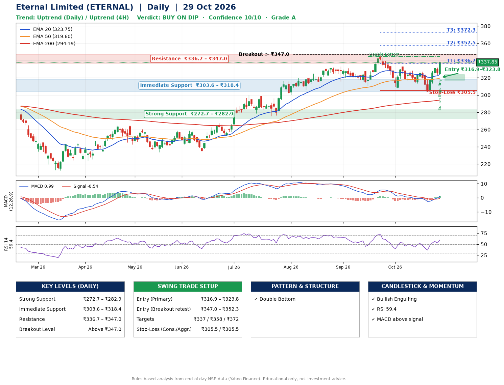

📌 **Eternal Limited (ETERNAL) – Multi-Timeframe Technical Analysis (Daily + 4H Combined)**
_Data up to 29 Oct 2026 · Close ₹337.85_

**📍 Daily Timeframe Trend**
- Trend: **Uptrend** (price above rising EMAs)
- Recent swing highs: ₹319.7, ₹333.0, ₹344.4 · swing lows: ₹315.8, ₹310.8, ₹308.1
- EMAs: EMA20 ₹323.8, EMA50 ₹319.6, EMA200 ₹294.2; bullish stack (EMA20 > EMA50 > EMA200); price above EMA20, EMA50, EMA200
- MACD 0.99 above signal -0.54 (above zero), fresh bullish crossover; histogram rising
- RSI(14) 59.4; no divergence on the last two swings

**📍 4-Hour Timeframe Trend**
- Structure: **Uptrend** (price above rising EMAs)
- Pullback/support area: recent 4H swing lows ₹313.6, ₹302.0; EMA20 ₹324.8
- EMA20/50: bullish stack (EMA20 > EMA50); price above EMA20, EMA50
- MACD 3.15 above signal 0.68 (above zero); histogram rising
- RSI(14) 64.0; Hidden bearish divergence

**📍 Pattern Detection (Both Timeframes)**
- Daily: **Double Bottom** – bottoms near ₹310.8/₹308.1, neckline ₹344.4, forming

**📍 Candlestick Patterns (last 3 daily candles)**
- **Bullish Engulfing** – 29 Oct: buyers fully reversed the prior red candle

**📍 Price Action Key Levels (Daily Structure)**

| Zone | Price Level (₹) | Context |
|------|-----------------|---------|
| Strong Support | ₹272.7 – ₹282.9 | Cluster of earlier swing lows (demand) |
| Immediate Support | ₹303.6 – ₹318.4 | Nearest swing-low / wick area |
| Resistance | ₹336.7 – ₹347.0 | Nearest swing-high supply |
| Breakout Level | Above ₹347.0 | Swing continuation trigger (52-week high ₹344.4) |

**📍 Swing Trade Setup**

🟢 **Entry Zone**
- Primary: ₹316.9 – ₹323.8 (daily support / EMA20 area; enter on a bullish 4H candle)
- Alternate: ₹347.0 – ₹352.3 (breakout retest)

🎯 **Profit Targets**
- T1: ₹336.7
- T2: ₹357.5
- T3: ₹372.3

🛑 **Stop-Loss**
- Conservative: below daily swing low (₹305.5)
- Aggressive: below 4H structure (₹305.5)
- Risk per share ≈ ₹14.8; reward:risk to T1 ≈ 1.1

**📌 Strategy Notes**
- Higher timeframe: daily trend is uptrend; only take longs while price holds above ₹272.7.
- Entry timing: wait for a bullish 4H candle (engulfing/hammer) inside ₹316.9 – ₹323.8 rather than buying mid-range.
- EMA stacking: bullish stack (EMA20 > EMA50 > EMA200); price above EMA20, EMA50, EMA200.
- Breakout rule: a daily close above ₹347.0 with volume above its 20-day average (≈27,963,794) opens T2/T3.
- Momentum: RSI 59 – room to run; no divergence on the last two swings.
- Exit discipline: move the stop to entry once T1 is hit; book partial profits at each target.

**STEP 2 — Marked Up Chart**

**✅ Trade Validation Checklist**
- Trend + momentum aligned: Yes · Price at entry zone: No
- Stop defined (₹305.5) · Reward:risk ≥ 1.5 to T1: No

## 📌 Final Verdict

Recommendation: **🟡 BUY ON DIP**

Confidence: **10/10**

Trade Quality: **A**

Reason:
• Daily uptrend (price above rising EMAs)
• EMAs stacked bullishly

Next Action:
• Wait for a pullback to ₹316.9–₹323.8

_Rules-based analysis from end-of-day data. Educational only, not investment advice. Never place orders without your own confirmation._