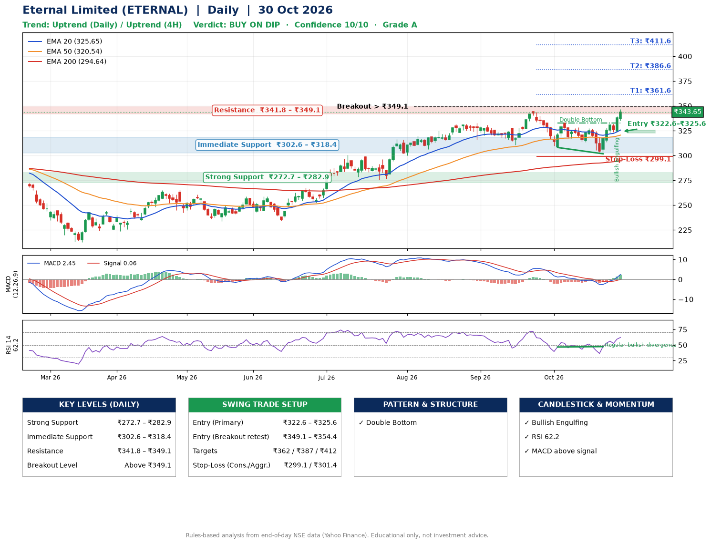

📌 **Eternal Limited (ETERNAL) – Multi-Timeframe Technical Analysis (Daily + 4H Combined)**
_Data up to 30 Oct 2026 · Close ₹343.65_

**📍 Daily Timeframe Trend**
- Trend: **Uptrend** (price above rising EMAs)
- Recent swing highs: ₹319.7, ₹333.0, ₹344.4 · swing lows: ₹310.8, ₹308.1, ₹301.8
- EMAs: EMA20 ₹325.6, EMA50 ₹320.5, EMA200 ₹294.6; bullish stack (EMA20 > EMA50 > EMA200); price above EMA20, EMA50, EMA200
- MACD 2.45 above signal 0.06 (above zero), fresh bullish crossover; histogram rising
- RSI(14) 62.2; Regular bullish divergence

**📍 4-Hour Timeframe Trend**
- Structure: **Uptrend** (price above rising EMAs)
- Pullback/support area: recent 4H swing lows ₹313.6, ₹302.0; EMA20 ₹328.5
- EMA20/50: bullish stack (EMA20 > EMA50); price above EMA20, EMA50
- MACD 5.17 above signal 2.17 (above zero); histogram falling
- RSI(14) 66.1; Hidden bearish divergence

**📍 Pattern Detection (Both Timeframes)**
- Daily: **Double Bottom** – bottoms near ₹308.1/₹301.8, neckline ₹332.7, confirmed (closed above neckline)

**📍 Candlestick Patterns (last 3 daily candles)**
- **Bullish Engulfing** – 29 Oct: buyers fully reversed the prior red candle

**📍 Price Action Key Levels (Daily Structure)**

| Zone | Price Level (₹) | Context |
|------|-----------------|---------|
| Strong Support | ₹272.7 – ₹282.9 | Cluster of earlier swing lows (demand) |
| Immediate Support | ₹302.6 – ₹318.4 | Nearest swing-low / wick area |
| Resistance | ₹341.8 – ₹349.1 | Nearest swing-high supply |
| Breakout Level | Above ₹349.1 | Swing continuation trigger (52-week high ₹346.5) |

**📍 Swing Trade Setup**

🟢 **Entry Zone**
- Primary: ₹322.6 – ₹325.6 (daily support / EMA20 area; enter on a bullish 4H candle)
- Alternate: ₹349.1 – ₹354.4 (breakout retest)

🎯 **Profit Targets**
- T1: ₹361.6
- T2: ₹386.6
- T3: ₹411.6

🛑 **Stop-Loss**
- Conservative: below daily swing low (₹299.1)
- Aggressive: below 4H structure (₹301.4)
- Risk per share ≈ ₹25.0; reward:risk to T1 ≈ 1.5

**📌 Strategy Notes**
- Higher timeframe: daily trend is uptrend; only take longs while price holds above ₹272.7.
- Entry timing: wait for a bullish 4H candle (engulfing/hammer) inside ₹322.6 – ₹325.6 rather than buying mid-range.
- EMA stacking: bullish stack (EMA20 > EMA50 > EMA200); price above EMA20, EMA50, EMA200.
- Breakout rule: a daily close above ₹349.1 with volume above its 20-day average (≈28,455,257) opens T2/T3.
- Momentum: RSI 62 – room to run; Regular bullish divergence.
- Exit discipline: move the stop to entry once T1 is hit; book partial profits at each target.

**STEP 2 — Marked Up Chart**

**✅ Trade Validation Checklist**
- Trend + momentum aligned: Yes · Price at entry zone: No
- Stop defined (₹299.1) · Reward:risk ≥ 1.5 to T1: No

## 📌 Final Verdict

Recommendation: **🟡 BUY ON DIP**

Confidence: **10/10**

Trade Quality: **A**

Reason:
• Daily uptrend (price above rising EMAs)
• EMAs stacked bullishly

Next Action:
• Wait for a pullback to ₹322.6–₹325.6

_Rules-based analysis from end-of-day data. Educational only, not investment advice. Never place orders without your own confirmation._