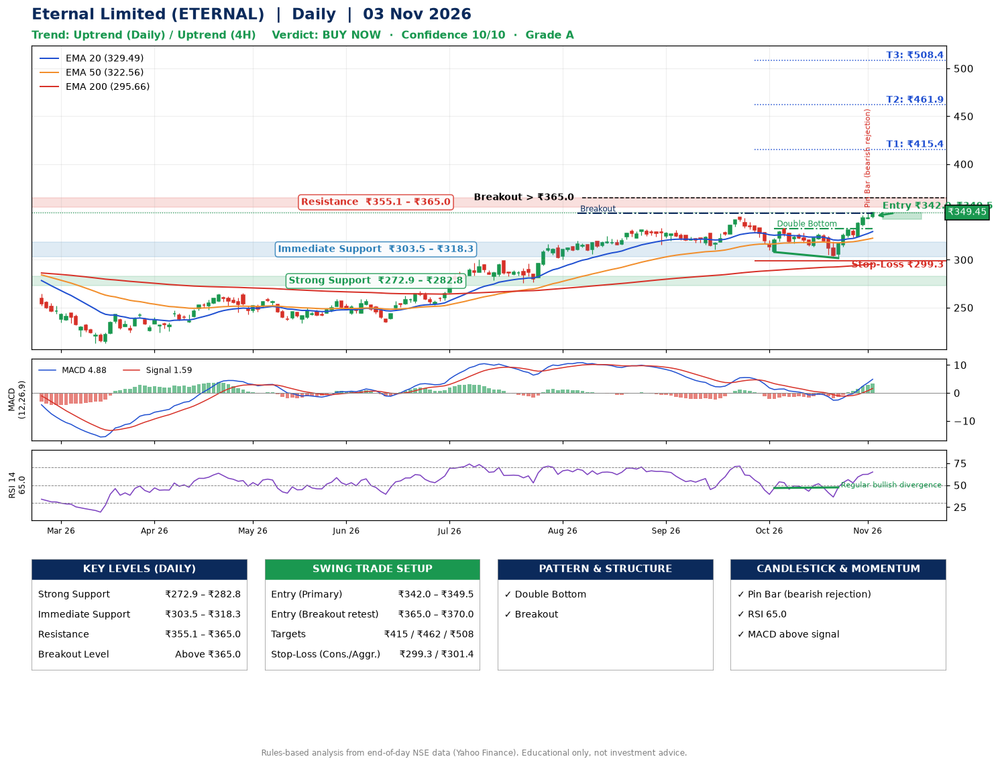

📌 **Eternal Limited (ETERNAL) – Multi-Timeframe Technical Analysis (Daily + 4H Combined)**
_Data up to 03 Nov 2026 · Close ₹349.45_

**📍 Daily Timeframe Trend**
- Trend: **Uptrend** (price above rising EMAs)
- Recent swing highs: ₹319.7, ₹333.0, ₹344.4 · swing lows: ₹310.8, ₹308.1, ₹301.8
- EMAs: EMA20 ₹329.5, EMA50 ₹322.6, EMA200 ₹295.7; bullish stack (EMA20 > EMA50 > EMA200); price above EMA20, EMA50, EMA200
- MACD 4.88 above signal 1.59 (above zero); histogram rising
- RSI(14) 65.0; Regular bullish divergence

**📍 4-Hour Timeframe Trend**
- Structure: **Uptrend** (price above rising EMAs)
- Pullback/support area: recent 4H swing lows ₹313.6, ₹302.0; EMA20 ₹334.6
- EMA20/50: bullish stack (EMA20 > EMA50); price above EMA20, EMA50
- MACD 7.16 above signal 4.77 (above zero); histogram falling
- RSI(14) 69.4; Hidden bearish divergence

**📍 Pattern Detection (Both Timeframes)**
- Daily: **Double Bottom** – bottoms near ₹308.1/₹301.8, neckline ₹332.7, confirmed (closed above neckline)
- Daily: **Breakout** – closed above the 60-session high ₹348.4 (volume not confirming yet)

**📍 Candlestick Patterns (last 3 daily candles)**
- **Pin Bar (bearish rejection)** – 02 Nov: long upper wick shows selling near ₹348.4

**📍 Price Action Key Levels (Daily Structure)**

| Zone | Price Level (₹) | Context |
|------|-----------------|---------|
| Strong Support | ₹272.9 – ₹282.8 | Cluster of earlier swing lows (demand) |
| Immediate Support | ₹303.5 – ₹318.3 | Nearest swing-low / wick area |
| Resistance | ₹355.1 – ₹365.0 | Nearest swing-high supply |
| Breakout Level | Above ₹365.0 | Swing continuation trigger (52-week high ₹350.2) |

**📍 Swing Trade Setup**

🟢 **Entry Zone**
- Primary: ₹342.0 – ₹349.5 (daily support / EMA20 area; enter on a bullish 4H candle)
- Alternate: ₹365.0 – ₹370.0 (breakout retest)

🎯 **Profit Targets**
- T1: ₹415.4
- T2: ₹461.9
- T3: ₹508.4

🛑 **Stop-Loss**
- Conservative: below daily swing low (₹299.3)
- Aggressive: below 4H structure (₹301.4)
- Risk per share ≈ ₹46.5; reward:risk to T1 ≈ 1.5

**📌 Strategy Notes**
- Higher timeframe: daily trend is uptrend; only take longs while price holds above ₹272.9.
- Entry timing: wait for a bullish 4H candle (engulfing/hammer) inside ₹342.0 – ₹349.5 rather than buying mid-range.
- EMA stacking: bullish stack (EMA20 > EMA50 > EMA200); price above EMA20, EMA50, EMA200.
- Breakout rule: a daily close above ₹365.0 with volume above its 20-day average (≈27,401,479) opens T2/T3.
- Momentum: RSI 65 – elevated, prefer dips; Regular bullish divergence.
- Exit discipline: move the stop to entry once T1 is hit; book partial profits at each target.

**STEP 2 — Marked Up Chart**

**✅ Trade Validation Checklist**
- Trend + momentum aligned: Yes · Price at entry zone: Yes
- Stop defined (₹299.3) · Reward:risk ≥ 1.5 to T1: No

## 📌 Final Verdict

Recommendation: **🟢 BUY NOW**

Confidence: **10/10**

Trade Quality: **A**

Reason:
• Daily uptrend (price above rising EMAs)
• EMAs stacked bullishly

Next Action:
• Buy now within the entry zone, with the stop-loss in place

_Rules-based analysis from end-of-day data. Educational only, not investment advice. Never place orders without your own confirmation._