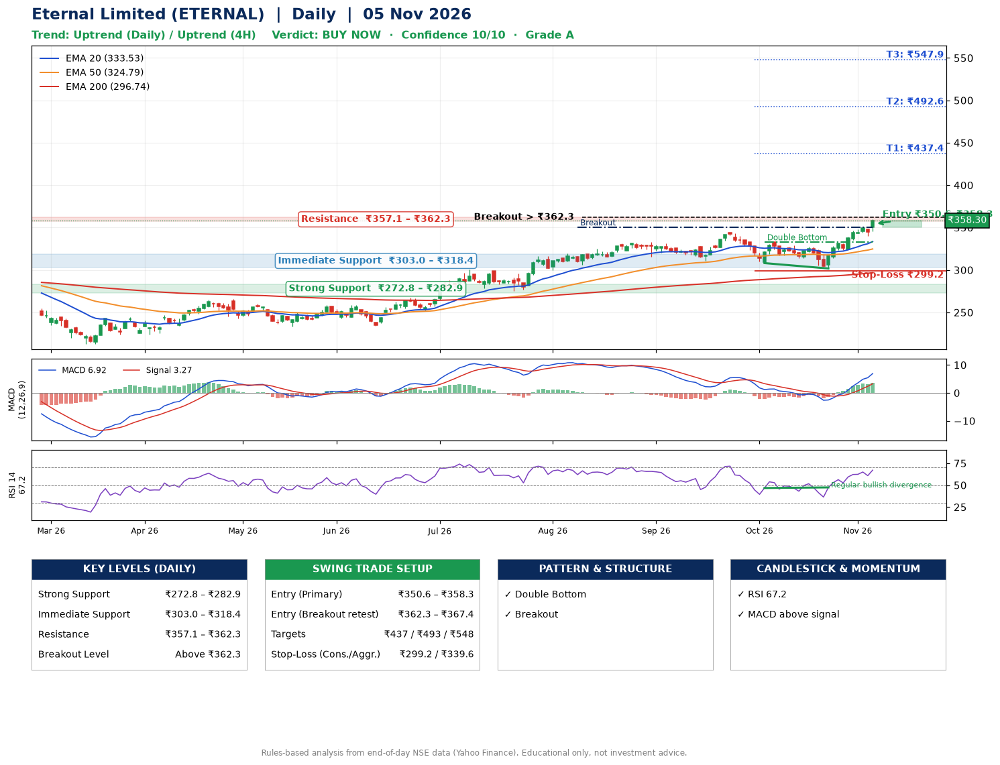

📌 **Eternal Limited (ETERNAL) – Multi-Timeframe Technical Analysis (Daily + 4H Combined)**
_Data up to 05 Nov 2026 · Close ₹358.30_

**📍 Daily Timeframe Trend**
- Trend: **Uptrend** (price above rising EMAs)
- Recent swing highs: ₹319.7, ₹333.0, ₹344.4 · swing lows: ₹310.8, ₹308.1, ₹301.8
- EMAs: EMA20 ₹333.5, EMA50 ₹324.8, EMA200 ₹296.7; bullish stack (EMA20 > EMA50 > EMA200); price above EMA20, EMA50, EMA200
- MACD 6.92 above signal 3.27 (above zero); histogram rising
- RSI(14) 67.2; Regular bullish divergence

**📍 4-Hour Timeframe Trend**
- Structure: **Uptrend** (higher highs and higher lows)
- Pullback/support area: recent 4H swing lows ₹302.0, ₹340.2; EMA20 ₹340.1
- EMA20/50: bullish stack (EMA20 > EMA50); price above EMA20, EMA50
- MACD 8.18 above signal 6.36 (above zero); histogram rising
- RSI(14) 70.6; no divergence

**📍 Pattern Detection (Both Timeframes)**
- Daily: **Double Bottom** – bottoms near ₹308.1/₹301.8, neckline ₹332.7, confirmed (closed above neckline)
- Daily: **Breakout** – closed above the 60-session high ₹350.2 on strong volume

**📍 Candlestick Patterns (last 3 daily candles)**
- No notable candlestick signal in the last 3 sessions.

**📍 Price Action Key Levels (Daily Structure)**

| Zone | Price Level (₹) | Context |
|------|-----------------|---------|
| Strong Support | ₹272.8 – ₹282.9 | Cluster of earlier swing lows (demand) |
| Immediate Support | ₹303.0 – ₹318.4 | Nearest swing-low / wick area |
| Resistance | ₹357.1 – ₹362.3 | Nearest swing-high supply |
| Breakout Level | Above ₹362.3 | Swing continuation trigger (52-week high ₹359.7) |

**📍 Swing Trade Setup**

🟢 **Entry Zone**
- Primary: ₹350.6 – ₹358.3 (daily support / EMA20 area; enter on a bullish 4H candle)
- Alternate: ₹362.3 – ₹367.4 (breakout retest)

🎯 **Profit Targets**
- T1: ₹437.4
- T2: ₹492.6
- T3: ₹547.9

🛑 **Stop-Loss**
- Conservative: below daily swing low (₹299.2)
- Aggressive: below 4H structure (₹339.6)
- Risk per share ≈ ₹55.3; reward:risk to T1 ≈ 1.5

**📌 Strategy Notes**
- Higher timeframe: daily trend is uptrend; only take longs while price holds above ₹272.8.
- Entry timing: wait for a bullish 4H candle (engulfing/hammer) inside ₹350.6 – ₹358.3 rather than buying mid-range.
- EMA stacking: bullish stack (EMA20 > EMA50 > EMA200); price above EMA20, EMA50, EMA200.
- Breakout rule: a daily close above ₹362.3 with volume above its 20-day average (≈27,838,382) opens T2/T3.
- Momentum: RSI 67 – elevated, prefer dips; Regular bullish divergence.
- Exit discipline: move the stop to entry once T1 is hit; book partial profits at each target.

**STEP 2 — Marked Up Chart**

**✅ Trade Validation Checklist**
- Trend + momentum aligned: Yes · Price at entry zone: Yes
- Stop defined (₹299.2) · Reward:risk ≥ 1.5 to T1: Yes

## 📌 Final Verdict

Recommendation: **🟢 BUY NOW**

Confidence: **10/10**

Trade Quality: **A**

Reason:
• Daily uptrend (price above rising EMAs)
• EMAs stacked bullishly

Next Action:
• Buy now within the entry zone, with the stop-loss in place

_Rules-based analysis from end-of-day data. Educational only, not investment advice. Never place orders without your own confirmation._