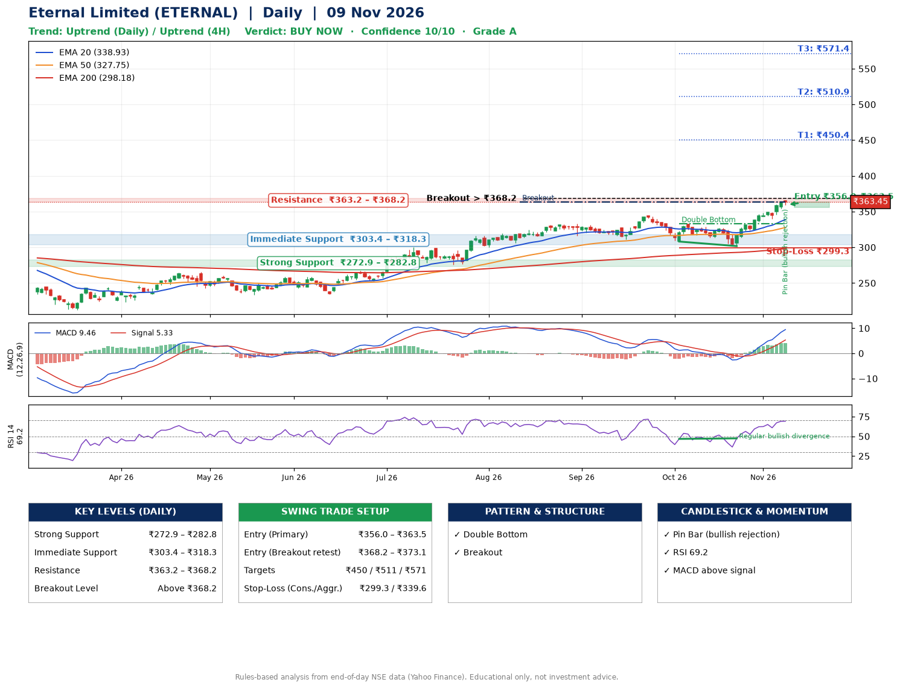

📌 **Eternal Limited (ETERNAL) – Multi-Timeframe Technical Analysis (Daily + 4H Combined)**
_Data up to 09 Nov 2026 · Close ₹363.45_

**📍 Daily Timeframe Trend**
- Trend: **Uptrend** (price above rising EMAs)
- Recent swing highs: ₹319.7, ₹333.0, ₹344.4 · swing lows: ₹310.8, ₹308.1, ₹301.8
- EMAs: EMA20 ₹338.9, EMA50 ₹327.7, EMA200 ₹298.2; bullish stack (EMA20 > EMA50 > EMA200); price above EMA20, EMA50, EMA200
- MACD 9.46 above signal 5.33 (above zero); histogram rising
- RSI(14) 69.2; Regular bullish divergence

**📍 4-Hour Timeframe Trend**
- Structure: **Uptrend** (higher highs and higher lows)
- Pullback/support area: recent 4H swing lows ₹302.0, ₹340.2; EMA20 ₹347.2
- EMA20/50: bullish stack (EMA20 > EMA50); price above EMA20, EMA50
- MACD 9.63 above signal 8.10 (above zero); histogram falling
- RSI(14) 71.1; no divergence

**📍 Pattern Detection (Both Timeframes)**
- Daily: **Double Bottom** – bottoms near ₹308.1/₹301.8, neckline ₹332.7, confirmed (closed above neckline)
- Daily: **Breakout** – closed above the 60-session high ₹363.1 (volume not confirming yet)

**📍 Candlestick Patterns (last 3 daily candles)**
- **Pin Bar (bullish rejection)** – 09 Nov: long lower wick shows dip-buying near ₹359.1

**📍 Price Action Key Levels (Daily Structure)**

| Zone | Price Level (₹) | Context |
|------|-----------------|---------|
| Strong Support | ₹272.9 – ₹282.8 | Cluster of earlier swing lows (demand) |
| Immediate Support | ₹303.4 – ₹318.3 | Nearest swing-low / wick area |
| Resistance | ₹363.2 – ₹368.2 | Nearest swing-high supply |
| Breakout Level | Above ₹368.2 | Swing continuation trigger (52-week high ₹365.7) |

**📍 Swing Trade Setup**

🟢 **Entry Zone**
- Primary: ₹356.0 – ₹363.5 (daily support / EMA20 area; enter on a bullish 4H candle)
- Alternate: ₹368.2 – ₹373.1 (breakout retest)

🎯 **Profit Targets**
- T1: ₹450.4
- T2: ₹510.9
- T3: ₹571.4

🛑 **Stop-Loss**
- Conservative: below daily swing low (₹299.3)
- Aggressive: below 4H structure (₹339.6)
- Risk per share ≈ ₹60.5; reward:risk to T1 ≈ 1.5

**📌 Strategy Notes**
- Higher timeframe: daily trend is uptrend; only take longs while price holds above ₹272.9.
- Entry timing: wait for a bullish 4H candle (engulfing/hammer) inside ₹356.0 – ₹363.5 rather than buying mid-range.
- EMA stacking: bullish stack (EMA20 > EMA50 > EMA200); price above EMA20, EMA50, EMA200.
- Breakout rule: a daily close above ₹368.2 with volume above its 20-day average (≈28,180,286) opens T2/T3.
- Momentum: RSI 69 – elevated, prefer dips; Regular bullish divergence.
- Exit discipline: move the stop to entry once T1 is hit; book partial profits at each target.

**STEP 2 — Marked Up Chart**

**✅ Trade Validation Checklist**
- Trend + momentum aligned: Yes · Price at entry zone: Yes
- Stop defined (₹299.3) · Reward:risk ≥ 1.5 to T1: No

## 📌 Final Verdict

Recommendation: **🟢 BUY NOW**

Confidence: **10/10**

Trade Quality: **A**

Reason:
• Daily uptrend (price above rising EMAs)
• EMAs stacked bullishly

Next Action:
• Buy now within the entry zone, with the stop-loss in place

_Rules-based analysis from end-of-day data. Educational only, not investment advice. Never place orders without your own confirmation._