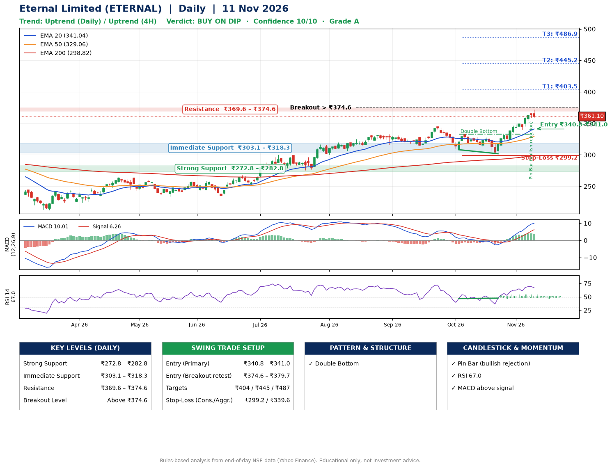

📌 **Eternal Limited (ETERNAL) – Multi-Timeframe Technical Analysis (Daily + 4H Combined)**
_Data up to 11 Nov 2026 · Close ₹361.10_

**📍 Daily Timeframe Trend**
- Trend: **Uptrend** (price above rising EMAs)
- Recent swing highs: ₹319.7, ₹333.0, ₹344.4 · swing lows: ₹310.8, ₹308.1, ₹301.8
- EMAs: EMA20 ₹341.0, EMA50 ₹329.1, EMA200 ₹298.8; bullish stack (EMA20 > EMA50 > EMA200); price above EMA20, EMA50, EMA200
- MACD 10.01 above signal 6.26 (above zero); histogram falling
- RSI(14) 67.0; Regular bullish divergence

**📍 4-Hour Timeframe Trend**
- Structure: **Uptrend** (higher highs and higher lows)
- Pullback/support area: recent 4H swing lows ₹302.0, ₹340.2; EMA20 ₹352.6
- EMA20/50: bullish stack (EMA20 > EMA50); price above EMA20, EMA50
- MACD 9.39 above signal 8.95 (above zero); histogram falling
- RSI(14) 68.6; no divergence

**📍 Pattern Detection (Both Timeframes)**
- Daily: **Double Bottom** – bottoms near ₹308.1/₹301.8, neckline ₹332.7, confirmed (closed above neckline)
- 4H: **Bull Flag** – 18% pole then a tight 5% flag; trigger above ₹372.0

**📍 Candlestick Patterns (last 3 daily candles)**
- **Pin Bar (bullish rejection)** – 09 Nov: long lower wick shows dip-buying near ₹359.1

**📍 Price Action Key Levels (Daily Structure)**

| Zone | Price Level (₹) | Context |
|------|-----------------|---------|
| Strong Support | ₹272.8 – ₹282.8 | Cluster of earlier swing lows (demand) |
| Immediate Support | ₹303.1 – ₹318.3 | Nearest swing-low / wick area |
| Resistance | ₹369.6 – ₹374.6 | Nearest swing-high supply |
| Breakout Level | Above ₹374.6 | Swing continuation trigger (52-week high ₹372.1) |

**📍 Swing Trade Setup**

🟢 **Entry Zone**
- Primary: ₹340.8 – ₹341.0 (daily support / EMA20 area; enter on a bullish 4H candle)
- Alternate: ₹374.6 – ₹379.7 (breakout retest)

🎯 **Profit Targets**
- T1: ₹403.5
- T2: ₹445.2
- T3: ₹486.9

🛑 **Stop-Loss**
- Conservative: below daily swing low (₹299.2)
- Aggressive: below 4H structure (₹339.6)
- Risk per share ≈ ₹41.7; reward:risk to T1 ≈ 1.5
- Time to T1: about 36 trading days (it rose this much within 60 trading days 40% of the time in the last 2 years)
- Time to T2: about 50 trading days (it rose this much within 60 trading days 17% of the time in the last 2 years)

**📌 Strategy Notes**
- Higher timeframe: daily trend is uptrend; only take longs while price holds above ₹272.8.
- Entry timing: wait for a bullish 4H candle (engulfing/hammer) inside ₹340.8 – ₹341.0 rather than buying mid-range.
- EMA stacking: bullish stack (EMA20 > EMA50 > EMA200); price above EMA20, EMA50, EMA200.
- Breakout rule: a daily close above ₹374.6 with volume above its 20-day average (≈28,981,900) opens T2/T3.
- Momentum: RSI 67 – elevated, prefer dips; Regular bullish divergence.
- Exit discipline: move the stop to entry once T1 is hit; book partial profits at each target.

**STEP 2 — Marked Up Chart**

**✅ Trade Validation Checklist**
- Trend + momentum aligned: Yes · Price at entry zone: No
- Stop defined (₹299.2) · Reward:risk ≥ 1.5 to T1: No

## 📌 Final Verdict

Recommendation: **🟡 BUY ON DIP**

Confidence: **10/10**

Trade Quality: **A**

Reason:
• Daily uptrend (price above rising EMAs)
• EMAs stacked bullishly

Next Action:
• Wait for a pullback to ₹340.8–₹341.0

_Rules-based analysis from end-of-day data. Educational only, not investment advice. Never place orders without your own confirmation._