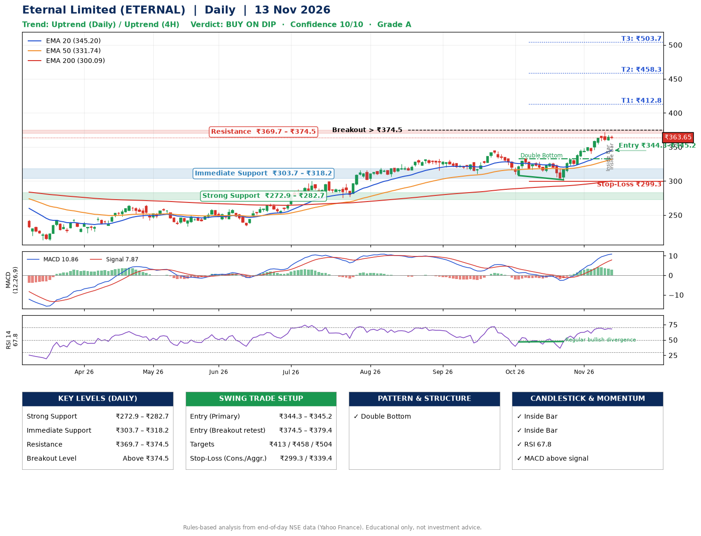

📌 **Eternal Limited (ETERNAL) – Multi-Timeframe Technical Analysis (Daily + 4H Combined)**
_Data up to 13 Nov 2026 · Close ₹363.65_

**📍 Daily Timeframe Trend**
- Trend: **Uptrend** (price above rising EMAs)
- Recent swing highs: ₹319.7, ₹333.0, ₹344.4 · swing lows: ₹310.8, ₹308.1, ₹301.8
- EMAs: EMA20 ₹345.2, EMA50 ₹331.7, EMA200 ₹300.1; bullish stack (EMA20 > EMA50 > EMA200); price above EMA20, EMA50, EMA200
- MACD 10.86 above signal 7.87 (above zero); histogram falling
- RSI(14) 67.8; Regular bullish divergence

**📍 4-Hour Timeframe Trend**
- Structure: **Uptrend** (higher highs and higher lows)
- Pullback/support area: recent 4H swing lows ₹340.2, ₹358.9; EMA20 ₹354.7
- EMA20/50: bullish stack (EMA20 > EMA50); price above EMA20, EMA50
- MACD 8.81 below signal 8.95 (above zero), fresh bearish crossover; histogram falling
- RSI(14) 67.5; no divergence

**📍 Pattern Detection (Both Timeframes)**
- Daily: **Double Bottom** – bottoms near ₹308.1/₹301.8, neckline ₹332.7, confirmed (closed above neckline)
- 4H: **Bull Flag** – 16% pole then a tight 4% flag; trigger above ₹372.0

**📍 Candlestick Patterns (last 3 daily candles)**
- **Inside Bar** – 12 Nov: compression inside the prior range ₹358.9–₹372.1
- **Inside Bar** – 13 Nov: compression inside the prior range ₹359.4–₹367.8

**📍 Price Action Key Levels (Daily Structure)**

| Zone | Price Level (₹) | Context |
|------|-----------------|---------|
| Strong Support | ₹272.9 – ₹282.7 | Cluster of earlier swing lows (demand) |
| Immediate Support | ₹303.7 – ₹318.2 | Nearest swing-low / wick area |
| Resistance | ₹369.7 – ₹374.5 | Nearest swing-high supply |
| Breakout Level | Above ₹374.5 | Swing continuation trigger (52-week high ₹372.1) |

**📍 Swing Trade Setup**

🟢 **Entry Zone**
- Primary: ₹344.3 – ₹345.2 (daily support / EMA20 area; enter on a bullish 4H candle)
- Alternate: ₹374.5 – ₹379.4 (breakout retest)

🎯 **Profit Targets**
- T1: ₹412.8
- T2: ₹458.3
- T3: ₹503.7

🛑 **Stop-Loss**
- Conservative: below daily swing low (₹299.3)
- Aggressive: below 4H structure (₹339.4)
- Risk per share ≈ ₹45.4; reward:risk to T1 ≈ 1.5
- Time to T1: about 36 trading days (it rose this much within 60 trading days 37% of the time in the last 2 years)
- Time to T2: about 53 trading days (it rose this much within 60 trading days 9% of the time in the last 2 years)

**📌 Strategy Notes**
- Higher timeframe: daily trend is uptrend; only take longs while price holds above ₹272.9.
- Entry timing: wait for a bullish 4H candle (engulfing/hammer) inside ₹344.3 – ₹345.2 rather than buying mid-range.
- EMA stacking: bullish stack (EMA20 > EMA50 > EMA200); price above EMA20, EMA50, EMA200.
- Breakout rule: a daily close above ₹374.5 with volume above its 20-day average (≈28,496,458) opens T2/T3.
- Momentum: RSI 68 – elevated, prefer dips; Regular bullish divergence.
- Exit discipline: move the stop to entry once T1 is hit; book partial profits at each target.

**STEP 2 — Marked Up Chart**

**✅ Trade Validation Checklist**
- Trend + momentum aligned: Yes · Price at entry zone: No
- Stop defined (₹299.3) · Reward:risk ≥ 1.5 to T1: No

## 📌 Final Verdict

Recommendation: **🟡 BUY ON DIP**

Confidence: **10/10**

Trade Quality: **A**

Reason:
• Daily uptrend (price above rising EMAs)
• EMAs stacked bullishly

Next Action:
• Wait for a pullback to ₹344.3–₹345.2

_Rules-based analysis from end-of-day data. Educational only, not investment advice. Never place orders without your own confirmation._