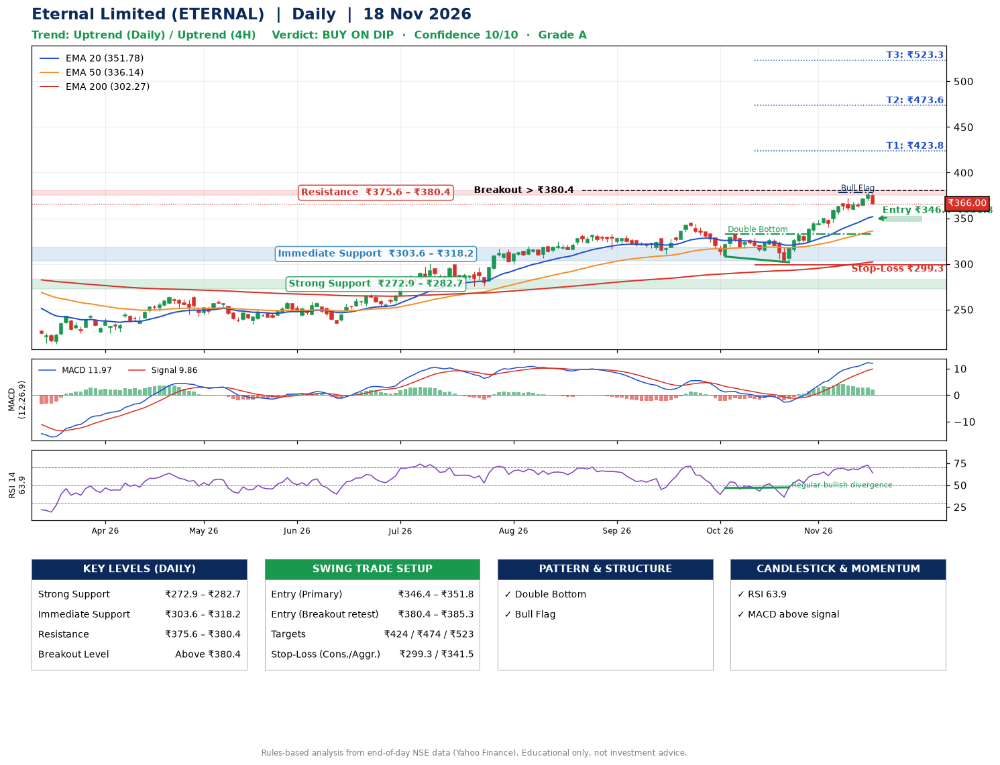

📌 **Eternal Limited (ETERNAL) – Multi-Timeframe Technical Analysis (Daily + 4H Combined)**
_Data up to 18 Nov 2026 · Close ₹366.00_

**📍 Daily Timeframe Trend**
- Trend: **Uptrend** (price above rising EMAs)
- Recent swing highs: ₹319.7, ₹333.0, ₹344.4 · swing lows: ₹310.8, ₹308.1, ₹301.8
- EMAs: EMA20 ₹351.8, EMA50 ₹336.1, EMA200 ₹302.3; bullish stack (EMA20 > EMA50 > EMA200); price above EMA20, EMA50, EMA200
- MACD 11.97 above signal 9.86 (above zero); histogram falling
- RSI(14) 63.9; Regular bullish divergence

**📍 4-Hour Timeframe Trend**
- Structure: **Uptrend** (higher highs and higher lows)
- Pullback/support area: recent 4H swing lows ₹340.2, ₹358.9; EMA20 ₹361.7
- EMA20/50: bullish stack (EMA20 > EMA50); price above EMA20, EMA50
- MACD 8.12 below signal 8.86 (above zero), fresh bearish crossover; histogram falling
- RSI(14) 60.5; no divergence

**📍 Pattern Detection (Both Timeframes)**
- Daily: **Double Bottom** – bottoms near ₹308.1/₹301.8, neckline ₹332.7, confirmed (closed above neckline)
- Daily: **Bull Flag** – 18% pole then a tight 7% flag; trigger above ₹378.0

**📍 Candlestick Patterns (last 3 daily candles)**
- No notable candlestick signal in the last 3 sessions.

**📍 Price Action Key Levels (Daily Structure)**

| Zone | Price Level (₹) | Context |
|------|-----------------|---------|
| Strong Support | ₹272.9 – ₹282.7 | Cluster of earlier swing lows (demand) |
| Immediate Support | ₹303.6 – ₹318.2 | Nearest swing-low / wick area |
| Resistance | ₹375.6 – ₹380.4 | Nearest swing-high supply |
| Breakout Level | Above ₹380.4 | Swing continuation trigger (52-week high ₹378.0) |

**📍 Swing Trade Setup**

🟢 **Entry Zone**
- Primary: ₹346.4 – ₹351.8 (daily support / EMA20 area; enter on a bullish 4H candle)
- Alternate: ₹380.4 – ₹385.3 (breakout retest)

🎯 **Profit Targets**
- T1: ₹423.8
- T2: ₹473.6
- T3: ₹523.3

🛑 **Stop-Loss**
- Conservative: below daily swing low (₹299.3)
- Aggressive: below 4H structure (₹341.5)
- Risk per share ≈ ₹49.8; reward:risk to T1 ≈ 1.5
- Time to T1: about 37 trading days (it rose this much within 60 trading days 33% of the time in the last 2 years)
- Time to T2: about 50 trading days (it rose this much within 60 trading days 4% of the time in the last 2 years)

**📌 Strategy Notes**
- Higher timeframe: daily trend is uptrend; only take longs while price holds above ₹272.9.
- Entry timing: wait for a bullish 4H candle (engulfing/hammer) inside ₹346.4 – ₹351.8 rather than buying mid-range.
- EMA stacking: bullish stack (EMA20 > EMA50 > EMA200); price above EMA20, EMA50, EMA200.
- Breakout rule: a daily close above ₹380.4 with volume above its 20-day average (≈29,272,710) opens T2/T3.
- Momentum: RSI 64 – room to run; Regular bullish divergence.
- Exit discipline: move the stop to entry once T1 is hit; book partial profits at each target.

**STEP 2 — Marked Up Chart**

**✅ Trade Validation Checklist**
- Trend + momentum aligned: Yes · Price at entry zone: No
- Stop defined (₹299.3) · Reward:risk ≥ 1.5 to T1: Yes

## 📌 Final Verdict

Recommendation: **🟡 BUY ON DIP**

Confidence: **10/10**

Trade Quality: **A**

Reason:
• Daily uptrend (price above rising EMAs)
• EMAs stacked bullishly

Next Action:
• Wait for a pullback to ₹346.4–₹351.8

_Rules-based analysis from end-of-day data. Educational only, not investment advice. Never place orders without your own confirmation._