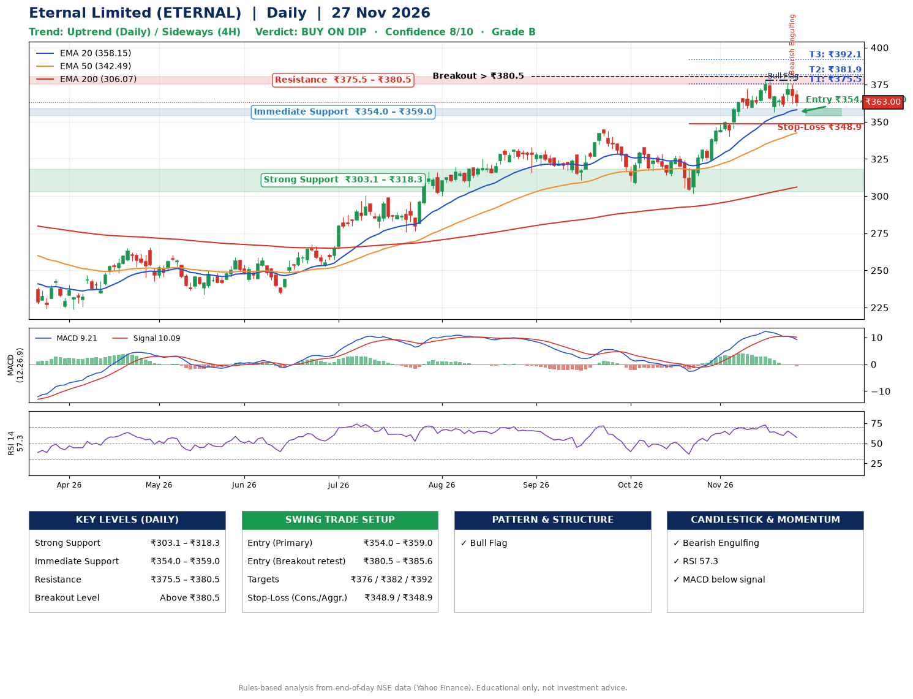

📌 **Eternal Limited (ETERNAL) – Multi-Timeframe Technical Analysis (Daily + 4H Combined)**
_Data up to 27 Nov 2026 · Close ₹363.00_

**📍 Daily Timeframe Trend**
- Trend: **Uptrend** (higher highs and higher lows)
- Recent swing highs: ₹333.0, ₹344.4, ₹378.0 · swing lows: ₹308.1, ₹301.8, ₹356.5
- EMAs: EMA20 ₹358.1, EMA50 ₹342.5, EMA200 ₹306.1; bullish stack (EMA20 > EMA50 > EMA200); price above EMA20, EMA50, EMA200
- MACD 9.21 below signal 10.09 (above zero), fresh bullish crossover; histogram falling
- RSI(14) 57.3; no divergence on the last two swings

**📍 4-Hour Timeframe Trend**
- Structure: **Sideways** (mixed swing structure)
- Pullback/support area: recent 4H swing lows ₹358.9, ₹356.5; EMA20 ₹364.5
- EMA20/50: bullish stack (EMA20 > EMA50); price above EMA50
- MACD 3.02 below signal 4.48 (above zero); histogram falling
- RSI(14) 50.8; no divergence

**📍 Pattern Detection (Both Timeframes)**
- Daily: **Bull Flag** – 17% pole then a tight 6% flag; trigger above ₹378.0
- 4H: **Double Top** – tops near ₹377.9/₹376.5, neckline ₹356.5, forming
- 4H: **Double Bottom** – bottoms near ₹358.9/₹356.5, neckline ₹377.9, forming

**📍 Candlestick Patterns (last 3 daily candles)**
- **Bearish Engulfing** – 26 Nov: sellers fully reversed the prior green candle

**📍 Price Action Key Levels (Daily Structure)**

| Zone | Price Level (₹) | Context |
|------|-----------------|---------|
| Strong Support | ₹303.1 – ₹318.3 | Cluster of earlier swing lows (demand) |
| Immediate Support | ₹354.0 – ₹359.0 | Nearest swing-low / wick area |
| Resistance | ₹375.5 – ₹380.5 | Nearest swing-high supply |
| Breakout Level | Above ₹380.5 | Swing continuation trigger (52-week high ₹378.0) |

**📍 Swing Trade Setup**

🟢 **Entry Zone**
- Primary: ₹354.0 – ₹359.0 (daily support / EMA20 area; enter on a bullish 4H candle)
- Alternate: ₹380.5 – ₹385.6 (breakout retest)

🎯 **Profit Targets**
- T1: ₹375.5
- T2: ₹381.9
- T3: ₹392.1

🛑 **Stop-Loss**
- Conservative: below daily swing low (₹348.9)
- Aggressive: below 4H structure (₹348.9)
- Risk per share ≈ ₹10.2; reward:risk to T1 ≈ 1.9
- Time to T1: about 8 trading days (it rose this much within 60 trading days 82% of the time in the last 2 years)
- Time to T2: about 14 trading days (it rose this much within 60 trading days 77% of the time in the last 2 years)

**📌 Strategy Notes**
- Higher timeframe: daily trend is uptrend; only take longs while price holds above ₹303.1.
- Entry timing: wait for a bullish 4H candle (engulfing/hammer) inside ₹354.0 – ₹359.0 rather than buying mid-range.
- EMA stacking: bullish stack (EMA20 > EMA50 > EMA200); price above EMA20, EMA50, EMA200.
- Breakout rule: a daily close above ₹380.5 with volume above its 20-day average (≈23,408,437) opens T2/T3.
- Momentum: RSI 57 – room to run; no divergence on the last two swings.
- Exit discipline: move the stop to entry once T1 is hit; book partial profits at each target.

**STEP 2 — Marked Up Chart**

**✅ Trade Validation Checklist**
- Trend + momentum aligned: No · Price at entry zone: No
- Stop defined (₹348.9) · Reward:risk ≥ 1.5 to T1: Yes

## 📌 Final Verdict

Recommendation: **🟡 BUY ON DIP**

Confidence: **8/10**

Trade Quality: **B**

Reason:
• Daily uptrend (higher highs and higher lows)
• EMAs stacked bullishly

Next Action:
• Wait for a pullback to ₹354.0–₹359.0, or a breakout above ₹380.5

_Rules-based analysis from end-of-day data. Educational only, not investment advice. Never place orders without your own confirmation._