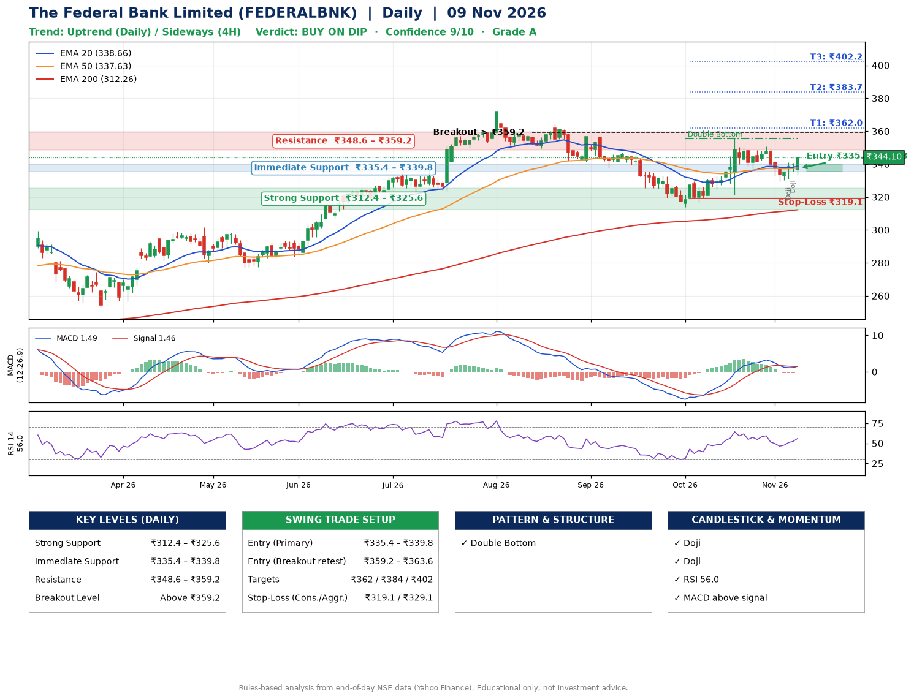

📌 **The Federal Bank Limited (FEDERALBNK) – Multi-Timeframe Technical Analysis (Daily + 4H Combined)**
_Data up to 09 Nov 2026 · Close ₹344.10_

**📍 Daily Timeframe Trend**
- Trend: **Uptrend** (price above rising EMAs)
- Recent swing highs: ₹357.0, ₹355.5, ₹350.9 · swing lows: ₹337.6, ₹313.8, ₹321.4
- EMAs: EMA20 ₹338.7, EMA50 ₹337.6, EMA200 ₹312.3; bullish stack (EMA20 > EMA50 > EMA200); price above EMA20, EMA50, EMA200
- MACD 1.49 above signal 1.46 (above zero), fresh bullish crossover; histogram rising
- RSI(14) 56.0; no divergence on the last two swings

**📍 4-Hour Timeframe Trend**
- Structure: **Sideways** (mixed swing structure)
- Pullback/support area: recent 4H swing lows ₹337.5, ₹329.6; EMA20 ₹339.3
- EMA20/50: bullish stack (EMA20 > EMA50); price above EMA20, EMA50
- MACD 0.37 above signal 0.23 (above zero), fresh bullish crossover; histogram rising
- RSI(14) 58.1; no divergence

**📍 Pattern Detection (Both Timeframes)**
- Daily: **Double Bottom** – bottoms near ₹313.8/₹321.4, neckline ₹355.5, forming
- 4H: **Double Top** – tops near ₹350.6/₹340.8, neckline ₹329.6, forming
- 4H: **Double Bottom** – bottoms near ₹337.5/₹329.6, neckline ₹350.6, forming
- 4H: **Symmetrical Triangle** – converging swing highs and lows over the last ~60 sessions

**📍 Candlestick Patterns (last 3 daily candles)**
- **Doji** – 05 Nov: indecision; wait for the next candle to confirm direction
- **Doji** – 06 Nov: indecision; wait for the next candle to confirm direction

**📍 Price Action Key Levels (Daily Structure)**

| Zone | Price Level (₹) | Context |
|------|-----------------|---------|
| Strong Support | ₹312.4 – ₹325.6 | Cluster of earlier swing lows (demand) |
| Immediate Support | ₹335.4 – ₹339.8 | Nearest swing-low / wick area |
| Resistance | ₹348.6 – ₹359.2 | Nearest swing-high supply |
| Breakout Level | Above ₹359.2 | Swing continuation trigger (52-week high ₹371.7) |

**📍 Swing Trade Setup**

🟢 **Entry Zone**
- Primary: ₹335.4 – ₹339.8 (daily support / EMA20 area; enter on a bullish 4H candle)
- Alternate: ₹359.2 – ₹363.6 (breakout retest)

🎯 **Profit Targets**
- T1: ₹362.0
- T2: ₹383.7
- T3: ₹402.2

🛑 **Stop-Loss**
- Conservative: below daily swing low (₹319.1)
- Aggressive: below 4H structure (₹329.1)
- Risk per share ≈ ₹18.5; reward:risk to T1 ≈ 1.3

**📌 Strategy Notes**
- Higher timeframe: daily trend is uptrend; only take longs while price holds above ₹312.4.
- Entry timing: wait for a bullish 4H candle (engulfing/hammer) inside ₹335.4 – ₹339.8 rather than buying mid-range.
- EMA stacking: bullish stack (EMA20 > EMA50 > EMA200); price above EMA20, EMA50, EMA200.
- Breakout rule: a daily close above ₹359.2 with volume above its 20-day average (≈8,435,292) opens T2/T3.
- Momentum: RSI 56 – room to run; no divergence on the last two swings.
- Exit discipline: move the stop to entry once T1 is hit; book partial profits at each target.

**STEP 2 — Marked Up Chart**

**✅ Trade Validation Checklist**
- Trend + momentum aligned: Yes · Price at entry zone: No
- Stop defined (₹319.1) · Reward:risk ≥ 1.5 to T1: No

## 📌 Final Verdict

Recommendation: **🟡 BUY ON DIP**

Confidence: **9/10**

Trade Quality: **A**

Reason:
• Daily uptrend (price above rising EMAs)
• EMAs stacked bullishly

Next Action:
• Wait for a pullback to ₹335.4–₹339.8, or a breakout above ₹359.2

_Rules-based analysis from end-of-day data. Educational only, not investment advice. Never place orders without your own confirmation._