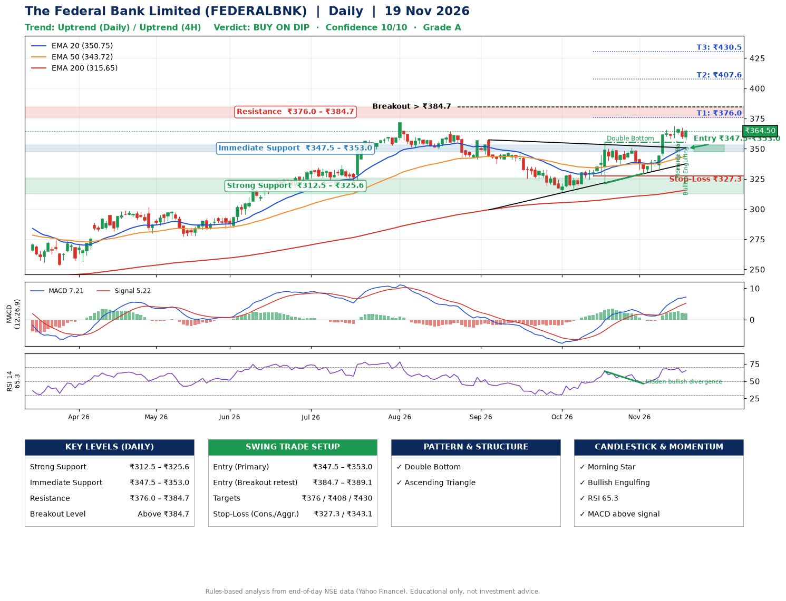

📌 **The Federal Bank Limited (FEDERALBNK) – Multi-Timeframe Technical Analysis (Daily + 4H Combined)**
_Data up to 19 Nov 2026 · Close ₹364.50_

**📍 Daily Timeframe Trend**
- Trend: **Uptrend** (price above rising EMAs)
- Recent swing highs: ₹357.0, ₹355.5, ₹350.9 · swing lows: ₹313.8, ₹321.4, ₹329.5
- EMAs: EMA20 ₹350.8, EMA50 ₹343.7, EMA200 ₹315.7; bullish stack (EMA20 > EMA50 > EMA200); price above EMA20, EMA50, EMA200
- MACD 7.21 above signal 5.22 (above zero); histogram falling
- RSI(14) 65.3; Hidden bullish divergence

**📍 4-Hour Timeframe Trend**
- Structure: **Uptrend** (price above rising EMAs)
- Pullback/support area: recent 4H swing lows ₹333.2, ₹358.2; EMA20 ₹356.9
- EMA20/50: bullish stack (EMA20 > EMA50); price above EMA20, EMA50
- MACD 6.04 above signal 5.86 (above zero); histogram falling
- RSI(14) 65.7; no divergence

**📍 Pattern Detection (Both Timeframes)**
- Daily: **Double Bottom** – bottoms near ₹321.4/₹329.5, neckline ₹355.5, confirmed (closed above neckline)
- Daily: **Ascending Triangle** – converging swing highs and lows over the last ~60 sessions

**📍 Candlestick Patterns (last 3 daily candles)**
- **Inside Bar** – 17 Nov: compression inside the prior range ₹359.0–₹368.9
- **Morning Star** – 17 Nov: three-candle bullish reversal
- **Bullish Engulfing** – 19 Nov: buyers fully reversed the prior red candle

**📍 Price Action Key Levels (Daily Structure)**

| Zone | Price Level (₹) | Context |
|------|-----------------|---------|
| Strong Support | ₹312.5 – ₹325.6 | Cluster of earlier swing lows (demand) |
| Immediate Support | ₹347.5 – ₹353.0 | Nearest swing-low / wick area |
| Resistance | ₹376.0 – ₹384.7 | Nearest swing-high supply |
| Breakout Level | Above ₹384.7 | Swing continuation trigger (52-week high ₹371.7) |

**📍 Swing Trade Setup**

🟢 **Entry Zone**
- Primary: ₹347.5 – ₹353.0 (daily support / EMA20 area; enter on a bullish 4H candle)
- Alternate: ₹384.7 – ₹389.1 (breakout retest)

🎯 **Profit Targets**
- T1: ₹376.0
- T2: ₹407.6
- T3: ₹430.5

🛑 **Stop-Loss**
- Conservative: below daily swing low (₹327.3)
- Aggressive: below 4H structure (₹343.1)
- Risk per share ≈ ₹22.9; reward:risk to T1 ≈ 1.1
- Time to T1: about 19 trading days (it rose this much within 60 trading days 70% of the time in the last 2 years)
- Time to T2: about 43 trading days (it rose this much within 60 trading days 39% of the time in the last 2 years)

**📌 Strategy Notes**
- Higher timeframe: daily trend is uptrend; only take longs while price holds above ₹312.5.
- Entry timing: wait for a bullish 4H candle (engulfing/hammer) inside ₹347.5 – ₹353.0 rather than buying mid-range.
- EMA stacking: bullish stack (EMA20 > EMA50 > EMA200); price above EMA20, EMA50, EMA200.
- Breakout rule: a daily close above ₹384.7 with volume above its 20-day average (≈6,684,167) opens T2/T3.
- Momentum: RSI 65 – elevated, prefer dips; Hidden bullish divergence.
- Exit discipline: move the stop to entry once T1 is hit; book partial profits at each target.

**STEP 2 — Marked Up Chart**

**✅ Trade Validation Checklist**
- Trend + momentum aligned: Yes · Price at entry zone: No
- Stop defined (₹327.3) · Reward:risk ≥ 1.5 to T1: No

## 📌 Final Verdict

Recommendation: **🟡 BUY ON DIP**

Confidence: **10/10**

Trade Quality: **A**

Reason:
• Daily uptrend (price above rising EMAs)
• EMAs stacked bullishly

Next Action:
• Wait for a pullback to ₹347.5–₹353.0

_Rules-based analysis from end-of-day data. Educational only, not investment advice. Never place orders without your own confirmation._