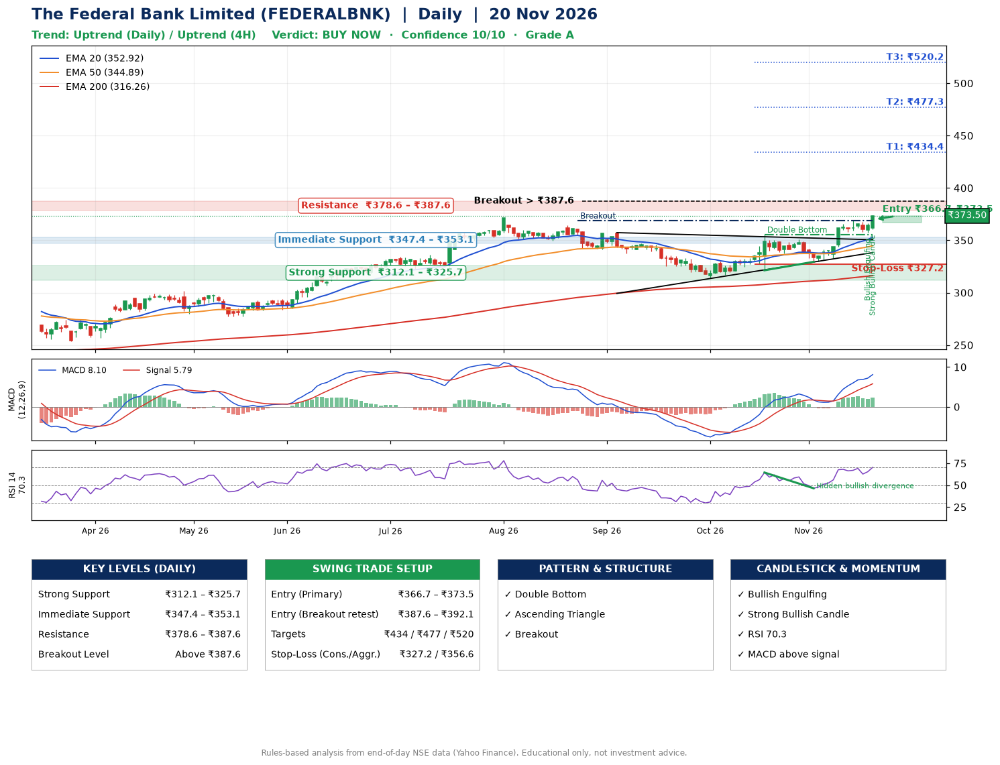

📌 **The Federal Bank Limited (FEDERALBNK) – Multi-Timeframe Technical Analysis (Daily + 4H Combined)**
_Data up to 20 Nov 2026 · Close ₹373.50_

**📍 Daily Timeframe Trend**
- Trend: **Uptrend** (price above rising EMAs)
- Recent swing highs: ₹357.0, ₹355.5, ₹350.9 · swing lows: ₹313.8, ₹321.4, ₹329.5
- EMAs: EMA20 ₹352.9, EMA50 ₹344.9, EMA200 ₹316.3; bullish stack (EMA20 > EMA50 > EMA200); price above EMA20, EMA50, EMA200
- MACD 8.10 above signal 5.79 (above zero); histogram rising
- RSI(14) 70.3; Hidden bullish divergence

**📍 4-Hour Timeframe Trend**
- Structure: **Uptrend** (price above rising EMAs)
- Pullback/support area: recent 4H swing lows ₹358.2, ₹357.1; EMA20 ₹359.8
- EMA20/50: bullish stack (EMA20 > EMA50); price above EMA20, EMA50
- MACD 6.94 above signal 6.19 (above zero); histogram rising
- RSI(14) 73.1; no divergence

**📍 Pattern Detection (Both Timeframes)**
- Daily: **Double Bottom** – bottoms near ₹321.4/₹329.5, neckline ₹355.5, confirmed (closed above neckline)
- Daily: **Ascending Triangle** – converging swing highs and lows over the last ~60 sessions
- Daily: **Breakout** – closed above the 60-session high ₹368.9 (volume not confirming yet)

**📍 Candlestick Patterns (last 3 daily candles)**
- **Bullish Engulfing** – 19 Nov: buyers fully reversed the prior red candle
- **Strong Bullish Candle** – 20 Nov: wide-range green candle, buyers in control

**📍 Price Action Key Levels (Daily Structure)**

| Zone | Price Level (₹) | Context |
|------|-----------------|---------|
| Strong Support | ₹312.1 – ₹325.7 | Cluster of earlier swing lows (demand) |
| Immediate Support | ₹347.4 – ₹353.1 | Nearest swing-low / wick area |
| Resistance | ₹378.6 – ₹387.6 | Nearest swing-high supply |
| Breakout Level | Above ₹387.6 | Swing continuation trigger (52-week high ₹374.0) |

**📍 Swing Trade Setup**

🟢 **Entry Zone**
- Primary: ₹366.7 – ₹373.5 (daily support / EMA20 area; enter on a bullish 4H candle)
- Alternate: ₹387.6 – ₹392.1 (breakout retest)

🎯 **Profit Targets**
- T1: ₹434.4
- T2: ₹477.3
- T3: ₹520.2

🛑 **Stop-Loss**
- Conservative: below daily swing low (₹327.2)
- Aggressive: below 4H structure (₹356.6)
- Risk per share ≈ ₹42.9; reward:risk to T1 ≈ 1.5
- Time to T1: about 43 trading days (it rose this much within 60 trading days 36% of the time in the last 2 years)
- Time to T2: about 48 trading days (it rose this much within 60 trading days 9% of the time in the last 2 years)

**📌 Strategy Notes**
- Higher timeframe: daily trend is uptrend; only take longs while price holds above ₹312.1.
- Entry timing: wait for a bullish 4H candle (engulfing/hammer) inside ₹366.7 – ₹373.5 rather than buying mid-range.
- EMA stacking: bullish stack (EMA20 > EMA50 > EMA200); price above EMA20, EMA50, EMA200.
- Breakout rule: a daily close above ₹387.6 with volume above its 20-day average (≈6,686,241) opens T2/T3.
- Momentum: RSI 70 – elevated, prefer dips; Hidden bullish divergence.
- Exit discipline: move the stop to entry once T1 is hit; book partial profits at each target.

**STEP 2 — Marked Up Chart**

**✅ Trade Validation Checklist**
- Trend + momentum aligned: Yes · Price at entry zone: Yes
- Stop defined (₹327.2) · Reward:risk ≥ 1.5 to T1: No

## 📌 Final Verdict

Recommendation: **🟢 BUY NOW**

Confidence: **10/10**

Trade Quality: **A**

Reason:
• Daily uptrend (price above rising EMAs)
• EMAs stacked bullishly

Next Action:
• Buy now within the entry zone, with the stop-loss in place

_Rules-based analysis from end-of-day data. Educational only, not investment advice. Never place orders without your own confirmation._