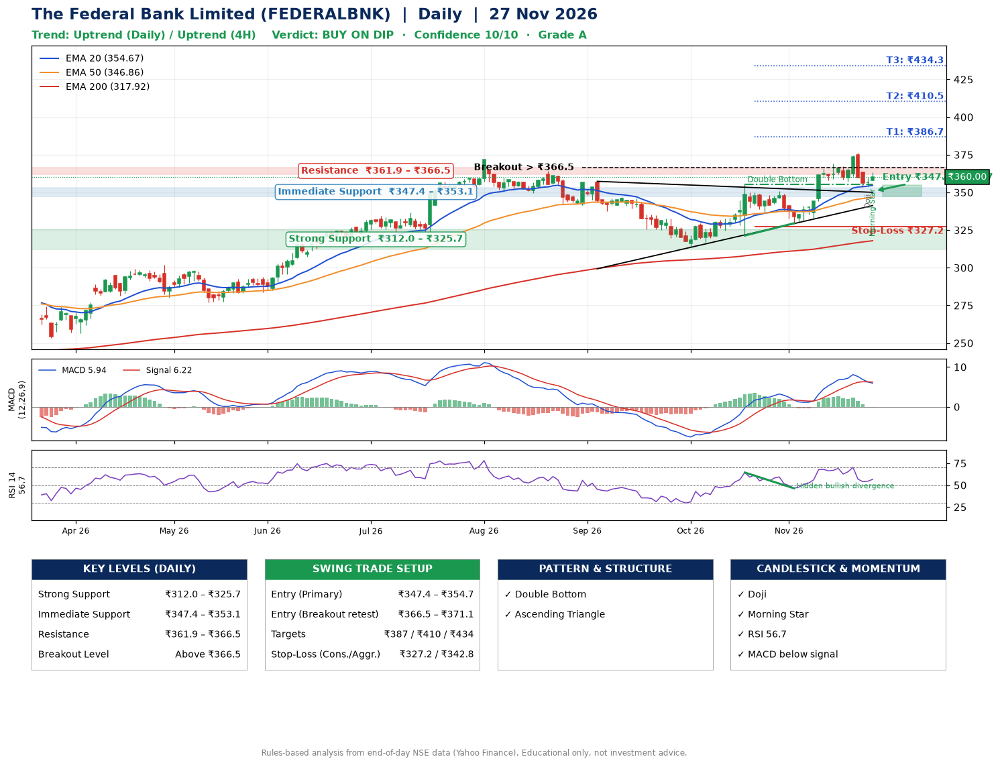

📌 **The Federal Bank Limited (FEDERALBNK) – Multi-Timeframe Technical Analysis (Daily + 4H Combined)**
_Data up to 27 Nov 2026 · Close ₹360.00_

**📍 Daily Timeframe Trend**
- Trend: **Uptrend** (price above rising EMAs)
- Recent swing highs: ₹357.0, ₹355.5, ₹350.9 · swing lows: ₹313.8, ₹321.4, ₹329.5
- EMAs: EMA20 ₹354.7, EMA50 ₹346.9, EMA200 ₹317.9; bullish stack (EMA20 > EMA50 > EMA200); price above EMA20, EMA50, EMA200
- MACD 5.94 below signal 6.22 (above zero), fresh bearish crossover; histogram falling
- RSI(14) 56.7; Hidden bullish divergence

**📍 4-Hour Timeframe Trend**
- Structure: **Uptrend** (price above rising EMAs)
- Pullback/support area: recent 4H swing lows ₹357.1, ₹353.8; EMA20 ₹359.3
- EMA20/50: bullish stack (EMA20 > EMA50); price above EMA20, EMA50
- MACD 2.18 below signal 3.75 (above zero); histogram rising
- RSI(14) 53.2; Regular bearish divergence

**📍 Pattern Detection (Both Timeframes)**
- Daily: **Double Bottom** – bottoms near ₹321.4/₹329.5, neckline ₹355.5, confirmed (closed above neckline)
- Daily: **Ascending Triangle** – converging swing highs and lows over the last ~60 sessions

**📍 Candlestick Patterns (last 3 daily candles)**
- **Doji** – 26 Nov: indecision; wait for the next candle to confirm direction
- **Morning Star** – 27 Nov: three-candle bullish reversal

**📍 Price Action Key Levels (Daily Structure)**

| Zone | Price Level (₹) | Context |
|------|-----------------|---------|
| Strong Support | ₹312.0 – ₹325.7 | Cluster of earlier swing lows (demand) |
| Immediate Support | ₹347.4 – ₹353.1 | Nearest swing-low / wick area |
| Resistance | ₹361.9 – ₹366.5 | Nearest swing-high supply |
| Breakout Level | Above ₹366.5 | Swing continuation trigger (52-week high ₹376.2) |

**📍 Swing Trade Setup**

🟢 **Entry Zone**
- Primary: ₹347.4 – ₹354.7 (daily support / EMA20 area; enter on a bullish 4H candle)
- Alternate: ₹366.5 – ₹371.1 (breakout retest)

🎯 **Profit Targets**
- T1: ₹386.7
- T2: ₹410.5
- T3: ₹434.3

🛑 **Stop-Loss**
- Conservative: below daily swing low (₹327.2)
- Aggressive: below 4H structure (₹342.8)
- Risk per share ≈ ₹23.8; reward:risk to T1 ≈ 1.5
- Time to T1: about 23 trading days (it rose this much within 60 trading days 62% of the time in the last 2 years)
- Time to T2: about 43 trading days (it rose this much within 60 trading days 37% of the time in the last 2 years)

**📌 Strategy Notes**
- Higher timeframe: daily trend is uptrend; only take longs while price holds above ₹312.0.
- Entry timing: wait for a bullish 4H candle (engulfing/hammer) inside ₹347.4 – ₹354.7 rather than buying mid-range.
- EMA stacking: bullish stack (EMA20 > EMA50 > EMA200); price above EMA20, EMA50, EMA200.
- Breakout rule: a daily close above ₹366.5 with volume above its 20-day average (≈6,764,333) opens T2/T3.
- Momentum: RSI 57 – room to run; Hidden bullish divergence.
- Exit discipline: move the stop to entry once T1 is hit; book partial profits at each target.

**STEP 2 — Marked Up Chart**

**✅ Trade Validation Checklist**
- Trend + momentum aligned: No · Price at entry zone: No
- Stop defined (₹327.2) · Reward:risk ≥ 1.5 to T1: No

## 📌 Final Verdict

Recommendation: **🟡 BUY ON DIP**

Confidence: **10/10**

Trade Quality: **A**

Reason:
• Daily uptrend (price above rising EMAs)
• EMAs stacked bullishly

Next Action:
• Wait for a pullback to ₹347.4–₹354.7, or a breakout above ₹366.5

_Rules-based analysis from end-of-day data. Educational only, not investment advice. Never place orders without your own confirmation._