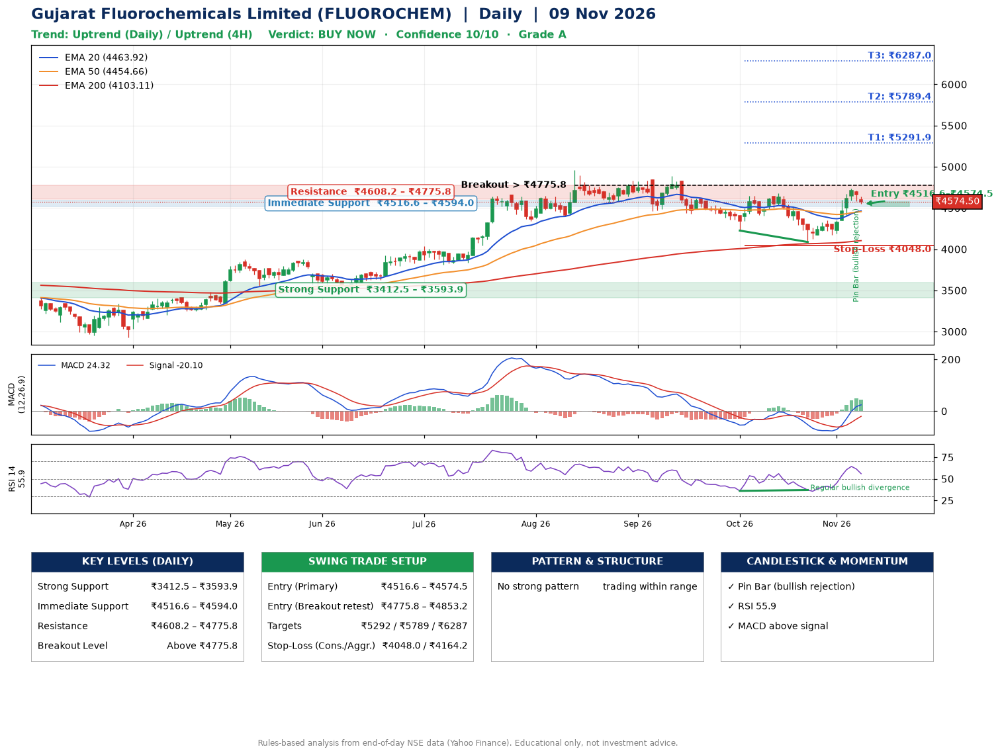

📌 **Gujarat Fluorochemicals Limited (FLUOROCHEM) – Multi-Timeframe Technical Analysis (Daily + 4H Combined)**
_Data up to 09 Nov 2026 · Close ₹4574.50_

**📍 Daily Timeframe Trend**
- Trend: **Uptrend** (price above rising EMAs)
- Recent swing highs: ₹4887.9, ₹4646.9, ₹4680.0 · swing lows: ₹4461.1, ₹4225.4, ₹4086.7
- EMAs: EMA20 ₹4463.9, EMA50 ₹4454.7, EMA200 ₹4103.1; bullish stack (EMA20 > EMA50 > EMA200); price above EMA20, EMA50, EMA200
- MACD 24.32 above signal -20.10 (above zero), fresh bullish crossover; histogram falling
- RSI(14) 55.9; Regular bullish divergence

**📍 4-Hour Timeframe Trend**
- Structure: **Uptrend** (higher highs and higher lows)
- Pullback/support area: recent 4H swing lows ₹4086.7, ₹4175.0; EMA20 ₹4497.8
- EMA20/50: bullish stack (EMA20 > EMA50); price above EMA20, EMA50
- MACD 75.09 above signal 50.02 (above zero); histogram falling
- RSI(14) 55.4; no divergence

**📍 Pattern Detection (Both Timeframes)**
- 4H: **Double Bottom** – bottoms near ₹4086.7/₹4175.0, neckline ₹4323.9, confirmed (closed above neckline)

**📍 Candlestick Patterns (last 3 daily candles)**
- **Pin Bar (bullish rejection)** – 06 Nov: long lower wick shows dip-buying near ₹4584.8

**📍 Price Action Key Levels (Daily Structure)**

| Zone | Price Level (₹) | Context |
|------|-----------------|---------|
| Strong Support | ₹3412.5 – ₹3593.9 | Cluster of earlier swing lows (demand) |
| Immediate Support | ₹4516.6 – ₹4594.0 | Nearest swing-low / wick area |
| Resistance | ₹4608.2 – ₹4775.8 | Nearest swing-high supply |
| Breakout Level | Above ₹4775.8 | Swing continuation trigger (52-week high ₹4958.9) |

**📍 Swing Trade Setup**

🟢 **Entry Zone**
- Primary: ₹4516.6 – ₹4574.5 (daily support / EMA20 area; enter on a bullish 4H candle)
- Alternate: ₹4775.8 – ₹4853.2 (breakout retest)

🎯 **Profit Targets**
- T1: ₹5291.9
- T2: ₹5789.4
- T3: ₹6287.0

🛑 **Stop-Loss**
- Conservative: below daily swing low (₹4048.0)
- Aggressive: below 4H structure (₹4164.2)
- Risk per share ≈ ₹497.5; reward:risk to T1 ≈ 1.5

**📌 Strategy Notes**
- Higher timeframe: daily trend is uptrend; only take longs while price holds above ₹3412.5.
- Entry timing: wait for a bullish 4H candle (engulfing/hammer) inside ₹4516.6 – ₹4574.5 rather than buying mid-range.
- EMA stacking: bullish stack (EMA20 > EMA50 > EMA200); price above EMA20, EMA50, EMA200.
- Breakout rule: a daily close above ₹4775.8 with volume above its 20-day average (≈97,119) opens T2/T3.
- Momentum: RSI 56 – room to run; Regular bullish divergence.
- Exit discipline: move the stop to entry once T1 is hit; book partial profits at each target.

**STEP 2 — Marked Up Chart**

**✅ Trade Validation Checklist**
- Trend + momentum aligned: Yes · Price at entry zone: Yes
- Stop defined (₹4048.0) · Reward:risk ≥ 1.5 to T1: Yes

## 📌 Final Verdict

Recommendation: **🟢 BUY NOW**

Confidence: **10/10**

Trade Quality: **A**

Reason:
• Daily uptrend (price above rising EMAs)
• EMAs stacked bullishly

Next Action:
• Buy now within the entry zone, with the stop-loss in place

_Rules-based analysis from end-of-day data. Educational only, not investment advice. Never place orders without your own confirmation._