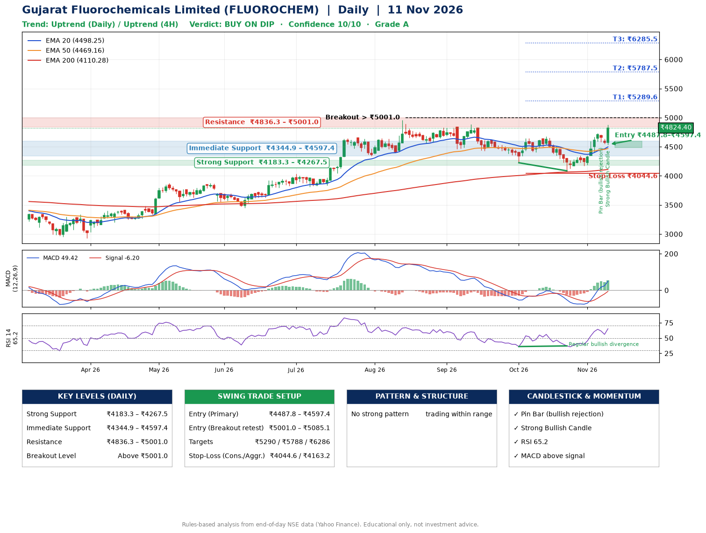

📌 **Gujarat Fluorochemicals Limited (FLUOROCHEM) – Multi-Timeframe Technical Analysis (Daily + 4H Combined)**
_Data up to 11 Nov 2026 · Close ₹4824.40_

**📍 Daily Timeframe Trend**
- Trend: **Uptrend** (price above rising EMAs)
- Recent swing highs: ₹4887.9, ₹4646.9, ₹4680.0 · swing lows: ₹4461.1, ₹4225.4, ₹4086.7
- EMAs: EMA20 ₹4498.2, EMA50 ₹4469.2, EMA200 ₹4110.3; bullish stack (EMA20 > EMA50 > EMA200); price above EMA20, EMA50, EMA200
- MACD 49.42 above signal -6.20 (above zero); histogram rising
- RSI(14) 65.2; Regular bullish divergence

**📍 4-Hour Timeframe Trend**
- Structure: **Uptrend** (higher highs and higher lows)
- Pullback/support area: recent 4H swing lows ₹4086.7, ₹4175.0; EMA20 ₹4547.5
- EMA20/50: bullish stack (EMA20 > EMA50); price above EMA20, EMA50
- MACD 96.15 above signal 64.44 (above zero); histogram rising
- RSI(14) 66.1; no divergence

**📍 Pattern Detection (Both Timeframes)**
- 4H: **Double Bottom** – bottoms near ₹4086.7/₹4175.0, neckline ₹4323.9, confirmed (closed above neckline)

**📍 Candlestick Patterns (last 3 daily candles)**
- **Pin Bar (bullish rejection)** – 06 Nov: long lower wick shows dip-buying near ₹4584.8
- **Strong Bullish Candle** – 11 Nov: wide-range green candle, buyers in control

**📍 Price Action Key Levels (Daily Structure)**

| Zone | Price Level (₹) | Context |
|------|-----------------|---------|
| Strong Support | ₹4183.3 – ₹4267.5 | Cluster of earlier swing lows (demand) |
| Immediate Support | ₹4344.9 – ₹4597.4 | Nearest swing-low / wick area |
| Resistance | ₹4836.3 – ₹5001.0 | Nearest swing-high supply |
| Breakout Level | Above ₹5001.0 | Swing continuation trigger (52-week high ₹4958.9) |

**📍 Swing Trade Setup**

🟢 **Entry Zone**
- Primary: ₹4487.8 – ₹4597.4 (daily support / EMA20 area; enter on a bullish 4H candle)
- Alternate: ₹5001.0 – ₹5085.1 (breakout retest)

🎯 **Profit Targets**
- T1: ₹5289.6
- T2: ₹5787.5
- T3: ₹6285.5

🛑 **Stop-Loss**
- Conservative: below daily swing low (₹4044.6)
- Aggressive: below 4H structure (₹4163.2)
- Risk per share ≈ ₹498.0; reward:risk to T1 ≈ 1.5

**📌 Strategy Notes**
- Higher timeframe: daily trend is uptrend; only take longs while price holds above ₹4183.3.
- Entry timing: wait for a bullish 4H candle (engulfing/hammer) inside ₹4487.8 – ₹4597.4 rather than buying mid-range.
- EMA stacking: bullish stack (EMA20 > EMA50 > EMA200); price above EMA20, EMA50, EMA200.
- Breakout rule: a daily close above ₹5001.0 with volume above its 20-day average (≈104,876) opens T2/T3.
- Momentum: RSI 65 – elevated, prefer dips; Regular bullish divergence.
- Exit discipline: move the stop to entry once T1 is hit; book partial profits at each target.

**STEP 2 — Marked Up Chart**

**✅ Trade Validation Checklist**
- Trend + momentum aligned: Yes · Price at entry zone: No
- Stop defined (₹4044.6) · Reward:risk ≥ 1.5 to T1: Yes

## 📌 Final Verdict

Recommendation: **🟡 BUY ON DIP**

Confidence: **10/10**

Trade Quality: **A**

Reason:
• Daily uptrend (price above rising EMAs)
• EMAs stacked bullishly

Next Action:
• Wait for a pullback to ₹4487.8–₹4597.4

_Rules-based analysis from end-of-day data. Educational only, not investment advice. Never place orders without your own confirmation._