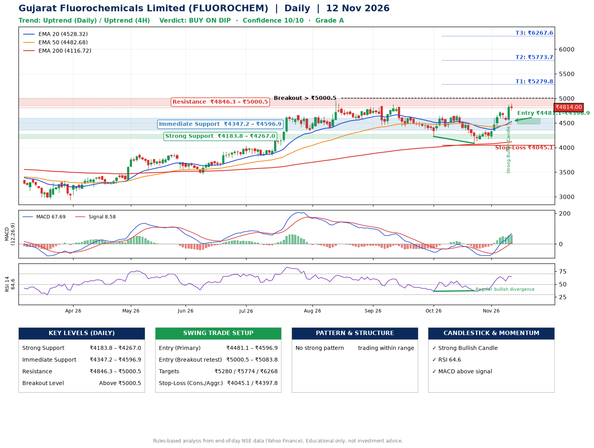

📌 **Gujarat Fluorochemicals Limited (FLUOROCHEM) – Multi-Timeframe Technical Analysis (Daily + 4H Combined)**
_Data up to 12 Nov 2026 · Close ₹4814.00_

**📍 Daily Timeframe Trend**
- Trend: **Uptrend** (price above rising EMAs)
- Recent swing highs: ₹4887.9, ₹4646.9, ₹4680.0 · swing lows: ₹4461.1, ₹4225.4, ₹4086.7
- EMAs: EMA20 ₹4528.3, EMA50 ₹4482.7, EMA200 ₹4116.7; bullish stack (EMA20 > EMA50 > EMA200); price above EMA20, EMA50, EMA200
- MACD 67.69 above signal 8.58 (above zero); histogram rising
- RSI(14) 64.6; Regular bullish divergence

**📍 4-Hour Timeframe Trend**
- Structure: **Uptrend** (higher highs and higher lows)
- Pullback/support area: recent 4H swing lows ₹4175.0, ₹4534.2; EMA20 ₹4594.8
- EMA20/50: bullish stack (EMA20 > EMA50); price above EMA20, EMA50
- MACD 109.47 above signal 80.25 (above zero); histogram falling
- RSI(14) 62.7; no divergence

**📍 Pattern Detection (Both Timeframes)**
- 4H: **Ascending Triangle** – converging swing highs and lows over the last ~60 sessions

**📍 Candlestick Patterns (last 3 daily candles)**
- **Strong Bullish Candle** – 11 Nov: wide-range green candle, buyers in control

**📍 Price Action Key Levels (Daily Structure)**

| Zone | Price Level (₹) | Context |
|------|-----------------|---------|
| Strong Support | ₹4183.8 – ₹4267.0 | Cluster of earlier swing lows (demand) |
| Immediate Support | ₹4347.2 – ₹4596.9 | Nearest swing-low / wick area |
| Resistance | ₹4846.3 – ₹5000.5 | Nearest swing-high supply |
| Breakout Level | Above ₹5000.5 | Swing continuation trigger (52-week high ₹4958.9) |

**📍 Swing Trade Setup**

🟢 **Entry Zone**
- Primary: ₹4481.1 – ₹4596.9 (daily support / EMA20 area; enter on a bullish 4H candle)
- Alternate: ₹5000.5 – ₹5083.8 (breakout retest)

🎯 **Profit Targets**
- T1: ₹5279.8
- T2: ₹5773.7
- T3: ₹6267.6

🛑 **Stop-Loss**
- Conservative: below daily swing low (₹4045.1)
- Aggressive: below 4H structure (₹4397.8)
- Risk per share ≈ ₹493.9; reward:risk to T1 ≈ 1.5
- Time to T1: about 25 trading days (it rose this much within 60 trading days 25% of the time in the last 2 years)
- Time to T2: about 39 trading days (it rose this much within 60 trading days 9% of the time in the last 2 years)

**📌 Strategy Notes**
- Higher timeframe: daily trend is uptrend; only take longs while price holds above ₹4183.8.
- Entry timing: wait for a bullish 4H candle (engulfing/hammer) inside ₹4481.1 – ₹4596.9 rather than buying mid-range.
- EMA stacking: bullish stack (EMA20 > EMA50 > EMA200); price above EMA20, EMA50, EMA200.
- Breakout rule: a daily close above ₹5000.5 with volume above its 20-day average (≈109,123) opens T2/T3.
- Momentum: RSI 65 – room to run; Regular bullish divergence.
- Exit discipline: move the stop to entry once T1 is hit; book partial profits at each target.

**STEP 2 — Marked Up Chart**

**✅ Trade Validation Checklist**
- Trend + momentum aligned: Yes · Price at entry zone: No
- Stop defined (₹4045.1) · Reward:risk ≥ 1.5 to T1: No

## 📌 Final Verdict

Recommendation: **🟡 BUY ON DIP**

Confidence: **10/10**

Trade Quality: **A**

Reason:
• Daily uptrend (price above rising EMAs)
• EMAs stacked bullishly

Next Action:
• Wait for a pullback to ₹4481.1–₹4596.9

_Rules-based analysis from end-of-day data. Educational only, not investment advice. Never place orders without your own confirmation._