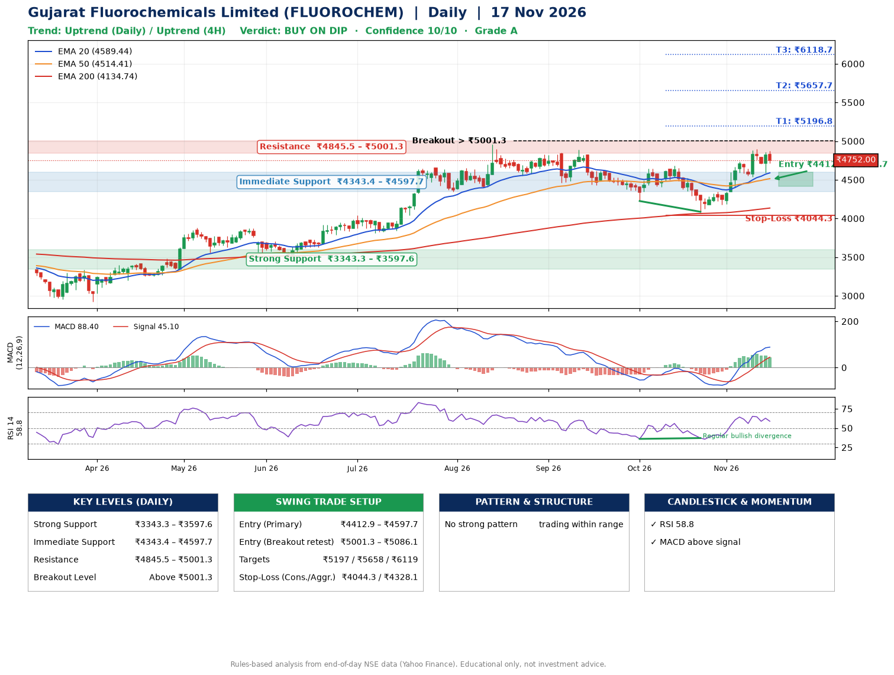

📌 **Gujarat Fluorochemicals Limited (FLUOROCHEM) – Multi-Timeframe Technical Analysis (Daily + 4H Combined)**
_Data up to 17 Nov 2026 · Close ₹4752.00_

**📍 Daily Timeframe Trend**
- Trend: **Uptrend** (price above rising EMAs)
- Recent swing highs: ₹4887.9, ₹4646.9, ₹4680.0 · swing lows: ₹4461.1, ₹4225.4, ₹4086.7
- EMAs: EMA20 ₹4589.4, EMA50 ₹4514.4, EMA200 ₹4134.7; bullish stack (EMA20 > EMA50 > EMA200); price above EMA20, EMA50, EMA200
- MACD 88.40 above signal 45.10 (above zero); histogram falling
- RSI(14) 58.8; Regular bullish divergence

**📍 4-Hour Timeframe Trend**
- Structure: **Uptrend** (higher highs and higher lows)
- Pullback/support area: recent 4H swing lows ₹4175.0, ₹4534.2; EMA20 ₹4663.8
- EMA20/50: bullish stack (EMA20 > EMA50); price above EMA20, EMA50
- MACD 90.61 below signal 92.05 (above zero), fresh bearish crossover; histogram falling
- RSI(14) 57.8; Regular bearish divergence

**📍 Pattern Detection (Both Timeframes)**
- No strong pattern detected. Trading within range.

**📍 Candlestick Patterns (last 3 daily candles)**
- No notable candlestick signal in the last 3 sessions.

**📍 Price Action Key Levels (Daily Structure)**

| Zone | Price Level (₹) | Context |
|------|-----------------|---------|
| Strong Support | ₹3343.3 – ₹3597.6 | Cluster of earlier swing lows (demand) |
| Immediate Support | ₹4343.4 – ₹4597.7 | Nearest swing-low / wick area |
| Resistance | ₹4845.5 – ₹5001.3 | Nearest swing-high supply |
| Breakout Level | Above ₹5001.3 | Swing continuation trigger (52-week high ₹4958.9) |

**📍 Swing Trade Setup**

🟢 **Entry Zone**
- Primary: ₹4412.9 – ₹4597.7 (daily support / EMA20 area; enter on a bullish 4H candle)
- Alternate: ₹5001.3 – ₹5086.1 (breakout retest)

🎯 **Profit Targets**
- T1: ₹5196.8
- T2: ₹5657.7
- T3: ₹6118.7

🛑 **Stop-Loss**
- Conservative: below daily swing low (₹4044.3)
- Aggressive: below 4H structure (₹4328.1)
- Risk per share ≈ ₹461.0; reward:risk to T1 ≈ 1.5
- Time to T1: about 23 trading days (it rose this much within 60 trading days 28% of the time in the last 2 years)
- Time to T2: about 35 trading days (it rose this much within 60 trading days 13% of the time in the last 2 years)

**📌 Strategy Notes**
- Higher timeframe: daily trend is uptrend; only take longs while price holds above ₹3343.3.
- Entry timing: wait for a bullish 4H candle (engulfing/hammer) inside ₹4412.9 – ₹4597.7 rather than buying mid-range.
- EMA stacking: bullish stack (EMA20 > EMA50 > EMA200); price above EMA20, EMA50, EMA200.
- Breakout rule: a daily close above ₹5001.3 with volume above its 20-day average (≈108,479) opens T2/T3.
- Momentum: RSI 59 – room to run; Regular bullish divergence.
- Exit discipline: move the stop to entry once T1 is hit; book partial profits at each target.

**STEP 2 — Marked Up Chart**

**✅ Trade Validation Checklist**
- Trend + momentum aligned: Yes · Price at entry zone: No
- Stop defined (₹4044.3) · Reward:risk ≥ 1.5 to T1: Yes

## 📌 Final Verdict

Recommendation: **🟡 BUY ON DIP**

Confidence: **10/10**

Trade Quality: **A**

Reason:
• Daily uptrend (price above rising EMAs)
• EMAs stacked bullishly

Next Action:
• Wait for a pullback to ₹4412.9–₹4597.7

_Rules-based analysis from end-of-day data. Educational only, not investment advice. Never place orders without your own confirmation._