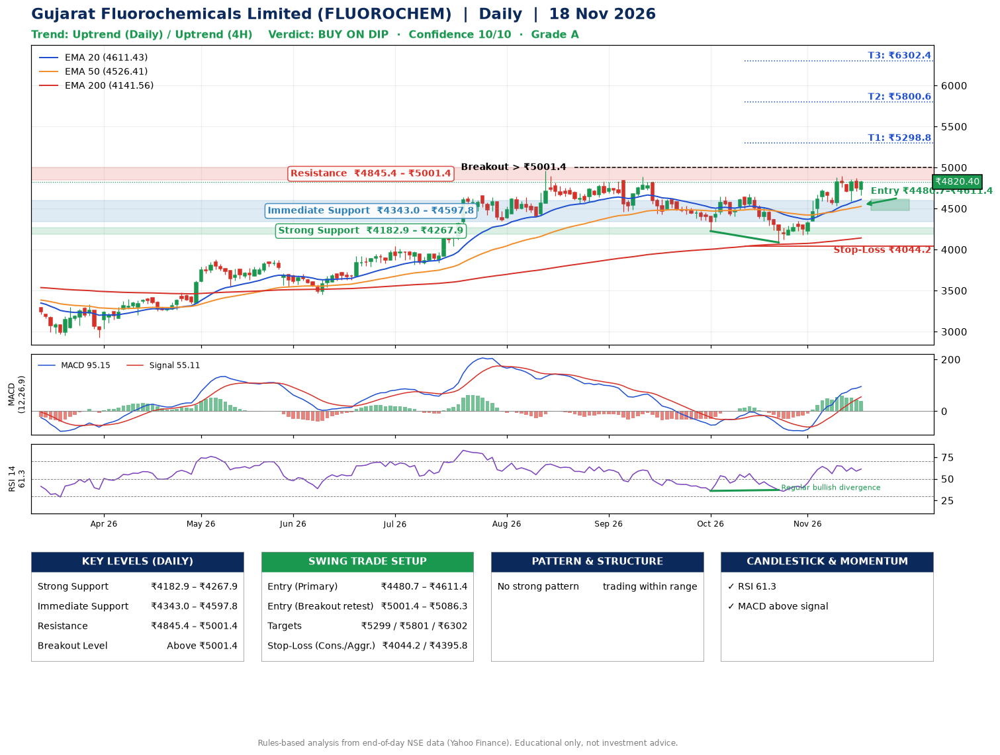

📌 **Gujarat Fluorochemicals Limited (FLUOROCHEM) – Multi-Timeframe Technical Analysis (Daily + 4H Combined)**
_Data up to 18 Nov 2026 · Close ₹4820.40_

**📍 Daily Timeframe Trend**
- Trend: **Uptrend** (price above rising EMAs)
- Recent swing highs: ₹4887.9, ₹4646.9, ₹4680.0 · swing lows: ₹4461.1, ₹4225.4, ₹4086.7
- EMAs: EMA20 ₹4611.4, EMA50 ₹4526.4, EMA200 ₹4141.6; bullish stack (EMA20 > EMA50 > EMA200); price above EMA20, EMA50, EMA200
- MACD 95.15 above signal 55.11 (above zero); histogram falling
- RSI(14) 61.3; Regular bullish divergence

**📍 4-Hour Timeframe Trend**
- Structure: **Uptrend** (price above rising EMAs)
- Pullback/support area: recent 4H swing lows ₹4534.2, ₹4587.8; EMA20 ₹4686.1
- EMA20/50: bullish stack (EMA20 > EMA50); price above EMA20, EMA50
- MACD 87.55 below signal 90.24 (above zero), fresh bearish crossover; histogram rising
- RSI(14) 61.2; no divergence

**📍 Pattern Detection (Both Timeframes)**
- No strong pattern detected. Trading within range.

**📍 Candlestick Patterns (last 3 daily candles)**
- No notable candlestick signal in the last 3 sessions.

**📍 Price Action Key Levels (Daily Structure)**

| Zone | Price Level (₹) | Context |
|------|-----------------|---------|
| Strong Support | ₹4182.9 – ₹4267.9 | Cluster of earlier swing lows (demand) |
| Immediate Support | ₹4343.0 – ₹4597.8 | Nearest swing-low / wick area |
| Resistance | ₹4845.4 – ₹5001.4 | Nearest swing-high supply |
| Breakout Level | Above ₹5001.4 | Swing continuation trigger (52-week high ₹4958.9) |

**📍 Swing Trade Setup**

🟢 **Entry Zone**
- Primary: ₹4480.7 – ₹4611.4 (daily support / EMA20 area; enter on a bullish 4H candle)
- Alternate: ₹5001.4 – ₹5086.3 (breakout retest)

🎯 **Profit Targets**
- T1: ₹5298.8
- T2: ₹5800.6
- T3: ₹6302.4

🛑 **Stop-Loss**
- Conservative: below daily swing low (₹4044.2)
- Aggressive: below 4H structure (₹4395.8)
- Risk per share ≈ ₹501.8; reward:risk to T1 ≈ 1.5
- Time to T1: about 25 trading days (it rose this much within 60 trading days 25% of the time in the last 2 years)
- Time to T2: about 42 trading days (it rose this much within 60 trading days 9% of the time in the last 2 years)

**📌 Strategy Notes**
- Higher timeframe: daily trend is uptrend; only take longs while price holds above ₹4182.9.
- Entry timing: wait for a bullish 4H candle (engulfing/hammer) inside ₹4480.7 – ₹4611.4 rather than buying mid-range.
- EMA stacking: bullish stack (EMA20 > EMA50 > EMA200); price above EMA20, EMA50, EMA200.
- Breakout rule: a daily close above ₹5001.4 with volume above its 20-day average (≈107,283) opens T2/T3.
- Momentum: RSI 61 – room to run; Regular bullish divergence.
- Exit discipline: move the stop to entry once T1 is hit; book partial profits at each target.

**STEP 2 — Marked Up Chart**

**✅ Trade Validation Checklist**
- Trend + momentum aligned: Yes · Price at entry zone: No
- Stop defined (₹4044.2) · Reward:risk ≥ 1.5 to T1: Yes

## 📌 Final Verdict

Recommendation: **🟡 BUY ON DIP**

Confidence: **10/10**

Trade Quality: **A**

Reason:
• Daily uptrend (price above rising EMAs)
• EMAs stacked bullishly

Next Action:
• Wait for a pullback to ₹4480.7–₹4611.4

_Rules-based analysis from end-of-day data. Educational only, not investment advice. Never place orders without your own confirmation._