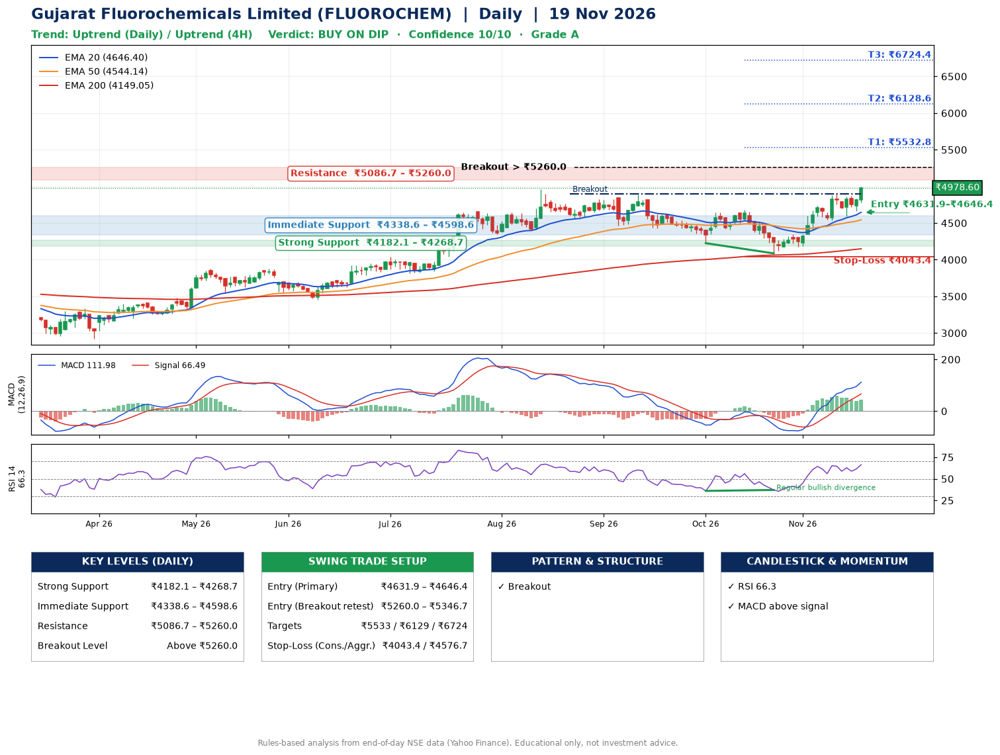

📌 **Gujarat Fluorochemicals Limited (FLUOROCHEM) – Multi-Timeframe Technical Analysis (Daily + 4H Combined)**
_Data up to 19 Nov 2026 · Close ₹4978.60_

**📍 Daily Timeframe Trend**
- Trend: **Uptrend** (price above rising EMAs)
- Recent swing highs: ₹4887.9, ₹4646.9, ₹4680.0 · swing lows: ₹4461.1, ₹4225.4, ₹4086.7
- EMAs: EMA20 ₹4646.4, EMA50 ₹4544.1, EMA200 ₹4149.1; bullish stack (EMA20 > EMA50 > EMA200); price above EMA20, EMA50, EMA200
- MACD 111.98 above signal 66.49 (above zero); histogram rising
- RSI(14) 66.3; Regular bullish divergence

**📍 4-Hour Timeframe Trend**
- Structure: **Uptrend** (price above rising EMAs)
- Pullback/support area: recent 4H swing lows ₹4534.2, ₹4587.8; EMA20 ₹4728.8
- EMA20/50: bullish stack (EMA20 > EMA50); price above EMA20, EMA50
- MACD 101.54 above signal 92.56 (above zero), fresh bullish crossover; histogram rising
- RSI(14) 68.2; no divergence

**📍 Pattern Detection (Both Timeframes)**
- Daily: **Breakout** – closed above the 60-session high ₹4899.0 on strong volume

**📍 Candlestick Patterns (last 3 daily candles)**
- No notable candlestick signal in the last 3 sessions.

**📍 Price Action Key Levels (Daily Structure)**

| Zone | Price Level (₹) | Context |
|------|-----------------|---------|
| Strong Support | ₹4182.1 – ₹4268.7 | Cluster of earlier swing lows (demand) |
| Immediate Support | ₹4338.6 – ₹4598.6 | Nearest swing-low / wick area |
| Resistance | ₹5086.7 – ₹5260.0 | Nearest swing-high supply |
| Breakout Level | Above ₹5260.0 | Swing continuation trigger (52-week high ₹5000.0) |

**📍 Swing Trade Setup**

🟢 **Entry Zone**
- Primary: ₹4631.9 – ₹4646.4 (daily support / EMA20 area; enter on a bullish 4H candle)
- Alternate: ₹5260.0 – ₹5346.7 (breakout retest)

🎯 **Profit Targets**
- T1: ₹5532.8
- T2: ₹6128.6
- T3: ₹6724.4

🛑 **Stop-Loss**
- Conservative: below daily swing low (₹4043.4)
- Aggressive: below 4H structure (₹4576.7)
- Risk per share ≈ ₹595.8; reward:risk to T1 ≈ 1.5
- Time to T1: about 33 trading days (it rose this much within 60 trading days 21% of the time in the last 2 years)
- Time to T2: about 51 trading days (it rose this much within 60 trading days 5% of the time in the last 2 years)

**📌 Strategy Notes**
- Higher timeframe: daily trend is uptrend; only take longs while price holds above ₹4182.1.
- Entry timing: wait for a bullish 4H candle (engulfing/hammer) inside ₹4631.9 – ₹4646.4 rather than buying mid-range.
- EMA stacking: bullish stack (EMA20 > EMA50 > EMA200); price above EMA20, EMA50, EMA200.
- Breakout rule: a daily close above ₹5260.0 with volume above its 20-day average (≈118,933) opens T2/T3.
- Momentum: RSI 66 – elevated, prefer dips; Regular bullish divergence.
- Exit discipline: move the stop to entry once T1 is hit; book partial profits at each target.

**STEP 2 — Marked Up Chart**

**✅ Trade Validation Checklist**
- Trend + momentum aligned: Yes · Price at entry zone: No
- Stop defined (₹4043.4) · Reward:risk ≥ 1.5 to T1: No

## 📌 Final Verdict

Recommendation: **🟡 BUY ON DIP**

Confidence: **10/10**

Trade Quality: **A**

Reason:
• Daily uptrend (price above rising EMAs)
• EMAs stacked bullishly

Next Action:
• Wait for a pullback to ₹4631.9–₹4646.4

_Rules-based analysis from end-of-day data. Educational only, not investment advice. Never place orders without your own confirmation._