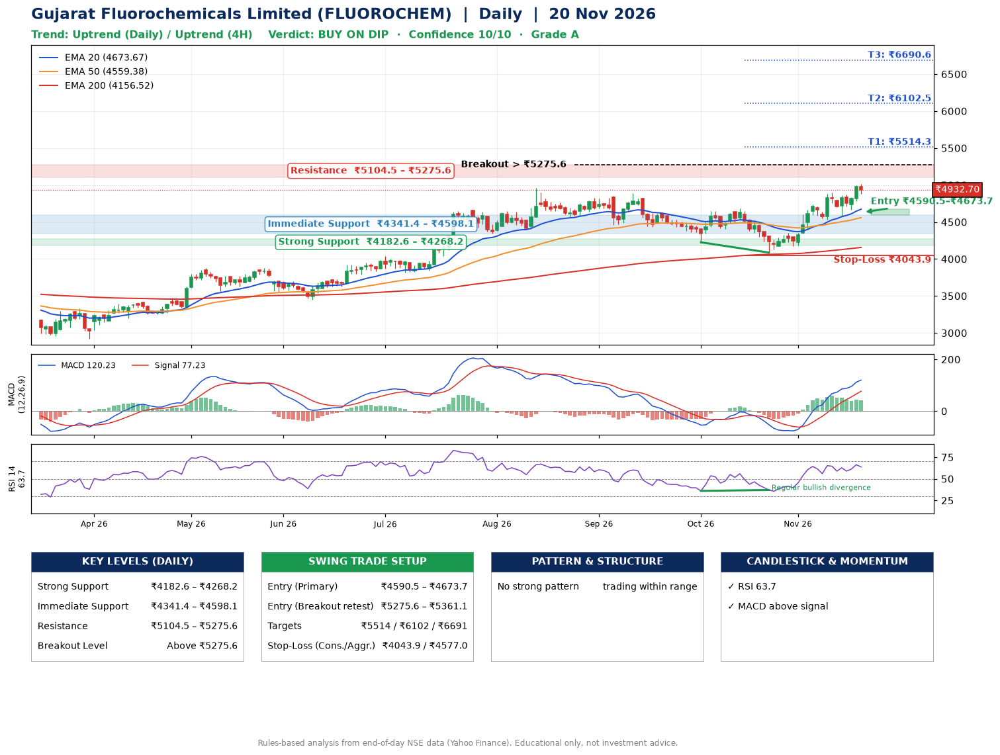

📌 **Gujarat Fluorochemicals Limited (FLUOROCHEM) – Multi-Timeframe Technical Analysis (Daily + 4H Combined)**
_Data up to 20 Nov 2026 · Close ₹4932.70_

**📍 Daily Timeframe Trend**
- Trend: **Uptrend** (price above rising EMAs)
- Recent swing highs: ₹4887.9, ₹4646.9, ₹4680.0 · swing lows: ₹4461.1, ₹4225.4, ₹4086.7
- EMAs: EMA20 ₹4673.7, EMA50 ₹4559.4, EMA200 ₹4156.5; bullish stack (EMA20 > EMA50 > EMA200); price above EMA20, EMA50, EMA200
- MACD 120.23 above signal 77.23 (above zero); histogram falling
- RSI(14) 63.7; Regular bullish divergence

**📍 4-Hour Timeframe Trend**
- Structure: **Uptrend** (price above rising EMAs)
- Pullback/support area: recent 4H swing lows ₹4534.2, ₹4587.8; EMA20 ₹4766.6
- EMA20/50: bullish stack (EMA20 > EMA50); price above EMA20, EMA50
- MACD 107.61 above signal 97.73 (above zero), fresh bullish crossover; histogram falling
- RSI(14) 64.5; no divergence

**📍 Pattern Detection (Both Timeframes)**
- No strong pattern detected. Trading within range.

**📍 Candlestick Patterns (last 3 daily candles)**
- No notable candlestick signal in the last 3 sessions.

**📍 Price Action Key Levels (Daily Structure)**

| Zone | Price Level (₹) | Context |
|------|-----------------|---------|
| Strong Support | ₹4182.6 – ₹4268.2 | Cluster of earlier swing lows (demand) |
| Immediate Support | ₹4341.4 – ₹4598.1 | Nearest swing-low / wick area |
| Resistance | ₹5104.5 – ₹5275.6 | Nearest swing-high supply |
| Breakout Level | Above ₹5275.6 | Swing continuation trigger (52-week high ₹5018.9) |

**📍 Swing Trade Setup**

🟢 **Entry Zone**
- Primary: ₹4590.5 – ₹4673.7 (daily support / EMA20 area; enter on a bullish 4H candle)
- Alternate: ₹5275.6 – ₹5361.1 (breakout retest)

🎯 **Profit Targets**
- T1: ₹5514.3
- T2: ₹6102.5
- T3: ₹6690.6

🛑 **Stop-Loss**
- Conservative: below daily swing low (₹4043.9)
- Aggressive: below 4H structure (₹4577.0)
- Risk per share ≈ ₹588.2; reward:risk to T1 ≈ 1.5
- Time to T1: about 31 trading days (it rose this much within 60 trading days 21% of the time in the last 2 years)
- Time to T2: about 51 trading days (it rose this much within 60 trading days 6% of the time in the last 2 years)

**📌 Strategy Notes**
- Higher timeframe: daily trend is uptrend; only take longs while price holds above ₹4182.6.
- Entry timing: wait for a bullish 4H candle (engulfing/hammer) inside ₹4590.5 – ₹4673.7 rather than buying mid-range.
- EMA stacking: bullish stack (EMA20 > EMA50 > EMA200); price above EMA20, EMA50, EMA200.
- Breakout rule: a daily close above ₹5275.6 with volume above its 20-day average (≈120,874) opens T2/T3.
- Momentum: RSI 64 – room to run; Regular bullish divergence.
- Exit discipline: move the stop to entry once T1 is hit; book partial profits at each target.

**STEP 2 — Marked Up Chart**

**✅ Trade Validation Checklist**
- Trend + momentum aligned: Yes · Price at entry zone: No
- Stop defined (₹4043.9) · Reward:risk ≥ 1.5 to T1: No

## 📌 Final Verdict

Recommendation: **🟡 BUY ON DIP**

Confidence: **10/10**

Trade Quality: **A**

Reason:
• Daily uptrend (price above rising EMAs)
• EMAs stacked bullishly

Next Action:
• Wait for a pullback to ₹4590.5–₹4673.7

_Rules-based analysis from end-of-day data. Educational only, not investment advice. Never place orders without your own confirmation._