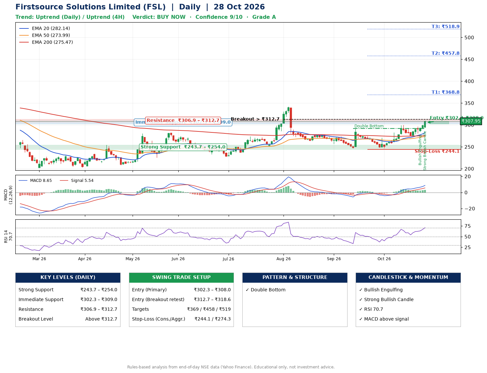

📌 **Firstsource Solutions Limited (FSL) – Multi-Timeframe Technical Analysis (Daily + 4H Combined)**
_Data up to 28 Oct 2026 · Close ₹307.95_

**📍 Daily Timeframe Trend**
- Trend: **Uptrend** (higher highs and higher lows)
- Recent swing highs: ₹273.9, ₹292.0, ₹300.0 · swing lows: ₹263.1, ₹246.6, ₹247.0
- EMAs: EMA20 ₹282.1, EMA50 ₹274.0, EMA200 ₹275.5; mixed / crossing; price above EMA20, EMA50, EMA200
- MACD 8.65 above signal 5.54 (above zero); histogram rising
- RSI(14) 70.7; no divergence on the last two swings

**📍 4-Hour Timeframe Trend**
- Structure: **Uptrend** (price above rising EMAs)
- Pullback/support area: recent 4H swing lows ₹247.1, ₹275.1; EMA20 ₹289.6
- EMA20/50: bullish stack (EMA20 > EMA50); price above EMA20, EMA50
- MACD 7.94 above signal 6.26 (above zero); histogram rising
- RSI(14) 71.2; no divergence

**📍 Pattern Detection (Both Timeframes)**
- Daily: **Double Bottom** – bottoms near ₹246.6/₹247.0, neckline ₹292.0, confirmed (closed above neckline)

**📍 Candlestick Patterns (last 3 daily candles)**
- **Bullish Engulfing** – 26 Oct: buyers fully reversed the prior red candle
- **Strong Bullish Candle** – 28 Oct: wide-range green candle, buyers in control

**📍 Price Action Key Levels (Daily Structure)**

| Zone | Price Level (₹) | Context |
|------|-----------------|---------|
| Strong Support | ₹243.7 – ₹254.0 | Cluster of earlier swing lows (demand) |
| Immediate Support | ₹302.3 – ₹309.0 | Nearest swing-low / wick area |
| Resistance | ₹306.9 – ₹312.7 | Nearest swing-high supply |
| Breakout Level | Above ₹312.7 | Swing continuation trigger (52-week high ₹371.8) |

**📍 Swing Trade Setup**

🟢 **Entry Zone**
- Primary: ₹302.3 – ₹308.0 (daily support / EMA20 area; enter on a bullish 4H candle)
- Alternate: ₹312.7 – ₹318.6 (breakout retest)

🎯 **Profit Targets**
- T1: ₹368.8
- T2: ₹457.8
- T3: ₹518.9

🛑 **Stop-Loss**
- Conservative: below daily swing low (₹244.1)
- Aggressive: below 4H structure (₹274.3)
- Risk per share ≈ ₹61.1; reward:risk to T1 ≈ 1.0

**📌 Strategy Notes**
- Higher timeframe: daily trend is uptrend; only take longs while price holds above ₹243.7.
- Entry timing: wait for a bullish 4H candle (engulfing/hammer) inside ₹302.3 – ₹308.0 rather than buying mid-range.
- EMA stacking: mixed / crossing; price above EMA20, EMA50, EMA200.
- Breakout rule: a daily close above ₹312.7 with volume above its 20-day average (≈3,474,984) opens T2/T3.
- Momentum: RSI 71 – elevated, prefer dips; no divergence on the last two swings.
- Exit discipline: move the stop to entry once T1 is hit; book partial profits at each target.

**STEP 2 — Marked Up Chart**

**✅ Trade Validation Checklist**
- Trend + momentum aligned: Yes · Price at entry zone: Yes
- Stop defined (₹244.1) · Reward:risk ≥ 1.5 to T1: No

## 📌 Final Verdict

Recommendation: **🟢 BUY NOW**

Confidence: **9/10**

Trade Quality: **A**

Reason:
• Daily uptrend (higher highs and higher lows)
• Double Bottom: bottoms near ₹246.6/₹247.0, neckline ₹292.0, confirmed (closed above neckline)

Next Action:
• Buy now within the entry zone, with the stop-loss in place

_Rules-based analysis from end-of-day data. Educational only, not investment advice. Never place orders without your own confirmation._