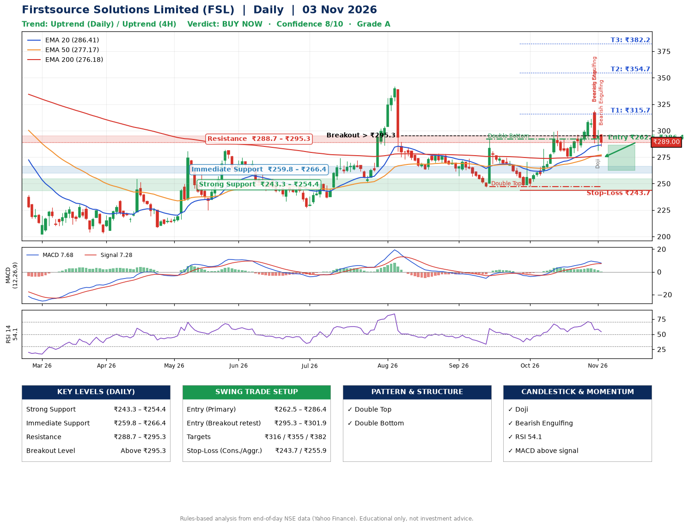

📌 **Firstsource Solutions Limited (FSL) – Multi-Timeframe Technical Analysis (Daily + 4H Combined)**
_Data up to 03 Nov 2026 · Close ₹289.00_

**📍 Daily Timeframe Trend**
- Trend: **Uptrend** (higher highs and higher lows)
- Recent swing highs: ₹273.9, ₹292.0, ₹300.0 · swing lows: ₹263.1, ₹246.6, ₹247.0
- EMAs: EMA20 ₹286.4, EMA50 ₹277.2, EMA200 ₹276.2; bullish stack (EMA20 > EMA50 > EMA200); price above EMA20, EMA50, EMA200
- MACD 7.68 above signal 7.28 (above zero); histogram falling
- RSI(14) 54.1; no divergence on the last two swings

**📍 4-Hour Timeframe Trend**
- Structure: **Uptrend** (higher highs and higher lows)
- Pullback/support area: recent 4H swing lows ₹275.1, ₹281.9; EMA20 ₹292.8
- EMA20/50: bullish stack (EMA20 > EMA50); price above EMA50
- MACD 3.74 below signal 5.78 (above zero), fresh bearish crossover; histogram falling
- RSI(14) 48.6; no divergence

**📍 Pattern Detection (Both Timeframes)**
- Daily: **Double Top** – tops near ₹292.0/₹300.0, neckline ₹247.0, forming
- Daily: **Double Bottom** – bottoms near ₹246.6/₹247.0, neckline ₹292.0, forming
- 4H: **Double Bottom** – bottoms near ₹275.1/₹281.9, neckline ₹318.9, forming

**📍 Candlestick Patterns (last 3 daily candles)**
- **Bearish Engulfing** – 30 Oct: sellers fully reversed the prior green candle
- **Evening Star** – 30 Oct: three-candle bearish reversal
- **Doji** – 02 Nov: indecision; wait for the next candle to confirm direction
- **Bearish Engulfing** – 03 Nov: sellers fully reversed the prior green candle

**📍 Price Action Key Levels (Daily Structure)**

| Zone | Price Level (₹) | Context |
|------|-----------------|---------|
| Strong Support | ₹243.3 – ₹254.4 | Cluster of earlier swing lows (demand) |
| Immediate Support | ₹259.8 – ₹266.4 | Nearest swing-low / wick area |
| Resistance | ₹288.7 – ₹295.3 | Nearest swing-high supply |
| Breakout Level | Above ₹295.3 | Swing continuation trigger (52-week high ₹371.8) |

**📍 Swing Trade Setup**

🟢 **Entry Zone**
- Primary: ₹262.5 – ₹286.4 (daily support / EMA20 area; enter on a bullish 4H candle)
- Alternate: ₹295.3 – ₹301.9 (breakout retest)

🎯 **Profit Targets**
- T1: ₹315.7
- T2: ₹354.7
- T3: ₹382.2

🛑 **Stop-Loss**
- Conservative: below daily swing low (₹243.7)
- Aggressive: below 4H structure (₹255.9)
- Risk per share ≈ ₹30.8; reward:risk to T1 ≈ 1.3

**📌 Strategy Notes**
- Higher timeframe: daily trend is uptrend; only take longs while price holds above ₹243.3.
- Entry timing: wait for a bullish 4H candle (engulfing/hammer) inside ₹262.5 – ₹286.4 rather than buying mid-range.
- EMA stacking: bullish stack (EMA20 > EMA50 > EMA200); price above EMA20, EMA50, EMA200.
- Breakout rule: a daily close above ₹295.3 with volume above its 20-day average (≈3,428,068) opens T2/T3.
- Momentum: RSI 54 – room to run; no divergence on the last two swings.
- Exit discipline: move the stop to entry once T1 is hit; book partial profits at each target.

**STEP 2 — Marked Up Chart**

**✅ Trade Validation Checklist**
- Trend + momentum aligned: Yes · Price at entry zone: No
- Stop defined (₹243.7) · Reward:risk ≥ 1.5 to T1: No

## 📌 Final Verdict

Recommendation: **🟢 BUY NOW**

Confidence: **8/10**

Trade Quality: **A**

Reason:
• Daily uptrend (higher highs and higher lows)
• EMAs stacked bullishly

Next Action:
• Buy now within the entry zone, with the stop-loss in place

_Rules-based analysis from end-of-day data. Educational only, not investment advice. Never place orders without your own confirmation._