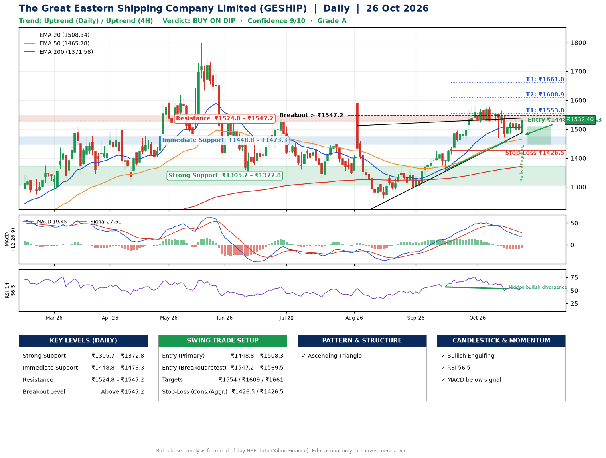

📌 **The Great Eastern Shipping Company Limited (GESHIP) – Multi-Timeframe Technical Analysis (Daily + 4H Combined)**
_Data up to 26 Oct 2026 · Close ₹1532.40_

**📍 Daily Timeframe Trend**
- Trend: **Uptrend** (higher highs and higher lows)
- Recent swing highs: ₹1598.9, ₹1380.0, ₹1583.0 · swing lows: ₹1294.0, ₹1358.8, ₹1460.0
- EMAs: EMA20 ₹1508.3, EMA50 ₹1465.8, EMA200 ₹1371.6; bullish stack (EMA20 > EMA50 > EMA200); price above EMA20, EMA50, EMA200
- MACD 19.45 below signal 27.61 (above zero); histogram rising
- RSI(14) 56.5; Hidden bullish divergence

**📍 4-Hour Timeframe Trend**
- Structure: **Uptrend** (price above rising EMAs)
- Pullback/support area: recent 4H swing lows ₹1469.6, ₹1460.4; EMA20 ₹1516.3
- EMA20/50: bullish stack (EMA20 > EMA50); price above EMA20, EMA50
- MACD 0.01 above signal -0.10 (above zero), fresh bullish crossover; histogram rising
- RSI(14) 54.0; no divergence

**📍 Pattern Detection (Both Timeframes)**
- Daily: **Ascending Triangle** – converging swing highs and lows over the last ~60 sessions

**📍 Candlestick Patterns (last 3 daily candles)**
- **Bullish Engulfing** – 26 Oct: buyers fully reversed the prior red candle

**📍 Price Action Key Levels (Daily Structure)**

| Zone | Price Level (₹) | Context |
|------|-----------------|---------|
| Strong Support | ₹1305.7 – ₹1372.8 | Cluster of earlier swing lows (demand) |
| Immediate Support | ₹1448.8 – ₹1473.3 | Nearest swing-low / wick area |
| Resistance | ₹1524.8 – ₹1547.2 | Nearest swing-high supply |
| Breakout Level | Above ₹1547.2 | Swing continuation trigger (52-week high ₹1798.0) |

**📍 Swing Trade Setup**

🟢 **Entry Zone**
- Primary: ₹1448.8 – ₹1508.3 (daily support / EMA20 area; enter on a bullish 4H candle)
- Alternate: ₹1547.2 – ₹1569.5 (breakout retest)

🎯 **Profit Targets**
- T1: ₹1553.8
- T2: ₹1608.9
- T3: ₹1661.0

🛑 **Stop-Loss**
- Conservative: below daily swing low (₹1426.5)
- Aggressive: below 4H structure (₹1426.5)
- Risk per share ≈ ₹52.1; reward:risk to T1 ≈ 1.4

**📌 Strategy Notes**
- Higher timeframe: daily trend is uptrend; only take longs while price holds above ₹1305.7.
- Entry timing: wait for a bullish 4H candle (engulfing/hammer) inside ₹1448.8 – ₹1508.3 rather than buying mid-range.
- EMA stacking: bullish stack (EMA20 > EMA50 > EMA200); price above EMA20, EMA50, EMA200.
- Breakout rule: a daily close above ₹1547.2 with volume above its 20-day average (≈885,815) opens T2/T3.
- Momentum: RSI 56 – room to run; Hidden bullish divergence.
- Exit discipline: move the stop to entry once T1 is hit; book partial profits at each target.

**STEP 2 — Marked Up Chart**

**✅ Trade Validation Checklist**
- Trend + momentum aligned: No · Price at entry zone: No
- Stop defined (₹1426.5) · Reward:risk ≥ 1.5 to T1: No

## 📌 Final Verdict

Recommendation: **🟡 BUY ON DIP**

Confidence: **9/10**

Trade Quality: **A**

Reason:
• Daily uptrend (higher highs and higher lows)
• EMAs stacked bullishly

Next Action:
• Wait for a pullback to ₹1448.8–₹1508.3, or a breakout above ₹1547.2

_Rules-based analysis from end-of-day data. Educational only, not investment advice. Never place orders without your own confirmation._