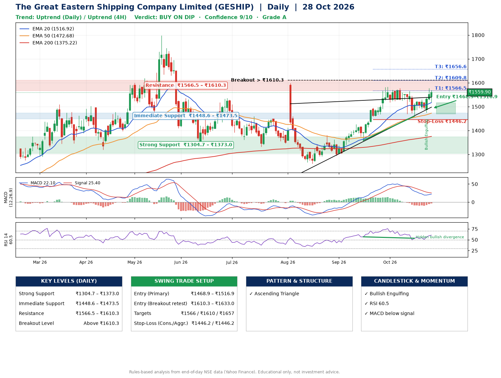

📌 **The Great Eastern Shipping Company Limited (GESHIP) – Multi-Timeframe Technical Analysis (Daily + 4H Combined)**
_Data up to 28 Oct 2026 · Close ₹1559.90_

**📍 Daily Timeframe Trend**
- Trend: **Uptrend** (higher highs and higher lows)
- Recent swing highs: ₹1598.9, ₹1380.0, ₹1583.0 · swing lows: ₹1294.0, ₹1358.8, ₹1460.0
- EMAs: EMA20 ₹1516.9, EMA50 ₹1472.7, EMA200 ₹1375.2; bullish stack (EMA20 > EMA50 > EMA200); price above EMA20, EMA50, EMA200
- MACD 22.10 below signal 25.40 (above zero); histogram rising
- RSI(14) 60.5; Hidden bullish divergence

**📍 4-Hour Timeframe Trend**
- Structure: **Uptrend** (higher highs and higher lows)
- Pullback/support area: recent 4H swing lows ₹1460.4, ₹1475.7; EMA20 ₹1528.8
- EMA20/50: bullish stack (EMA20 > EMA50); price above EMA20, EMA50
- MACD 8.82 above signal 3.69 (above zero), fresh bullish crossover; histogram rising
- RSI(14) 60.6; no divergence

**📍 Pattern Detection (Both Timeframes)**
- Daily: **Ascending Triangle** – converging swing highs and lows over the last ~60 sessions
- 4H: **Double Top** – tops near ₹1565.0/₹1577.8, neckline ₹1460.4, forming
- 4H: **Double Bottom** – bottoms near ₹1460.4/₹1475.7, neckline ₹1537.7, confirmed (closed above neckline)

**📍 Candlestick Patterns (last 3 daily candles)**
- **Bullish Engulfing** – 26 Oct: buyers fully reversed the prior red candle

**📍 Price Action Key Levels (Daily Structure)**

| Zone | Price Level (₹) | Context |
|------|-----------------|---------|
| Strong Support | ₹1304.7 – ₹1373.0 | Cluster of earlier swing lows (demand) |
| Immediate Support | ₹1448.6 – ₹1473.5 | Nearest swing-low / wick area |
| Resistance | ₹1566.5 – ₹1610.3 | Nearest swing-high supply |
| Breakout Level | Above ₹1610.3 | Swing continuation trigger (52-week high ₹1798.0) |

**📍 Swing Trade Setup**

🟢 **Entry Zone**
- Primary: ₹1468.9 – ₹1516.9 (daily support / EMA20 area; enter on a bullish 4H candle)
- Alternate: ₹1610.3 – ₹1633.0 (breakout retest)

🎯 **Profit Targets**
- T1: ₹1566.5
- T2: ₹1609.8
- T3: ₹1656.6

🛑 **Stop-Loss**
- Conservative: below daily swing low (₹1446.2)
- Aggressive: below 4H structure (₹1446.2)
- Risk per share ≈ ₹46.8; reward:risk to T1 ≈ 1.6

**📌 Strategy Notes**
- Higher timeframe: daily trend is uptrend; only take longs while price holds above ₹1304.7.
- Entry timing: wait for a bullish 4H candle (engulfing/hammer) inside ₹1468.9 – ₹1516.9 rather than buying mid-range.
- EMA stacking: bullish stack (EMA20 > EMA50 > EMA200); price above EMA20, EMA50, EMA200.
- Breakout rule: a daily close above ₹1610.3 with volume above its 20-day average (≈776,080) opens T2/T3.
- Momentum: RSI 61 – room to run; Hidden bullish divergence.
- Exit discipline: move the stop to entry once T1 is hit; book partial profits at each target.

**STEP 2 — Marked Up Chart**

**✅ Trade Validation Checklist**
- Trend + momentum aligned: No · Price at entry zone: No
- Stop defined (₹1446.2) · Reward:risk ≥ 1.5 to T1: Yes

## 📌 Final Verdict

Recommendation: **🟡 BUY ON DIP**

Confidence: **9/10**

Trade Quality: **A**

Reason:
• Daily uptrend (higher highs and higher lows)
• EMAs stacked bullishly

Next Action:
• Wait for a pullback to ₹1468.9–₹1516.9, or a breakout above ₹1610.3

_Rules-based analysis from end-of-day data. Educational only, not investment advice. Never place orders without your own confirmation._