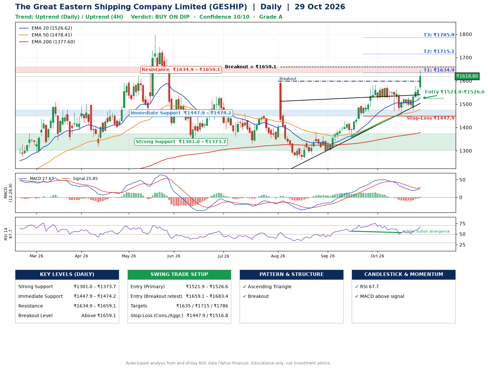

📌 **The Great Eastern Shipping Company Limited (GESHIP) – Multi-Timeframe Technical Analysis (Daily + 4H Combined)**
_Data up to 29 Oct 2026 · Close ₹1618.80_

**📍 Daily Timeframe Trend**
- Trend: **Uptrend** (higher highs and higher lows)
- Recent swing highs: ₹1598.9, ₹1380.0, ₹1583.0 · swing lows: ₹1294.0, ₹1358.8, ₹1460.0
- EMAs: EMA20 ₹1526.6, EMA50 ₹1478.4, EMA200 ₹1377.6; bullish stack (EMA20 > EMA50 > EMA200); price above EMA20, EMA50, EMA200
- MACD 27.67 above signal 25.85 (above zero), fresh bullish crossover; histogram rising
- RSI(14) 67.7; Hidden bullish divergence

**📍 4-Hour Timeframe Trend**
- Structure: **Uptrend** (higher highs and higher lows)
- Pullback/support area: recent 4H swing lows ₹1475.7, ₹1520.1; EMA20 ₹1545.2
- EMA20/50: bullish stack (EMA20 > EMA50); price above EMA20, EMA50
- MACD 19.55 above signal 8.69 (above zero); histogram rising
- RSI(14) 69.8; no divergence

**📍 Pattern Detection (Both Timeframes)**
- Daily: **Ascending Triangle** – converging swing highs and lows over the last ~60 sessions
- Daily: **Breakout** – closed above the 60-session high ₹1598.9 on strong volume
- 4H: **Ascending Triangle** – converging swing highs and lows over the last ~60 sessions

**📍 Candlestick Patterns (last 3 daily candles)**
- No notable candlestick signal in the last 3 sessions.

**📍 Price Action Key Levels (Daily Structure)**

| Zone | Price Level (₹) | Context |
|------|-----------------|---------|
| Strong Support | ₹1301.0 – ₹1373.7 | Cluster of earlier swing lows (demand) |
| Immediate Support | ₹1447.9 – ₹1474.2 | Nearest swing-low / wick area |
| Resistance | ₹1634.9 – ₹1659.1 | Nearest swing-high supply |
| Breakout Level | Above ₹1659.1 | Swing continuation trigger (52-week high ₹1798.0) |

**📍 Swing Trade Setup**

🟢 **Entry Zone**
- Primary: ₹1521.9 – ₹1526.6 (daily support / EMA20 area; enter on a bullish 4H candle)
- Alternate: ₹1659.1 – ₹1683.4 (breakout retest)

🎯 **Profit Targets**
- T1: ₹1634.9
- T2: ₹1715.1
- T3: ₹1785.9

🛑 **Stop-Loss**
- Conservative: below daily swing low (₹1447.9)
- Aggressive: below 4H structure (₹1516.8)
- Risk per share ≈ ₹76.4; reward:risk to T1 ≈ 1.4

**📌 Strategy Notes**
- Higher timeframe: daily trend is uptrend; only take longs while price holds above ₹1301.0.
- Entry timing: wait for a bullish 4H candle (engulfing/hammer) inside ₹1521.9 – ₹1526.6 rather than buying mid-range.
- EMA stacking: bullish stack (EMA20 > EMA50 > EMA200); price above EMA20, EMA50, EMA200.
- Breakout rule: a daily close above ₹1659.1 with volume above its 20-day average (≈729,700) opens T2/T3.
- Momentum: RSI 68 – elevated, prefer dips; Hidden bullish divergence.
- Exit discipline: move the stop to entry once T1 is hit; book partial profits at each target.

**STEP 2 — Marked Up Chart**

**✅ Trade Validation Checklist**
- Trend + momentum aligned: Yes · Price at entry zone: No
- Stop defined (₹1447.9) · Reward:risk ≥ 1.5 to T1: No

## 📌 Final Verdict

Recommendation: **🟡 BUY ON DIP**

Confidence: **10/10**

Trade Quality: **A**

Reason:
• Daily uptrend (higher highs and higher lows)
• EMAs stacked bullishly

Next Action:
• Wait for a pullback to ₹1521.9–₹1526.6

_Rules-based analysis from end-of-day data. Educational only, not investment advice. Never place orders without your own confirmation._