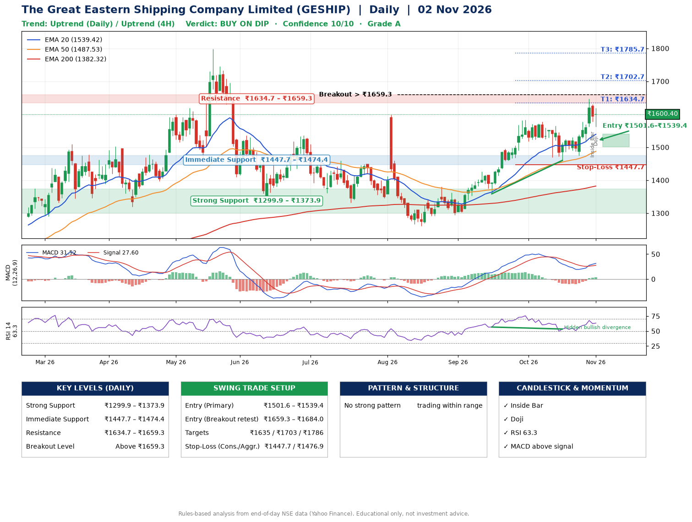

📌 **The Great Eastern Shipping Company Limited (GESHIP) – Multi-Timeframe Technical Analysis (Daily + 4H Combined)**
_Data up to 02 Nov 2026 · Close ₹1600.40_

**📍 Daily Timeframe Trend**
- Trend: **Uptrend** (higher highs and higher lows)
- Recent swing highs: ₹1598.9, ₹1380.0, ₹1583.0 · swing lows: ₹1294.0, ₹1358.8, ₹1460.0
- EMAs: EMA20 ₹1539.4, EMA50 ₹1487.5, EMA200 ₹1382.3; bullish stack (EMA20 > EMA50 > EMA200); price above EMA20, EMA50, EMA200
- MACD 31.52 above signal 27.60 (above zero), fresh bullish crossover; histogram rising
- RSI(14) 63.3; Hidden bullish divergence

**📍 4-Hour Timeframe Trend**
- Structure: **Uptrend** (higher highs and higher lows)
- Pullback/support area: recent 4H swing lows ₹1475.7, ₹1520.1; EMA20 ₹1561.8
- EMA20/50: bullish stack (EMA20 > EMA50); price above EMA20, EMA50
- MACD 22.86 above signal 16.51 (above zero); histogram falling
- RSI(14) 63.0; no divergence

**📍 Pattern Detection (Both Timeframes)**
- No strong pattern detected. Trading within range.

**📍 Candlestick Patterns (last 3 daily candles)**
- **Inside Bar** – 30 Oct: compression inside the prior range ₹1562.8–₹1647.0
- **Doji** – 02 Nov: indecision; wait for the next candle to confirm direction

**📍 Price Action Key Levels (Daily Structure)**

| Zone | Price Level (₹) | Context |
|------|-----------------|---------|
| Strong Support | ₹1299.9 – ₹1373.9 | Cluster of earlier swing lows (demand) |
| Immediate Support | ₹1447.7 – ₹1474.4 | Nearest swing-low / wick area |
| Resistance | ₹1634.7 – ₹1659.3 | Nearest swing-high supply |
| Breakout Level | Above ₹1659.3 | Swing continuation trigger (52-week high ₹1798.0) |

**📍 Swing Trade Setup**

🟢 **Entry Zone**
- Primary: ₹1501.6 – ₹1539.4 (daily support / EMA20 area; enter on a bullish 4H candle)
- Alternate: ₹1659.3 – ₹1684.0 (breakout retest)

🎯 **Profit Targets**
- T1: ₹1634.7
- T2: ₹1702.7
- T3: ₹1785.7

🛑 **Stop-Loss**
- Conservative: below daily swing low (₹1447.7)
- Aggressive: below 4H structure (₹1476.9)
- Risk per share ≈ ₹72.9; reward:risk to T1 ≈ 1.6

**📌 Strategy Notes**
- Higher timeframe: daily trend is uptrend; only take longs while price holds above ₹1299.9.
- Entry timing: wait for a bullish 4H candle (engulfing/hammer) inside ₹1501.6 – ₹1539.4 rather than buying mid-range.
- EMA stacking: bullish stack (EMA20 > EMA50 > EMA200); price above EMA20, EMA50, EMA200.
- Breakout rule: a daily close above ₹1659.3 with volume above its 20-day average (≈698,329) opens T2/T3.
- Momentum: RSI 63 – room to run; Hidden bullish divergence.
- Exit discipline: move the stop to entry once T1 is hit; book partial profits at each target.

**STEP 2 — Marked Up Chart**

**✅ Trade Validation Checklist**
- Trend + momentum aligned: Yes · Price at entry zone: No
- Stop defined (₹1447.7) · Reward:risk ≥ 1.5 to T1: Yes

## 📌 Final Verdict

Recommendation: **🟡 BUY ON DIP**

Confidence: **10/10**

Trade Quality: **A**

Reason:
• Daily uptrend (higher highs and higher lows)
• EMAs stacked bullishly

Next Action:
• Wait for a pullback to ₹1501.6–₹1539.4

_Rules-based analysis from end-of-day data. Educational only, not investment advice. Never place orders without your own confirmation._